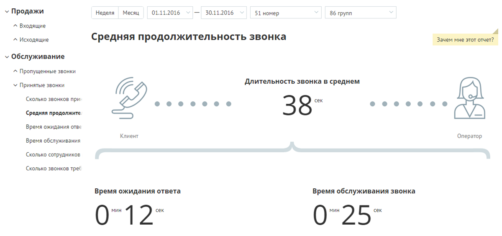
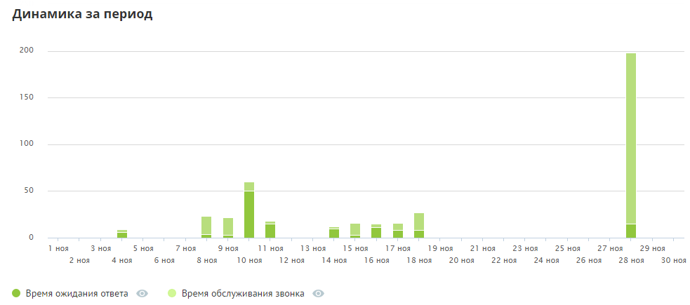
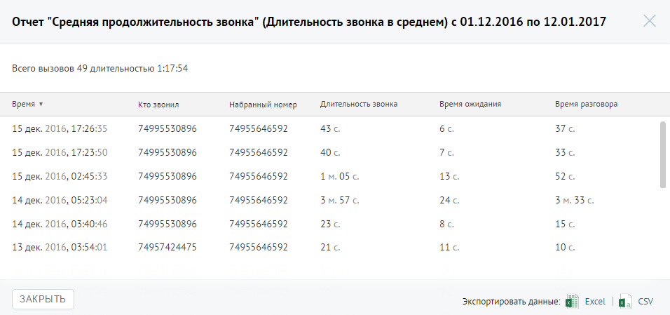

##### Отчет «Средняя продолжительность»

> Трассировка: PDF §4.5.9.2.2 · сквозные стр. 265-266 · источники: ч.1 `kb/sources/mango-lk-manual/LK_manual_v-125-1-280.pdf` с.265-266.

Отчет «Средняя продолжительность звонка» в графическом виде отображает информацию о средней продолжительности звонка. Показатель имеет две составляющие — среднее время ожидания ответа и среднее время обслуживания вызова.

В верхней части отчета приведены данные о средней продолжительности вызовов в виде инфографики. В зависимости от значения показателя «Время ожидания ответа» формируется текст совета.

> **Описание иллюстрации LK-§4.5.9.2.2-1** (к §4.5.9.2.2 «Отчет «Средняя продолжительность»», стр. 265; 1200×564 px). Снимок экрана / схема Личного кабинета.
> Относится к тексту руководства: «… приведены данные о средней продолжительности вызовов в виде инфографики. В зависимости от значения показателя «Время ожидания ответа» формируется текст совета.».
> Текст на изображении (OCR, требует сверки): v Продажи; 'Неделя; Месяц.; 01.11.2016; — 30.11.2016; 51 номер; 86 групп; ^ Входящие; ^ Исходящие; Средняя продолжительность звонка; Зачем мне этот отчет?; у Обслуживание; ^ Пропущенные звонки; Длительность звонка в среднем; У Принятые звонки; Сколько звонков при; хооофоооо; e@oeooeoeoee; ‘Средняя продолжите; 38"; Время ожидания отве; Клиент; 'Оператор; Время обслуживания; Сколько сотрудников; Сколько звонков треб; Время ожидания ответа; Время обслуживания звонка; 07127; 07257

В нижней части окна отображается детальная информация по заданному периоду.

> **Описание иллюстрации LK-§4.5.9.2.2-2** (к §4.5.9.2.2 «Отчет «Средняя продолжительность»», стр. 266; 983×435 px). Снимок экрана / схема Личного кабинета.
> Относится к тексту руководства: «…В нижней части окна отображается детальная информация по заданному периоду.».
> Текст на изображении (OCR, требует сверки): Динамика за период; 200; 150; 100; 50; не; il,; иниаа; т ноя; зноя; 5 ноя; 7ноя; Hom; 11 ноя; 13 ноя; 15 ноя; ho; 19 ноя; 21 ноя; 23 Hor; 25 ноя; 27 ноя; 29 ноя; ноя; 4 ноя; 6 Hon; 10 ноя; 12 ноя; 14 ноя; 16 ноя; 18 ноя; 20 ноя; 22 ноя; 24 ноя; 26 ноя; 28 ноя; 30 ноя; © Время ожидания ответа @ © Время обслуживания звонка ©

Для получения детальной информации о вызовах предусмотрена дополнительная форма «Кто звонил», содержащая данные из отчета «Истории вызовов» согласно установленным значениям фильтра.

Чтобы открыть форму, следует щелкнуть по определенному элементу отчета. Содержание данных зависит от того, по какому элементу было совершено нажатие. В данном случае дополнительный отчет формируется при щелчке по диаграмме «Длительность звонка в среднем».

> **Описание иллюстрации LK-§4.5.9.2.2-3** (к §4.5.9.2.2 «Отчет «Средняя продолжительность»», стр. 266; 956×449 px). Снимок экрана / схема Личного кабинета.
> Относится к тексту руководства: «…ит от того, по какому элементу было совершено нажатие. В данном случае дополнительный отчет формируется при щелчке по диаграмме «Длительность звонка в среднем».».
> Текст на изображении (OCR, требует сверки): Отчет "Средняя продолжительность звонка" (Длительность звонка в среднем) с 01.12.2016 по 12.01.2017; Всего вызовов 49 длительностью 1:17:54; время ¥; то звонил; набранный номер; `Длительность звонка; время ожидания; время разговора:; 74995530896; 74955646592; 43°; 6c.; 376.; 15 дек. 2016, 17:26:35; 15 дек. 2016, 17:; 50; 40c.; Tc.; 33°; 15 дек. 2016, 02:; 1м.05 с.; 13°; 52 с; 14 дек. 2016, 05:23:04; 24,; 3M.33c; 14 дек. 2016, 03:40:46; 23.; 8c.; 15; 74957424475; 21; ие; 10.; 13 дек. 2016, 03:54:01; ЗАКРЫТЬ; cv; экспортировать данные: Ef) Excel
