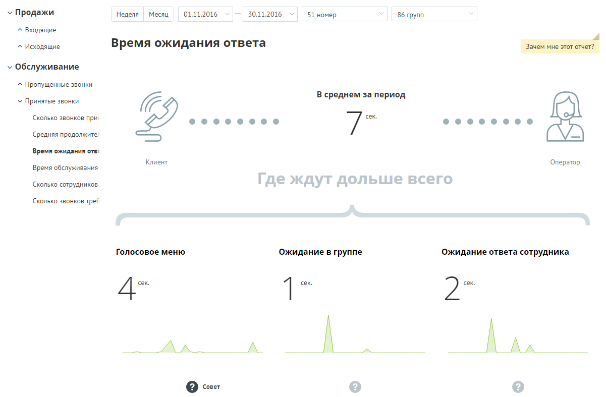
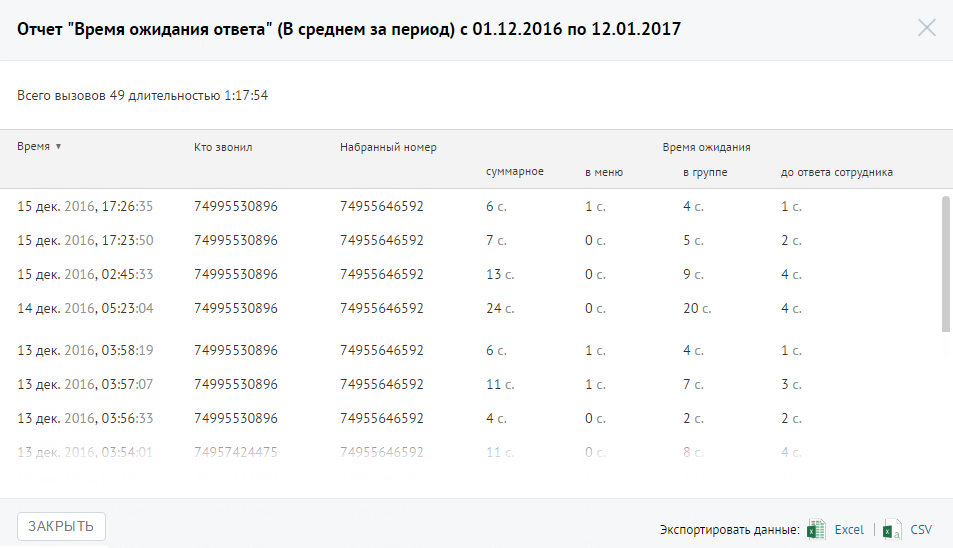

##### Отчет «Время ожидания ответа»

> Трассировка: PDF §4.5.9.2.2 · сквозные стр. 266-268 · источники: ч.1 `kb/sources/mango-lk-manual/LK_manual_v-125-1-280.pdf` с.266-268.

Отчет «Время ожидания ответа» отображает информацию о времени ожидания обслуживания вызова на разных стадиях: голосовое меню, дозвон на группу и дозвон на оператора.

По умолчанию оптимальным временем ожидания в голосовом меню считается время не более 25 секунд, ожидание в очереди на группу — от 0 до 60 секунд, ожидание ответа оператора не должно превышать 5 секунд.

> **Описание иллюстрации LK-§4.5.9.2.2-1** (к §4.5.9.2.2 «Отчет «Время ожидания ответа»», стр. 267; 1201×787 px). Снимок экрана / схема Личного кабинета.
> Относится к тексту руководства: «…я в голосовом меню считается время не более 25 секунд, ожидание в очереди на группу — от 0 до 60 секунд, ожидание ответа оператора не должно превышать 5 секунд.».
> Текст на изображении (OCR, требует сверки): 01.11.2016; 30.11.2016; У Продажи; 'Неделя; Месяц; 51 номер; 86 групп; ^ Входящие; Зачем мне этот отчет?; ^ Исходящие; Время ожидания ответа; v Обслуживание; ^ Пропущенные звонки; В среднем за период; У Принятые звонки; Сколько звонков при,; @eeoeoeaeoeoeee; 7 сек.; Средняя продолжите,; Время ожидания ova:; Клиент; Оператор; Время обслуживания; Сколько сотрудников; Сколько звонков треб; Голосовое меню; Ожидание в группе; Ожидание ответа сотрудника; 4 ek.; 1 cex,; Qo

> **Описание иллюстрации LK-§4.5.9.2.2-2** (к §4.5.9.2.2 «Отчет «Время ожидания ответа»», стр. 267; 24×24 px). Пиктограмма (значок элемента интерфейса).
> Относится к тексту руководства: «…лиент; Оператор; Время обслуживания; Сколько сотрудников; Сколько звонков треб; Голосовое меню; Ожидание в группе; Ожидание ответа сотрудника; 4 ek.; 1 cex,; Qo».
> Текста на изображении нет; назначение значка — см. текст, к которому он относится.

Щелкните по пиктограмме , чтобы посмотреть совет для каждой стадии обработки вызова.

Для получения детальной информации о вызовах предусмотрена дополнительная форма, содержащая данные из отчета «Истории вызовов» согласно установленным значениям фильтра.

Чтобы открыть форму, следует щелкнуть по определенному элементу отчета. Содержание данных зависит от того, по какому элементу было совершено нажатие:

 Диаграмма «В среднем за период» - звонки, которые учитываются при подсчете числового показателя «В среднем за период», отражающего среднюю длительность ожидания ответа по принятым внешним входящим звонкам за установленный календарный период;

В данном случае дополнительный отчет формируется при щелчке по диаграмме «В среднем за период».

> **Описание иллюстрации LK-§4.5.9.2.2-3** (к §4.5.9.2.2 «Отчет «Время ожидания ответа»», стр. 268; 953×548 px). Снимок экрана / схема Личного кабинета.
> Относится к тексту руководства: «…В данном случае дополнительный отчет формируется при щелчке по диаграмме «В среднем за период».».
> Текст на изображении (OCR, требует сверки): Отчет "Время ожидания ответа" (В среднем за период) с 01.12.2016 по 12.01.2017; Всего вызовов 49 длительностью; время ¥; то звонил; набранный номер; Время ожидания; суммарное; вменю; в группе; до ответа сотрудника; 15 дек. 2016, 17:; 74995530896; 74955646592; 6c.; 1c.; 4c; 15 дек. 2016, 17:23:50; Tc.; Oc; 5c.; 26; 15 дек. 2016, 02:45:33; 13; Be; 24.; 20.; 14 дек. 2016, 05:23:04; 13 дек. 2016, 03:; 219; 1c; 13 дек. 2016, 03:57:07; 11; 7c.; 3c.; 13 дек. 2016, 03:56:33; 5549; ЕЕ; ЗАКРЫТЬ; Excel; cv; экспортировать данные: 4
