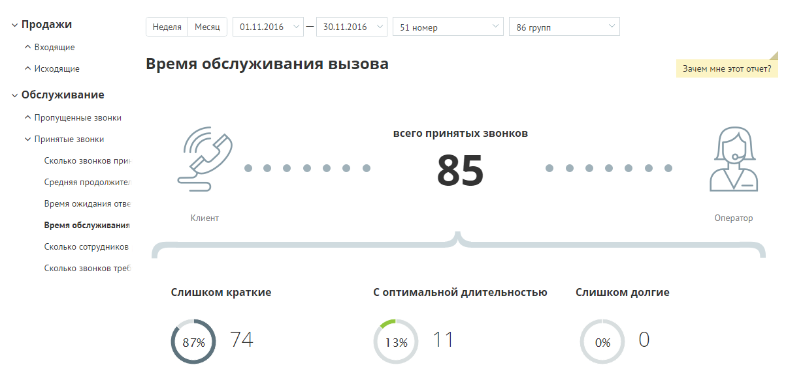
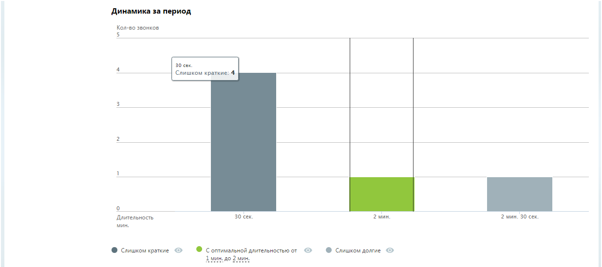
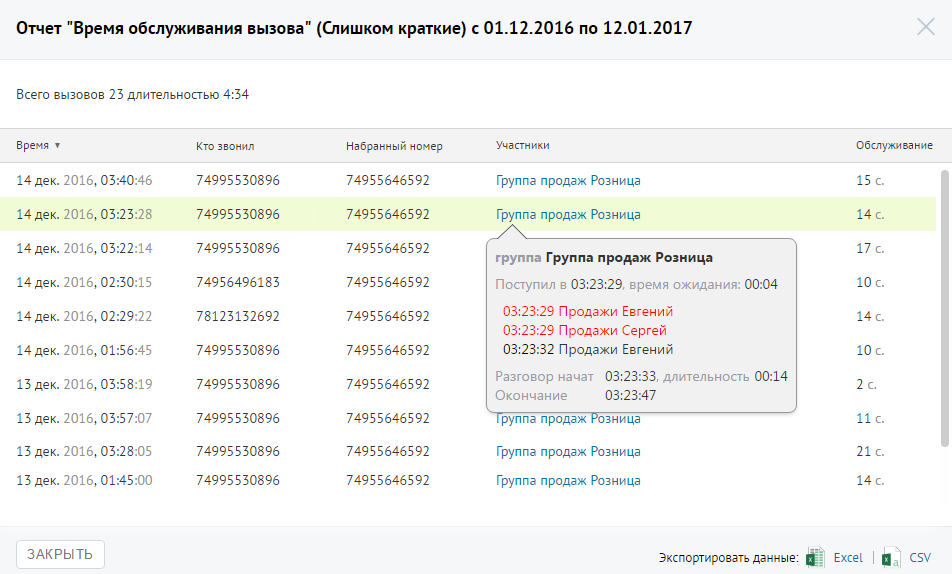

##### Отчет «Время обслуживания вызова»

> Трассировка: PDF §4.5.9.2.2 · сквозные стр. 268-270 · источники: ч.1 `kb/sources/mango-lk-manual/LK_manual_v-125-1-280.pdf` с.268-270.

Отчет «Время обслуживания вызова» содержит информацию о количестве входящих вызовов, обслуженных за определенный период.

По умолчанию оптимальной длительностью обслуживания вызова считается период от 30 секунд до 2 минут. При необходимости измените этот период самостоятельно, установив другое значение в поле «С оптимальной длительностью от… до» после формирования отчета.

В верхней части отчета приведены данные о принятых звонках в виде инфографики.

> **Описание иллюстрации LK-§4.5.9.2.2-1** (к §4.5.9.2.2 «Отчет «Время обслуживания вызова»», стр. 268; 1203×586 px). Снимок экрана / схема Личного кабинета.
> Относится к тексту руководства: «…В верхней части отчета приведены данные о принятых звонках в виде инфографики.».
> Текст на изображении (OCR, требует сверки): У Продажи; 'Неделя; Месяц; 01.11.2016; 30.11.2016; 51 номер; 86 групп; ^ Входящие; ^ Исходящие; Время обслуживания вызова; Зачем мне этот отчет?; v Обслуживание; ^ Пропущенные звонки; У Принятые звонки; всего принятых звонков; Сколько звонков при,; ee; eeeee; eeeeoeeee8?e; Средняя продолжите,; 85; Время ожидания отве; Клиент; Оператор; Время обслуживания; Сколько сотрудников; Сколько звонков треб; Слишком краткие; С оптимальной длительностью; Слишком долгие; 87%; 74; 13%; 11

В нижней части окна отображается детальная информация о количестве вызовов, относящихся к определенному периоду.

> **Описание иллюстрации LK-§4.5.9.2.2-2** (к §4.5.9.2.2 «Отчет «Время обслуживания вызова»», стр. 269; 1236×550 px). Снимок экрана / схема Личного кабинета.
> Относится к тексту руководства: «…В нижней части окна отображается детальная информация о количестве вызовов, относящихся к определенному периоду.».
> Текст на изображении (OCR, требует сверки): Динамика за период; Кол-во звонков; Длительность; 30 сек.; 2 мин.; 2 мин. 30 сек.; мин.; © Слишком краткие @ — ® Соптимальной длительностью от @ — ® Слишком долие @; мин до 2мин,

Щелкните по кнопкам Слишком короткие, С оптимальной длительностью и Слишком долгие для того, чтобы скрыть/отобразить соответствующие показатели на графике.

Для получения детальной информации о вызовах предусмотрена дополнительная форма, содержащая данные из отчета «Истории вызовов» согласно установленным значениям фильтра.

Чтобы открыть форму, следует щелкнуть по определенному элементу отчета. Содержание данных зависит от того, по какому элементу было совершено нажатие:

 Диаграмма «Слишком краткие» - принятые звонки за установленный период, длительность разговора по которым меньше установленного нижнего порога оптимальной длительности;

 Диаграмма «Слишком долгие» - принятые звонки за установленный период, длительность разговора по которым больше установленного верхнего порога оптимальной длительности.

При щелчке по названию группы в столбце «Участники» отображается подсказка, содержащая подробную информацию по вызову.

> **Описание иллюстрации LK-§4.5.9.2.2-3** (к §4.5.9.2.2 «Отчет «Время обслуживания вызова»», стр. 270; 952×574 px). Снимок экрана / схема Личного кабинета.
> Относится к тексту руководства: «…При щелчке по названию группы в столбце «Участники» отображается подсказка, содержащая подробную информацию по вызову.».
> Текст на изображении (OCR, требует сверки): Отчет "Время обслуживания вызова" (Слишком краткие) c 01.12.2016 по 12.01.2017; Всего вызовов 23 длительностью; время ¥; то звонил; набранный номер; Участники; Обслуживание; 14 дек. 2016, 0:; 46; 74995530896; 74955646592; Группа продаж Розница; 156; 14 дек.; 2016, 03:23:28; 14; 2016, 03:22:14; 17; группа Группа продаж Розница; 74956496183; 10.; 2016, 02:30:15; Поступил в 03:23:29, время ожидания: 00:04; 2016, 02:; 78123132692; 03:23:29 Продажи Евгений; 03:23:29 Продажи Сергей; 2016, 01:; 03:23:32 Продажи Евгений; 13 дек.; 2016, 03:58:19; Разговор начат 03:23:33, длительность 00:14; 26; Окончан…
