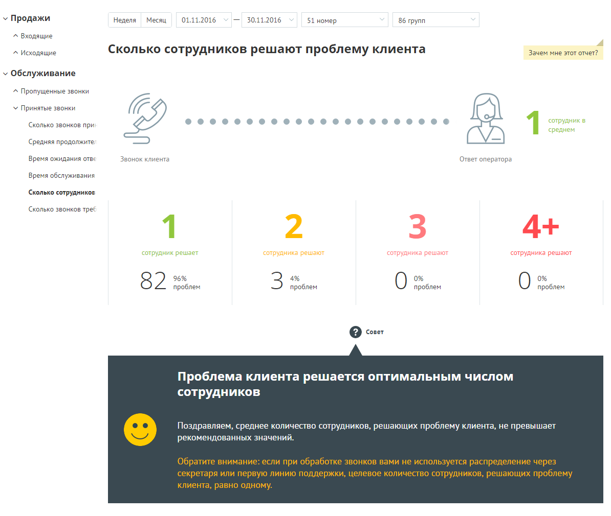
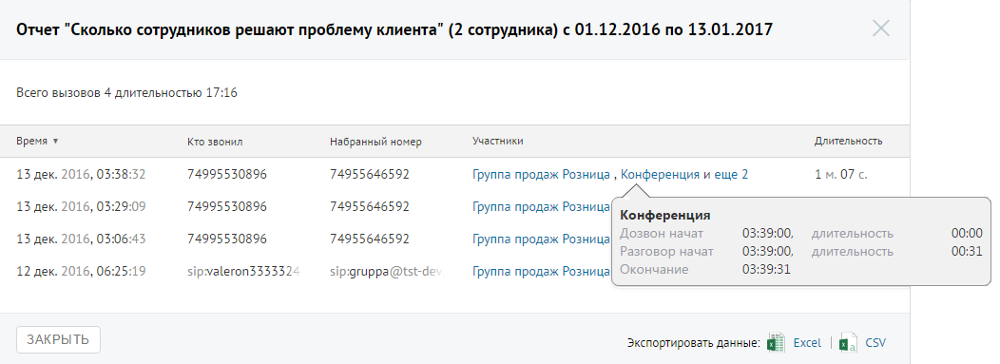

##### Отчет «Сколько сотрудников решают проблему клиента»

> Трассировка: PDF §4.5.9.2.2 · сквозные стр. 270-271 · источники: ч.1 `kb/sources/mango-lk-manual/LK_manual_v-125-1-280.pdf` с.270-271.

Отчет «Сколько сотрудников решают проблему клиента» отображает информацию о количестве сотрудников, участвующих в решении вопроса клиента.

> **Описание иллюстрации LK-§4.5.9.2.2-1** (к §4.5.9.2.2 «Отчет «Сколько сотрудников решают проблему клиента»», стр. 270; 1194×1010 px). Снимок экрана / схема Личного кабинета.
> Относится к тексту руководства: «…Отчет «Сколько сотрудников решают проблему клиента» отображает информацию о количестве сотрудников, участвующих в решении вопроса клиента.».
> Текст на изображении (OCR, требует сверки): У Продажи; 'Неделя; Месяц; 01.11.2016; 30.11.2016; 51 номер; 86 групп; ^ Входящие; ^ Исходящие; Сколько сотрудников решают проблему клиента; Зачем мне этот отчет?; v Обслуживание; ^ Пропущенные звонки; У Принятые звонки; сотрудник в; Сколько звонков при; среднем; Я 1; Средняя продолжите;; Время ожидания отве; Звонок клиента; Ответ оператора; Время обслуживания; Сколько сотрудникое; Сколько звонков трее; ‘сотрудник решает; ‘сотрудника решают; сотрудника решают; 96%; 82; проблем; Q com; Проблема клиента решается оптимальным числом; сотрудников; Поздравляем, среднее количество сотрудников, решающ…

По умолчанию оптимальным количеством сотрудников, участвующих в разговоре, является количество от одного до двух.

Для получения детальной информации о вызовах предусмотрена дополнительная форма «Кто звонил», содержащая данные из отчета «Истории вызовов» согласно установленным значениям фильтра.

Чтобы открыть форму, следует щелкнуть по определенному элементу отчета. Содержание данных зависит от того, по какому элементу было совершено нажатие. В данном случае дополнительный отчет формируется при щелчке по диаграмме с определенным количеством сотрудников, участвующих в разговоре.

При щелчке по названию группы в столбце «Кто пропустил» отображается подсказка, содержащая подробную информацию по вызову.

> **Описание иллюстрации LK-§4.5.9.2.2-2** (к §4.5.9.2.2 «Отчет «Сколько сотрудников решают проблему клиента»», стр. 271; 1052×383 px). Снимок экрана / схема Личного кабинета.
> Относится к тексту руководства: «…При щелчке по названию группы в столбце «Кто пропустил» отображается подсказка, содержащая подробную информацию по вызову.».
> Текст на изображении (OCR, требует сверки): Отчет "Сколько сотрудников решают проблему клиента" (2 сотрудника) с 01.12.2016 по 13.01.2017; Всего вызовов 4 длительностью 17:16; время ¥; то звонил; набранный номер; Участники; Длительность; 74995530896; 74955646592; 1м.07с.; 13 дек. 2016, 03:38:32; Группа продаж Розница , Конференция и еще 2; 13 дек. 2016, 03:29:09; Группа продаж Розница; Конференция; Дозвон начат; 03:39:00,; ‘длительность; 00:00; 13 дек. 2016, 03:06:43; Разговор начат; 00:31; 12 дек. 2016, 06:25:19; 03:39:31; sip:valeron333332.; sip-gruppa@tst-de; Группа продаж Розница| Окончание; ЗАКРЫТЬ; экспортировать данные: 4; Excel;…
