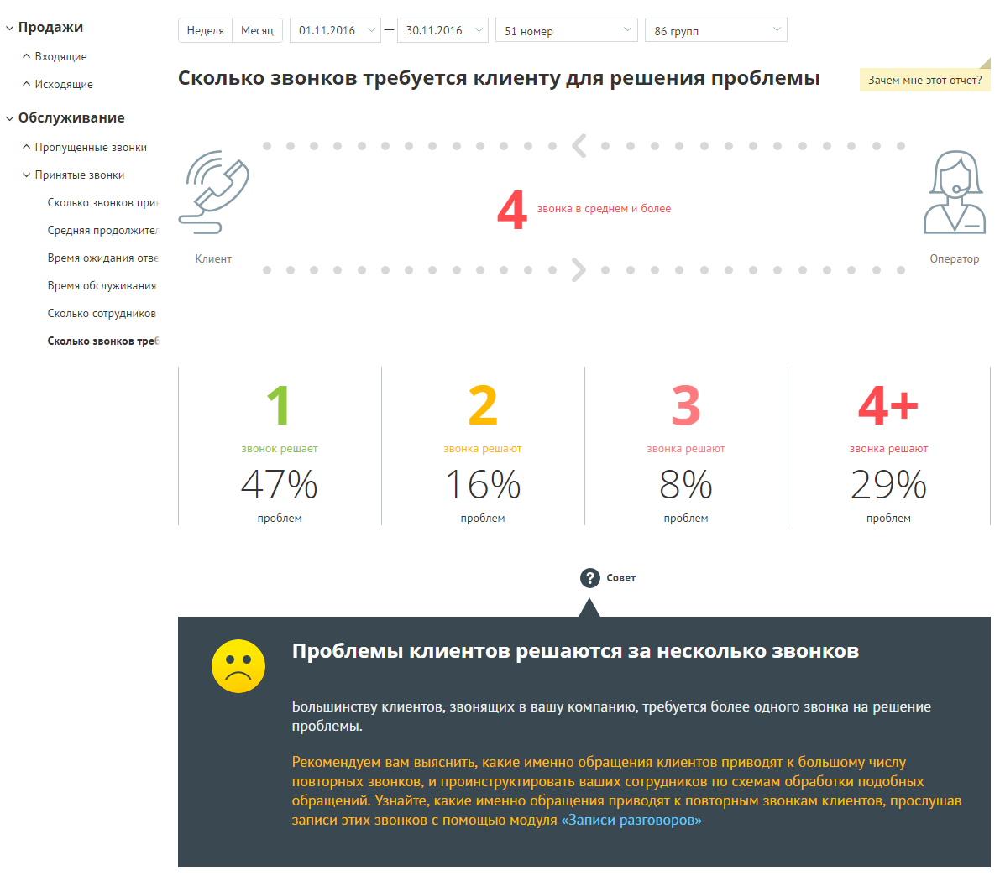
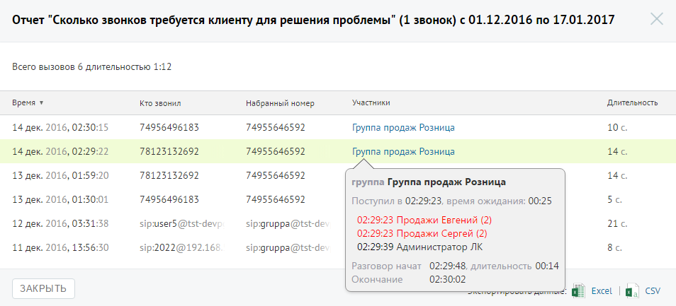

##### Отчет «Сколько звонков требуется клиенту для решения проблемы»

> Трассировка: PDF §4.5.9.2.2 · сквозные стр. 271-273 · источники: ч.1 `kb/sources/mango-lk-manual/LK_manual_v-125-1-280.pdf` с.271-273.

Отчет «Сколько звонков требуется клиенту для решения проблемы» количество повторных звонков, сделанных клиентом для решения его вопроса.

Пример сформированного отчета приведен на следующей странице.

> **Описание иллюстрации LK-§4.5.9.2.2-1** (к §4.5.9.2.2 «Отчет «Сколько звонков требуется клиенту для решения проблемы»», стр. 272; 1191×1050 px). Снимок экрана / схема Личного кабинета.
> Относится к тексту руководства: «…Пример сформированного отчета приведен на следующей странице.».
> Текст на изображении (OCR, требует сверки): У Продажи; 'Неделя; Месяц; 01.11.2016; 30.11.2016; 51 номер; 86 групп; ^ Входящие; Зачем мне этот отчет?; ^ Исходящие; Сколько звонков требуется клиенту для решения проблемы; v Обслуживание; ^ Пропущенные звонки; У Принятые звонки; Сколько звонков при; Средняя продолжите;; Время ожидания отве; Клиент; Оператор; Время обслуживания; Сколько сотрудников; Сколько звонков трее; звонок решает; звонка решают; 47%; 16%; 29%; проблем; Q cove:; Проблемы клиентов решаются за несколько звонков; Большинству клиентов, звонящих в вашу компанию, требуется более одного звонка на решение; проблемы.

Эталонное количество звонков, за которое должна быть решена проблема клиента - один звонок. Если звонков больше, то рекомендуем прослушать записи разговоров с помощью модуля «Записи разговоров».

Для получения детальной информации о вызовах предусмотрена дополнительная форма «Кто звонил», содержащая данные из отчета «Истории вызовов» согласно установленным значениям фильтра.

Чтобы открыть форму, следует щелкнуть по определенному элементу отчета. Содержание данных зависит от того, по какому элементу было совершено нажатие. В данном случае дополнительный отчет формируется при щелчке по диаграмме с определенным количеством звонков, необходимых для решения вопроса клиента.

При щелчке по названию группы в столбце «Кто пропустил» отображается подсказка, содержащая подробную информацию по вызову.

> **Описание иллюстрации LK-§4.5.9.2.2-2** (к §4.5.9.2.2 «Отчет «Сколько звонков требуется клиенту для решения проблемы»», стр. 273; 954×433 px). Снимок экрана / схема Личного кабинета.
> Относится к тексту руководства: «…При щелчке по названию группы в столбце «Кто пропустил» отображается подсказка, содержащая подробную информацию по вызову.».
> Текст на изображении (OCR, требует сверки): Отчет "Сколько звонков требуется клиенту для решения проблемы" (1 звонок) с 01.12.2016 по 17.01.2017; Всего вызовов 6 длительностью 1:12; время ¥; то звонил; набранный номер; Участники; Длительность; 74956496183; 74955646592; 1c.; 14 дек. 2016, 02:30:15; Группа продаж Розница; 14 дек. 2016, 02:29:22; 78123132692; 14с.; 13 дек. 2016, 01:; 10; 14.; группа Группа продаж Розница; 13 дек. 2016, 01:30:01; 5c.; Поступил в 02:29:23, время ожидания: 00:25; 12 дек. 2016, 03:31:38; sipuser5 @tst-dev; sip-gruppa@tst-<; 02:29:23 Продажи Евгений (2); 216; 02:29:23 Продажи Сергей (2); 8c.; 11 дек. 2016, 13:5…
