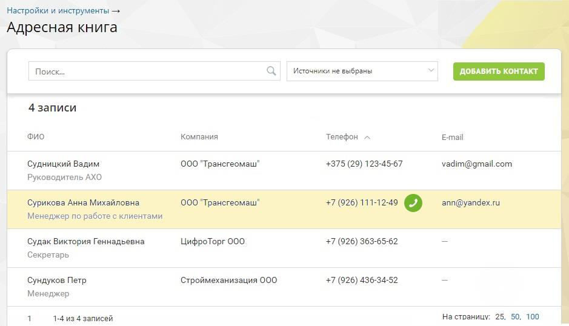
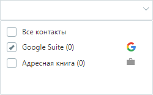

### 4.5.10. Адресная книга контрагентов

> Трассировка: PDF §4.5.10 · сквозные стр. 276-277 · источники: ч.1 `kb/sources/mango-lk-manual/LK_manual_v-125-1-280.pdf` с.276-277.

Инструмент «Адресная книга» предназначен для хранения основной информации о контрагентах. Список является единым для всех пользователей текущей ВАТС.

> **Описание иллюстрации LK-§4.5.10-1** (к §4.5.10 «Адресная книга контрагентов», стр. 276; 939×538 px). Снимок экрана / схема Личного кабинета.
> Относится к тексту руководства: «…Инструмент «Адресная книга» предназначен для хранения основной информации о контрагентах. Список является единым для всех пользователей текущей ВАТС.».
> Текст на изображении (OCR, требует сверки): Настройки и инструменты >; Адресная книга; Поиск.; Источники не выбраны; _ EEE; 4 записи; ‘ono; Компания; Телефон ^; Email; Судницкий Вадим.; 000 "Трансгеомаш"; +375 (29) 123-45-67; vadim@gmail.com; Руководитель АХО; ри; 108; 000"T; омаш"; +7 (926) 111-12-45; n@yar; ‘Mer; же; пс; лиентами.; Судак Виктория Геннадьевна; ЦифроТорг 000; +7 (926) 363-65-62; Секретарь; Сундуков Петр; Строймеханизация 000; +7 (926) 436-34-52; Менеджер; 1-4 из 4 записей; На страницу: 25, 50, 100

Адресная книга может содержать контакты, полученные посредством интеграции с внешними системами – amoCRM, Bitrix24 и т.д. Такие контакты помечены пиктограммой соответствующей системы.

Для фильтрации записей в зависимости от источника следует открыть выпадающий список и установить флаги напротив названия нужного источника.

> **Описание иллюстрации LK-§4.5.10-2** (к §4.5.10 «Адресная книга контрагентов», стр. 277; 250×155 px). Снимок экрана / схема Личного кабинета.
> Относится к тексту руководства: «…Для фильтрации записей в зависимости от источника следует открыть выпадающий список и установить флаги напротив названия нужного источника.».
> Текст на изображении (OCR, требует сверки): О Все контакты; [У] Google Suite (0); О Адресная книга (0)

Предусмотрен быстрый поиск интересующего контрагента (по ФИО, должности, названию компании, телефонному номеру или E-mail). Для этого следует ввести необходимые данные в поле поиска. При вводе искомого текста работает автоматическая фильтрация записей адресной книги с учетом указанной комбинации символов.

Название компании контрагента (при его наличии) является кликабельной ссылкой. При щелчке по ссылке выполняется фильтрация списка контрагентов, в результате которой в отфильтрованном списке должны отображаться все контрагенты, относящиеся к данной компании.

В случае, если для контрагента указан контактный телефонный номер, то при наведении курсора на строку отображается кнопка Позвонить. Обязательным условием отображения кнопки также является наличие хотя бы одного активного средства приема звонков в карточке пользователя личного кабинета. При щелчке по кнопке выполняется дозвон соответствующему контрагенту.

Для редактирования карточки контрагента следует навести курсор на нужную строку и щелкнуть по ней в любом свободном месте (за исключением названия компании и кнопки дозвона).
