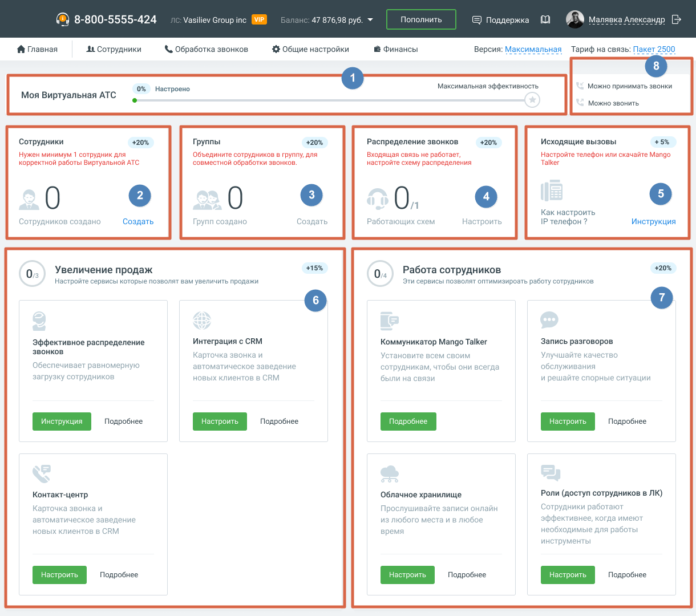

### 1.8.2. Сценарий МАЛЫЙ + СРЕДНИЙ

> Трассировка: PDF §1.8.2 · сквозные стр. 22-23 · источники: ч.1 `kb/sources/mango-lk-manual/LK_manual_v-125-1-280.pdf` с.22-23.

Сценарий Малый + Средний по умолчанию предназначен для пользователей тарифных планов ВАТС «Базовый» или «Расширенный». Следуя сценарию, пользователь настроит отображение данных на главной панели ВАТС.

> **Описание иллюстрации LK-§1.8.2-1** (к §1.8.2 «Сценарий МАЛЫЙ + СРЕДНИЙ», стр. 22; 1220×1080 px). Снимок экрана / схема Личного кабинета.
> Относится к тексту руководства: «…едназначен для пользователей тарифных планов ВАТС «Базовый» или «Расширенный». Следуя сценарию, пользователь настроит отображение данных на главной панели ВАТС.».
> Текст на изображении (OCR, требует сверки): ($) 8-800-5555-424; asiliev Gi; up inc; vip; 47; 76,98 руб. 7; Пополнить; {© Поддержка; fis); AX Mansoxa длек; HAP; ft Главная; At Сотрудники; & Обработка звонков; 33 Общие настройки; 8 Финансы; Версия: М; ая; Тариф на связь: Пан; 0% Настроено; Максимальная эффективность,; Можно принимать звонки; Моя Виртуальная АТС; Можно звонить,; Сотрудники; 420%; Группы; Распределение звонков.; Исходящие вызовы; Нужен минимум 1 сотрудник для; Объедините сотрудников в группу, для; Входящая связь не работает,; Настройте телефон или скачайте Mango; корректной работы Виртуальной ATC; ‘совместной обработки звон…
