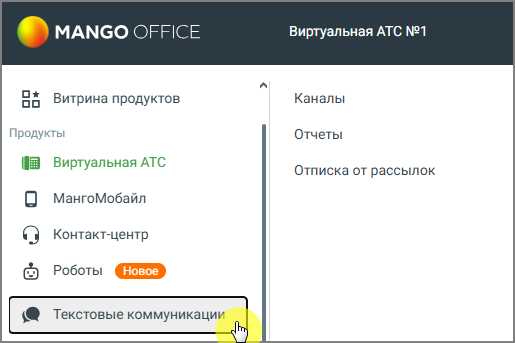

#### 4.5.11.1. Подключение «Текстовые коммуникации» в Личном кабинете

> Трассировка: PDF §4.5.11.1 · сквозные стр. 279-280 · источники: ч.1 `kb/sources/mango-lk-manual/LK_manual_v-125-1-280.pdf` с.279-280.

Для подключения «Текстовые коммуникации» зайдите в Личный кабинет пользователя ВАТС и далее в боковой навигационной панели выберите пункт Текстовые коммуникации. Ознакомьтесь с возможностями модуля и нажмите кнопку Подключить.. После подлючения вам будут доступны три вкладки меню: Каналы, Отчеты и Отписка от рассылок.

> **Описание иллюстрации LK-§4.5.11.1-1** (к §4.5.11.1 «Подключение «Текстовые коммуникации» в Личном кабинете», стр. 279; 515×343 px). Снимок экрана / схема Личного кабинета.
> Относится к тексту руководства: «…и. Ознакомьтесь с возможностями модуля и нажмите кнопку Подключить.. После подлючения вам будут доступны три вкладки меню: Каналы, Отчеты и Отписка от рассылок.».
> Текст на изображении (OCR, требует сверки): MANGO OFFICE; Виртуальная ATC №1; Каналы; о Витрина продуктов; Продукты; Отчеты; № Виртуальная ATC; Отписка от рассылок; 0 мангомобайл; () Контакт-центр; (>) Роботы

Технические требования к оборудованию, необходимые для корректной работы модуля (десктоп):

Платформа Разрешение экрана Браузер Версия

Windows 10 и выше Google Chrome 82 и выше

Яндекс.Браузер 20,5 и выше

1920x1080, 1366x768

Firefox 77 и выше

MacOS > Mojave и выше 1920x1080 Safari 13,1 и выше
