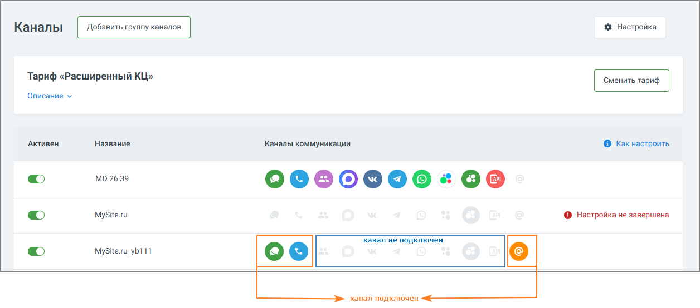

#### 4.5.11.2. Мои группы каналов

> Трассировка: PDF §4.5.11.2 · сквозные стр. 280-281 · источники: ч.1 `kb/sources/mango-lk-manual/LK_manual_v-125-1-280.pdf` с.280, ч.2 `kb/sources/mango-lk-manual/LK_manual_v-125-281-566.pdf` с.1.

При отсутствии ранее созданных групп каналов на экране отобразится описание возможностей «Текстовые коммуникации» . Для создания новой группы щелкните по кнопке Подключить и выберите тариф. Тарифы «Текстовые коммуникации»

Базовая версия - рекомендуется пользователям, у которых не более одной активной группы каналов.

Расширенная версия - позволяет пользователю создать и активировать больше групп каналов.

Ознакомьтесь с подробным описанием тарифов, а также условиями подключения, и нажмите кнопку Подключить.

При наличии ранее созданных групп каналов на экране отобразится их список и перечень подключенных каналов коммуникации. Для создания новой группы каналов следует щелкнуть по кнопке Добавить.

> **Описание иллюстрации LK-§4.5.11.2-1** (к §4.5.11.2 «Мои группы каналов», стр. 280; 1256×554 px). Снимок экрана / схема Личного кабинета.
> Относится к тексту руководства: «…упп каналов на экране отобразится их список и перечень подключенных каналов коммуникации. Для создания новой группы каналов следует щелкнуть по кнопке Добавить.».
> Текст на изображении (OCR, требует сверки): % Настройка; Каналы; Тариф «Расширенный КЦ»; Описание У; ‘Активен; Название; Каналы коммуникации; © Какнастроить; MD 26.39; 086000; #00; MySite.ru; © Настройка не завершена; канал не подключен; MySite.ru_yb111; канал подключен

Каждая запись списка содержит:

 Переключатель активности группы каналов;

 Название группы каналов. При щелчке по названию выполняется переход к настройкам группы;

 Список активных каналов коммуникации.

Для каждого отдельно используемого сайта рекомендуется создавать отдельную группу каналов.

Подключение каналов коммуникации в группу допускается также после создания группы.

Выберите каналы коммуникации и нажмите Подключить для перехода к настройке группы. Настройка распределена по следующим разделам:

 Настройки группы каналов;

 Настройки каналов коммуникации;

 Расписание;

 Код для сайта.

Для удаления группы каналов откройте настройки группы, пройдите к нижней части экрана и нажмите кнопку УДАЛИТЬ. ВНИМАНИЕ Если группа каналов была подключена из раздела «Настройки» Контакт- центра MANGO OFFICE, то при удалении Контакт-центра группу необходимо переподключить в Личном кабинете ВАТС.
