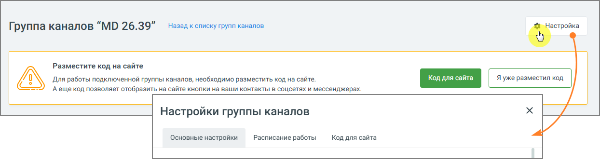

##### 4.5.11.2.1. Настройки группы каналов

> Трассировка: PDF §4.5.11.2.1 · сквозные стр. 281-282 · источники: ч.2 `kb/sources/mango-lk-manual/LK_manual_v-125-281-566.pdf` с.1-2.

Главное окно группы каналов содержит следующие каналы коммуникации с клиентами:

 Виджеты для сайта

 Соцсети и мессенджеры

 Другие каналы

> **Описание иллюстрации LK-§4.5.11.2.1-1** (к §4.5.11.2.1 «Настройки группы каналов», стр. 281; 1244×336 px). Снимок экрана / схема Личного кабинета.
> Относится к тексту руководства: «… Другие каналы».
> Текст на изображении (OCR, требует сверки): Назад к списку групп каналов; Группа каналов “MD 26.39”; Разместите код на сайте; Для работы подключенной группы каналов, необходимо разместить код на сайте.; `Аеще код позволяет отобразить Ha сайте кнопки на ваши контакты в соцсетях и мессенджерах.; Настройки группы каналов; Основные настройки; Расписание работы; Код для сайта

Кликните по кнопке Настройка в правом верхнем углу окна и перейдите к настройкам группы каналов. Эти настройки буду действовать для всех подключенных каналов.

После внесения необходимых изменений в настройки, сохраните их кнопкой Сохранить.
