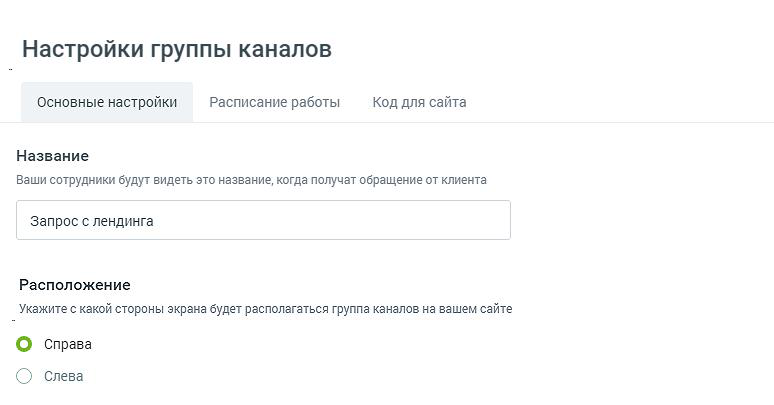
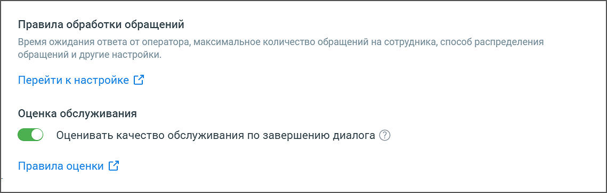
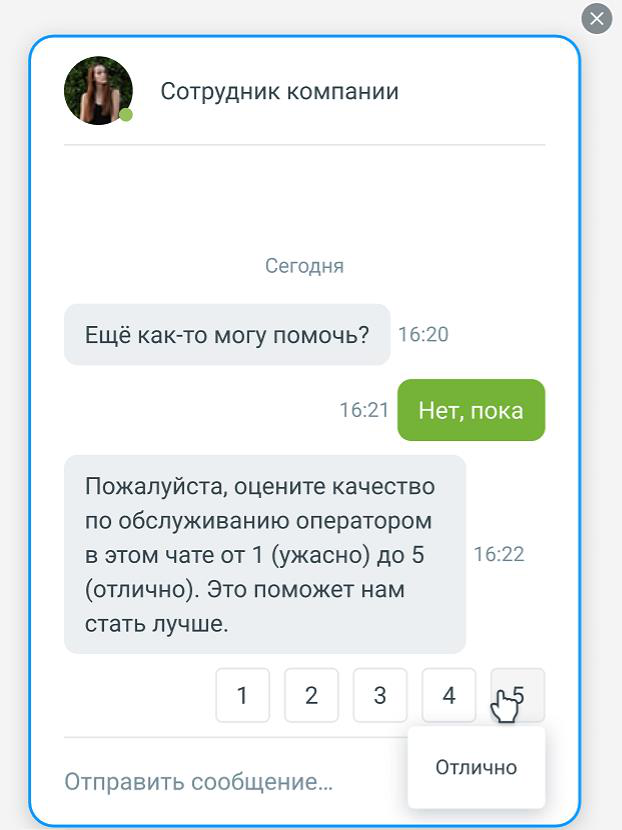
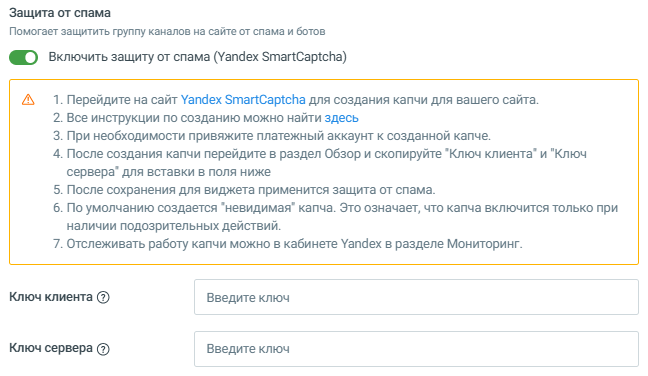
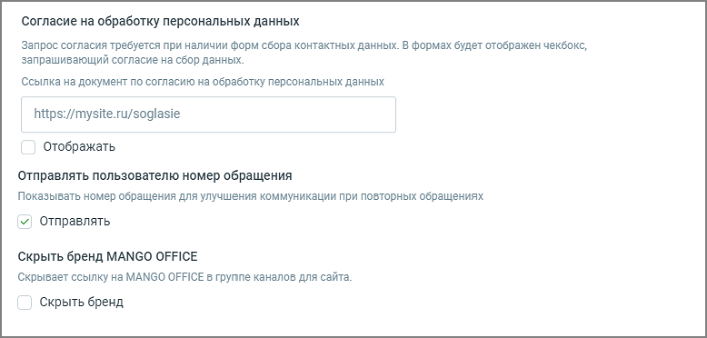

###### 4.5.11.2.1.1. Основные настройки

> Трассировка: PDF §4.5.11.2.1.1 · сквозные стр. 282-285 · источники: ч.2 `kb/sources/mango-lk-manual/LK_manual_v-125-281-566.pdf` с.2-5.

В настройках группы каналов следует указать:

Название – здесь можно сменить заданное по умолчанию имя группы;

Расположение – отметьте подходящий вариант расположения на экране всплывающих уведомлений;

> **Описание иллюстрации LK-§4.5.11.2.1.1-1** (к §4.5.11.2.1.1 «Основные настройки», стр. 282; 774×405 px). Снимок экрана / схема Личного кабинета.
> Относится к тексту руководства: «…Расположение – отметьте подходящий вариант расположения на экране всплывающих уведомлений;».
> Текст на изображении (OCR, требует сверки): | Настройки группы каналов; Основные настройки; Расписание работы; Код для сайта; Название; Ваши сотрудники будут видеть это название, когда получат обращение от клиента; Запрос с лендинга; Расположение; Укажите с какой стороны экрана будет располагаться группа каналов на вашем сайте; © справа; © слева

Правила обработки обращений – ссылка «Перейти к настройке» ведет на страницу «Обработка звонков → Настройки дозвона по умолчанию → Настройки правил обработки текстовых обращений» в Личном кабинете;

> **Описание иллюстрации LK-§4.5.11.2.1.1-2** (к §4.5.11.2.1.1 «Основные настройки», стр. 282; 1139×364 px). Снимок экрана / схема Личного кабинета.
> Относится к тексту руководства: «…«Перейти к настройке» ведет на страницу «Обработка звонков → Настройки дозвона по умолчанию → Настройки правил обработки текстовых обращений» в Личном кабинете;».
> Текст на изображении (OCR, требует сверки): Правила обработки обращений; Время ожидания ответа от оператора, максимальное количество обращений на сотрудника, способ распределения; ‘обращений и другие настройки.; Перейти к настройке [7; Оценка обслуживания; «Г оценивать качество обслуживания по завершению диалога ©); Правила оценки [7

Оценка обслуживания – если чекбокс включен, клиенты могут оставлять оценки в чатах после завершения диалога с сотрудником. Это дает возможность можно было собрать сквозную аналитику оценки работы конкретного сотрудника для всех каналов. Выставление оценки доступно клиенту в течение пяти минут после завершения диалога с оператором. При выставлении оценки в чате она будет отображаться в формате [Выставленная оценка] / [Пояснение оценки].

> **Описание иллюстрации LK-§4.5.11.2.1.1-3** (к §4.5.11.2.1.1 «Основные настройки», стр. 283; 622×830 px). Снимок экрана / схема Личного кабинета.
> Относится к тексту руководства: «…ние пяти минут после завершения диалога с оператором. При выставлении оценки в чате она будет отображаться в формате [Выставленная оценка] / [Пояснение оценки].».
> Текст на изображении (OCR, требует сверки): Сегодня; 16:20; Ещё как-то могу помочь?; Пожалуйста, оцените качество; по обслужи ванию оператором; в этом чате от 1 (ужасно) до 5; 16:22; (отлично). Это поможет нам; стать лучше.; Отлично; Отправить сообщение...

Ссылка «Правила оценки» ведет на страницу «Оценка качества в чатах» модуля Контроль качества, для настройки вопросов клиенту.

Для работы оценок необходимо подключить услугу «Омниканальной оценки диалогов» на странице модуля Контроль качества. Для того чтобы иметь возможность настраивать более одного вопроса необходимо включить услугу «Несколько вопросов».

Защита от спама – Настройка защиты от спама подразумевает интеграцию модуля «Текстовые коммуникации» с Yandex SmartCAPTCHA.

Для подключения пользователь должен настроить интеграцию модуля «Текстовые коммуникации» с сервисом Yandex SmartCAPTCHA. Для этого необходимо получить ключи доступа в Yandex SmartCAPTCHA и указать их в настройках модуля. После сохранения настроек система использует SmartCAPTCHA для проверки пользователей и защиты от автоматических спам-запросов.

При отключении «Защиты от спама» ранее введённые ключи сохраняются, при повторном подключении вносить их не требуется.

> **Описание иллюстрации LK-§4.5.11.2.1.1-4** (к §4.5.11.2.1.1 «Основные настройки», стр. 284; 648×376 px). Снимок экрана / схема Личного кабинета.
> Относится к тексту руководства: «…При отключении «Защиты от спама» ранее введённые ключи сохраняются, при повторном подключении вносить их не требуется.».
> Текст на изображении (OCR, требует сверки): Защита от спама; Помогает защитить группу каналов на сайте от спама и ботов; @) включить защиту от спама (Yandex SmartCaptcha); Перейдите на сайт Yandex SmartCaptcha для создания капчи для вашего сайта.; Все инструкции по созданию можно найти здесь; При необходимости привяжите платежный аккаунт к созданной капче.; После создания капчи перейдите в раздел Обзор и скопируйте "Ключ клиента" и "Ключ; сервера" для вставки в поля ниже; После сохранения для виджета применится защита от спама.; По умолчанию создается "невидимая" капча. Это означает, что капча включится только при; наличии подозрительны…

Согласие на обработку персональных данных – при включённой настройке внутри окна виджета отображается чекбокс и текст согласия со сбором персональных данных. Также можно разместить прямую ссылку на документ, при этом текст согласия кликабелен и ведет клиента на указанную ссылку. Клиент не сможет инициировать чат или заказать звонок, если не установит флажок согласия.

Отправлять пользователю номер обращения – при включенной настройке сотрудник может просмотреть и скопировать номер обращения внутри диалога Мои обращения. Также номер сообщения отображается в окне виджета;

Скрыть бренд MANGO OFFICE – при включенной настройке упоминания бренда в виджете отсутствует;

> **Описание иллюстрации LK-§4.5.11.2.1.1-5** (к §4.5.11.2.1.1 «Основные настройки», стр. 285; 778×372 px). Снимок экрана / схема Личного кабинета.
> Относится к тексту руководства: «…Скрыть бренд MANGO OFFICE – при включенной настройке упоминания бренда в виджете отсутствует;».
> Текст на изображении (OCR, требует сверки): Согласие на обработку персональных данных; Запрос согласия требуется при наличии форм сбора контактных данных. В формах будет отображен чекбокс,; запрашивающий согласие на сбор данных.; Ссылка на документ по согласию на обработку персональных данных; https://mysite.ru/soglasie; Отображать; Отправлять пользователю номер обращения; Показывать номер обращения для улучшения коммуникации при повторных обращениях; v| Отправлять; Скрыть бренд MANGO OFFICE; Скрывает ссылку Ha MANGO OFFICE в группе каналов для сайта.; Скрыть бренд

Кнопка Удалить группу каналов – перед удалением группы необходимо еще раз подтвердить согласие на удаление.
