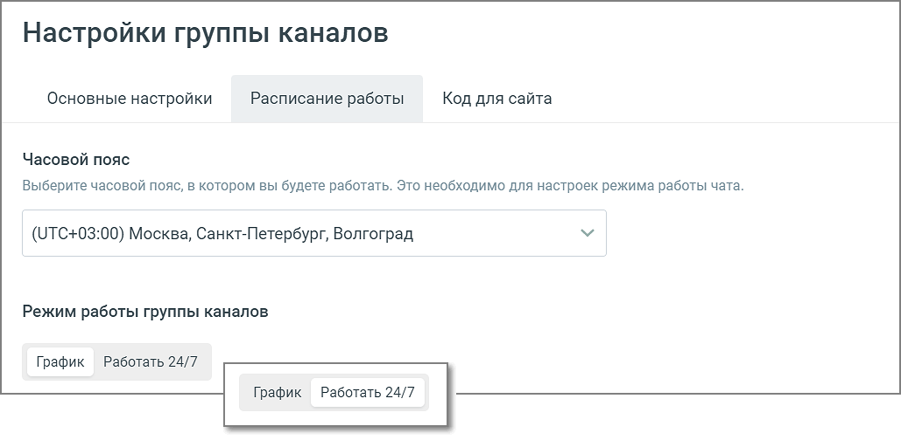
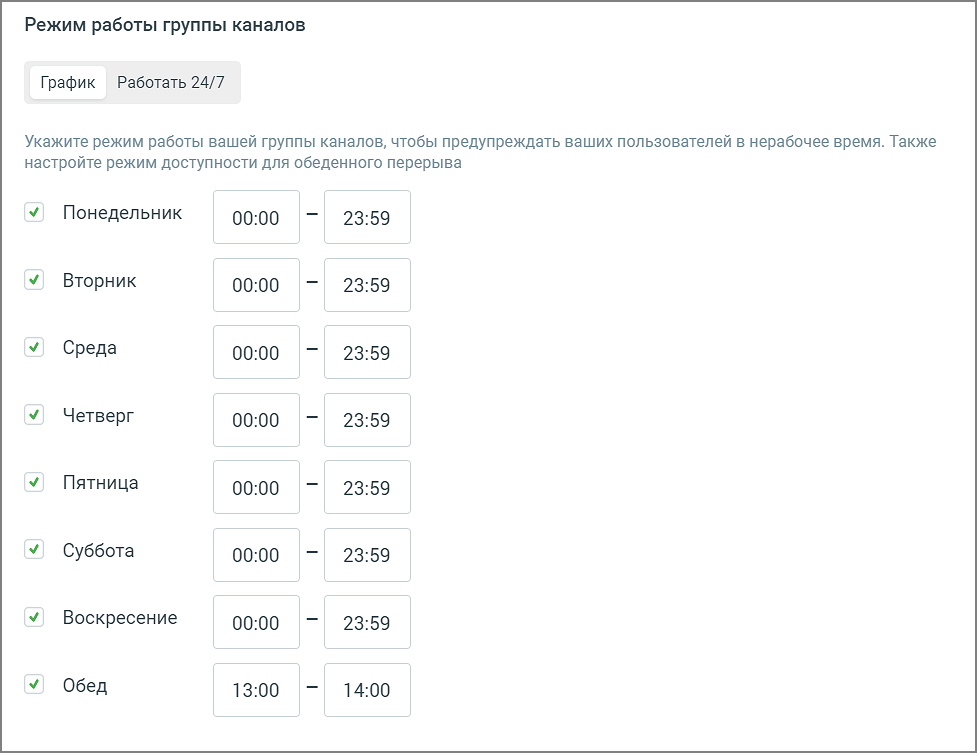
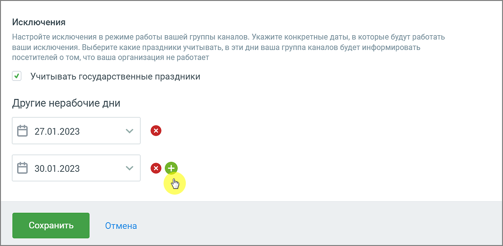

###### 4.5.11.2.2.2. Расписание работы

> Трассировка: PDF §4.5.11.2.2.2 · сквозные стр. 285-288 · источники: ч.2 `kb/sources/mango-lk-manual/LK_manual_v-125-281-566.pdf` с.5-8.

В настройках расписания укажите:

Часовой пояс – часовой пояс, в котором будет работать виджет. В зависимости от выбранного часового пояса определяются остальные настройки расписания виджета;

Режим работы виджета: График, Работать 24/7

> **Описание иллюстрации LK-§4.5.11.2.2.2-1** (к §4.5.11.2.2.2 «Расписание работы», стр. 285; 1029×504 px). Снимок экрана / схема Личного кабинета.
> Относится к тексту руководства: «…Режим работы виджета: График, Работать 24/7».
> Текст на изображении (OCR, требует сверки): Настройки группы каналов; Основные настройки; Расписание работы; Код для сайта; Часовой пояс; Выберите часовой пояс, в котором вы будете работать. Это необходимо для настроек режима работы чата; (UTC+03:00) Москва, Санкт-Петербург, Волгоград.; Режим работы группы каналов; График; Работать 24/7

 График – для каждого из дней недели можно задать рабочее время.

> **Описание иллюстрации LK-§4.5.11.2.2.2-2** (к §4.5.11.2.2.2 «Расписание работы», стр. 286; 977×753 px). Снимок экрана / схема Личного кабинета.
> Относится к тексту руководства: «… График – для каждого из дней недели можно задать рабочее время.».
> Текст на изображении (OCR, требует сверки): Режим работы группы каналов; Работать 24/7; График; Укажите режим работы вашей группы каналов, чтобы предупреждать ваших пользователей в нерабочее время. Также; настройте режим доступности для обеденного перерыва; Понедельник; 00:00; 23:59; Вторник; Среда; Четверг; Пятница; Суббота; Воскресение; Обед; 13:00; 14:00

 Работать 24/7 – круглосуточная работа без выходных

> **Описание иллюстрации LK-§4.5.11.2.2.2-3** (к §4.5.11.2.2.2 «Расписание работы», стр. 286; 1047×178 px). Снимок экрана / схема Личного кабинета.
> Относится к тексту руководства: «… Работать 24/7 – круглосуточная работа без выходных».
> Текст на изображении (OCR, требует сверки): Режим работы группы каналов; График; Работать 24/7; Режим работы 24/7 непрерывный. Без выходных и обеденных перерывов

Исключения:

 если чекбокс «государственные праздники» отмечен, государственные праздники считаются нерабочими днями;  другие нерабочие дни – можно добавлять/удалять дни, которые также считаются нерабочими.

> **Описание иллюстрации LK-§4.5.11.2.2.2-4** (к §4.5.11.2.2.2 «Расписание работы», стр. 287; 1056×517 px). Снимок экрана / схема Личного кабинета.
> Относится к тексту руководства: «…здники» отмечен, государственные праздники считаются нерабочими днями;  другие нерабочие дни – можно добавлять/удалять дни, которые также считаются нерабочими.».
> Текст на изображении (OCR, требует сверки): Исключения; Настройте исключения в режиме работы вашей группы каналов. Укажите конкретные даты, в которые будут работать,; ваши исключения. Выберите какие праздники учитывать, в эти дни ваша группа каналов будет информировать; посетителей о том, что ваша организация не работает; У’ Учитывать государственные праздники; Другие нерабочие дни; Е 27.01.2023; Е 30.01.2023; ма; отмена

ВНИМАНИЕ

Настроенное на вкладке расписание будет действовать для всех каналов коммуникации.
