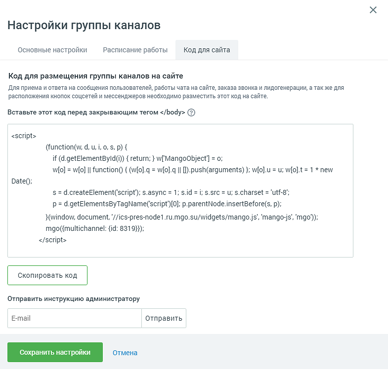

###### 4.5.11.2.2.3. Код для сайта

> Трассировка: PDF §4.5.11.2.2.3 · сквозные стр. 288 · источники: ч.2 `kb/sources/mango-lk-manual/LK_manual_v-125-281-566.pdf` с.8.

В поле «Код для вставки на сайт» указан код группы каналов, который следует скопировать и вставить в код своего сайта перед закрывающим тегом </body>:

> **Описание иллюстрации LK-§4.5.11.2.2.3-1** (к §4.5.11.2.2.3 «Код для сайта», стр. 288; 785×750 px). Снимок экрана / схема Личного кабинета.
> Относится к тексту руководства: «…В поле «Код для вставки на сайт» указан код группы каналов, который следует скопировать и вставить в код своего сайта перед закрывающим тегом </body>:».
> Текст на изображении (OCR, требует сверки): Настройки группы каналов; Основные настройки; Расписание работы; Код для сайта; Код для размещения группы каналов на сайте; Для приема и ответа на сообщения пользователей, работы чата на сайте, заказа звонка и лидогенерации, а так же для; расположения кнопок соцсетей и мессенджеров необходимо разместить этот код на сайте.; Вставьте этот код перед закрывающим тегом </body> (2); <script>; if (d.getElementByld(i)) { return; } w[MangoObject] = о;; р = d.getElementsByTagName(‘script’})[0]; p.parentNode.insertBefore(s, р);; }(window, document, '//ics-pres-node1 .ru.mgo.su/widgets/mango.js’, 'mango-j…

Или укажите электронную почту разработчика и нажмите «Отправить». На указанный e-mail будет выслана подробная инструкция вместе с кодом для вставки на сайт.

Код для вставки на сайт можно отправить на несколько адресов электронной почты одновременно. В качестве разделителя между адресами используйте запятую.
