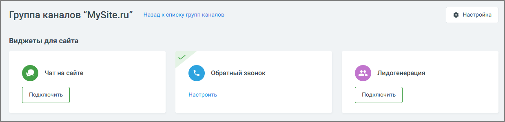
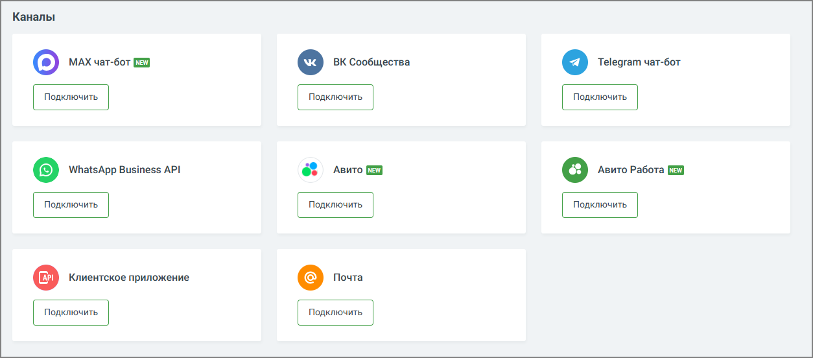

##### 4.5.11.2.2. Настройка каналов коммуникации

> Трассировка: PDF §4.5.11.2.2 · сквозные стр. 288-290 · источники: ч.2 `kb/sources/mango-lk-manual/LK_manual_v-125-281-566.pdf` с.8-10.

Настройте каналы коммуникации с клиентами.

Виджеты для сайта:

 Заказ обратного звонка  Лидогенерация  Чат на сайте

> **Описание иллюстрации LK-§4.5.11.2.2-1** (к §4.5.11.2.2 «Настройка каналов коммуникации», стр. 289; 1238×302 px). Снимок экрана / схема Личного кабинета.
> Относится к тексту руководства: «… Заказ обратного звонка  Лидогенерация  Чат на сайте».
> Текст на изображении (OCR, требует сверки): Назад к списку групп каналов; % Настройка; Группа каналов “MySite.ru”; Виджеты для сайта; й e@ O6parubiii звонок; Настроить

Каналы:

 MAX  Вконтакте  WhatsApp  Telegram  Клиентское приложение (по API)  E-mail  Авито  Авито Работа

> **Описание иллюстрации LK-§4.5.11.2.2-2** (к §4.5.11.2.2 «Настройка каналов коммуникации», стр. 289; 1254×552 px). Снимок экрана / схема Личного кабинета.
> Относится к тексту руководства: «… MAX  Вконтакте  WhatsApp  Telegram  Клиентское приложение (по API)  E-mail  Авито  Авито Работа».
> Текст на изображении (OCR, требует сверки): Каналы; [О] МАХ чат-бот; eo ВК Сообщества; © Telegram чат-бот; Подключить; 6% Авито 1; [©] WhatsApp Business API; [=] Авито Работа; QO wn
