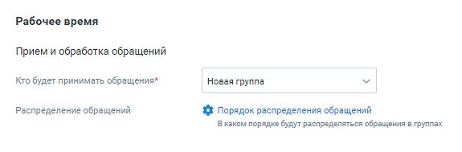
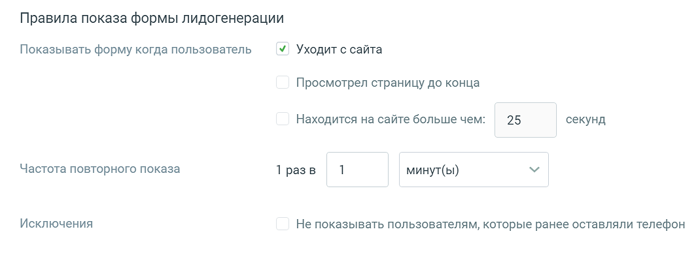
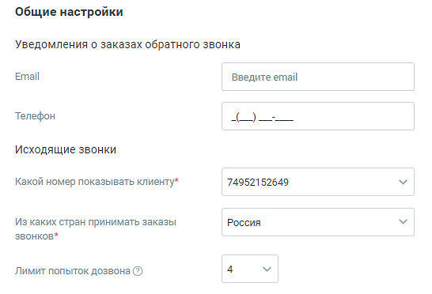
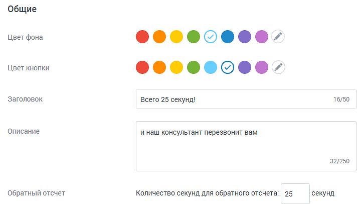
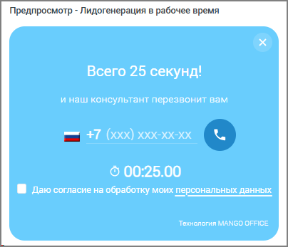

##### Лидогенерация

> Трассировка: PDF §4.5.11.2.2 · сквозные стр. 294-298 · источники: ч.2 `kb/sources/mango-lk-manual/LK_manual_v-125-281-566.pdf` с.14-18.

Настройте канал коммуникации с клиентами. Виджет отображается при определенных действиях посетителя сайта.

Вкладка «Настройка канала»

Переходите к индивидуальным настройкам канала.

> **Описание иллюстрации LK-§4.5.11.2.2-1** (к §4.5.11.2.2 «Лидогенерация», стр. 294; 575×189 px). Снимок экрана / схема Личного кабинета.
> Относится к тексту руководства: «…Переходите к индивидуальным настройкам канала.».
> Текст на изображении (OCR, требует сверки): Рабочее время; Прием и обработка обращений; Кто будет принимать обращения*; Новая группа; Распределение обращений; $ Порядок распределения обращений; В каком порядке будут распределяться обращения в группах

Предусмотрены следующие настройки лидогенерации в рабочее время:

Прием и обработка обращений

 Кто будет обрабатывать обращения – сотрудник либо группа, которые будут обрабатывать поступившие звонки. В качестве сотрудника можно выбрать чат-

бот (если в ЛК ВАТС подключена услуга «Чат-бот»). Поле обязательно для заполнения;

 Распределение обращений – только для варианта «группа». Распределение обращений устанавливается в соответствующем разделе Личного кабинета пользователя ВАТС.

> **Описание иллюстрации LK-§4.5.11.2.2-2** (к §4.5.11.2.2 «Лидогенерация», стр. 295; 1067×391 px). Снимок экрана / схема Личного кабинета.
> Относится к тексту руководства: «… Распределение обращений – только для варианта «группа». Распределение обращений устанавливается в соответствующем разделе Личного кабинета пользователя ВАТС.».
> Текст на изображении (OCR, требует сверки): Правила показа формы лидогенерации; Показывать форму когда пользователь; У. Уходит с сайта; Просмотрел страницу до конца; Находится на сайте больше чем:; 25; секунд; Частота повторного показа; 1 разв; минут(ы); Исключения; Не показывать пользователям, которые ранее оставляли телефон

Правила показа формы лидогенерации

 Показывать форму когда пользователь – выбор отслеживаемых действий посетителя, после которых будет показана форма лидогенерации для отправки заказа обратного звонка;

 Частота повторного показа – период, через который виджет отображается повторно;

 Исключения – при включенной настройке виджет не будет отображаться тем посетителям, которые указали свой номер телефона.

В нерабочее время форма лидогенерации не отображается.

> **Описание иллюстрации LK-§4.5.11.2.2-3** (к §4.5.11.2.2 «Лидогенерация», стр. 296; 546×372 px). Снимок экрана / схема Личного кабинета.
> Относится к тексту руководства: «…В нерабочее время форма лидогенерации не отображается.».
> Текст на изображении (OCR, требует сверки): Общие настройки; Уведомления о заказах обратного звонка; Email; Введите email; Телефон; Исходящие звонки; Какой номер показывать клиенту*; 74952152649; Из каких стран принимать заказы; Россия; звонков*; Лимит попыток дозвона (2)

В блоке Общие настройки предусмотрен следующий набор настроек:

Уведомления о заказах обратного звонка

 E-mail – адрес электронной почты для получения уведомлений. Если включен прием обращений в нерабочее время, поле является обязательным для заполнения;

 Телефон – мобильный номер телефона для получения уведомлений о заказах обратного звонка в виде SMS-сообщений.

Если указать e-mail и телефон, уведомления будут приходить на оба контакта.

Исходящие звонки (настройки доступны только для варианта «Использовать автовызов»)

 Какой номер показывать клиенту – номер телефона, который отобразится у посетителя, заказавшего звонок. Поле является обязательным для заполнения;

 Из каких стран принимать заказы звонков – ограничения на направления исходящего дозвона. По умолчанию установлены звонки только в регионе «Россия»;

 Лимит попыток дозвона – максимальное количество попыток дозвона клиенту, которое осуществляет система, пока не удастся связать оператора и клиента.

ВАЖНО: При дозвоне сначала система звонит оператору, потом клиенту. Лимит дозвонов до оператора – 4. Если клиент сбросит звонок, новая попытка дозвона будет осуществлена через 15 минут. Если клиент не возьмёт трубку, новая попытка дозвона будет через 100 секунд.

Вкладка «Внешний вид»

Далее настройте внешний вид канала коммуникации «Лидогенерация» в рабочее время.

> **Описание иллюстрации LK-§4.5.11.2.2-4** (к §4.5.11.2.2 «Лидогенерация», стр. 297; 722×406 px). Снимок экрана / схема Личного кабинета.
> Относится к тексту руководства: «…Далее настройте внешний вид канала коммуникации «Лидогенерация» в рабочее время.».
> Текст на изображении (OCR, требует сверки): Общие; Цвет фона; ©0800080080-; Цвет кнопки; Заголовок; Всего 25 секунд!; 16/50; описание; и наш консультант перезвонит вам; 32/250; Обратный отсчет; Количество секунд для обратного отсчета: 25; секунд

 Цвет фона - цвет основного окна виджета. Можно выбрать произвольный цвет,

> **Описание иллюстрации LK-§4.5.11.2.2-5** (к §4.5.11.2.2 «Лидогенерация», стр. 297; 30×30 px). Пиктограмма (значок элемента интерфейса).
> Относится к тексту руководства: «… Цвет фона - цвет основного окна виджета. Можно выбрать произвольный цвет,».
> Текста на изображении нет; назначение значка — см. текст, к которому он относится.

кликнув по иконке ;

 Цвет кнопки – цвет кнопки виджета. Можно выбрать произвольный цвет, кликнув

> **Описание иллюстрации LK-§4.5.11.2.2-6** (к §4.5.11.2.2 «Лидогенерация», стр. 297; 30×30 px). Пиктограмма (значок элемента интерфейса).
> Относится к тексту руководства: «… Цвет кнопки – цвет кнопки виджета. Можно выбрать произвольный цвет, кликнув».
> Текста на изображении нет; назначение значка — см. текст, к которому он относится.

по иконке ;

 Заголовок – текст размещенного на виджете заголовка;

 Описание – текст, размещенный на виджете;

 Обратный отсчет (количество секунд для обратного отсчета) – количество секунд, в течение которых сотрудник компании перезвонит на номер телефона посетителя сайта:

 Максимальное количество символов - 4

 Максимальное значение - 3599

В процессе настройки меняется внешний вид виджета в окне предпросмотра.

> **Описание иллюстрации LK-§4.5.11.2.2-7** (к §4.5.11.2.2 «Лидогенерация», стр. 298; 404×347 px). Снимок экрана / схема Личного кабинета.
> Относится к тексту руководства: «…В процессе настройки меняется внешний вид виджета в окне предпросмотра.».
> Текст на изображении (OCR, требует сверки): › - Лидогенерация в ра:; мя; Всего 25 секунд!; и наш консультант перезвонит вам; © 00:25.00; @ даю согласие на обработку моих персональных данных; Технология MANGO OFFICE

Сохраните настройки виджета кнопкой Сохранить.

Отключить канал – после дополнительного согласия на отключение канал связи отключается.

ВНИМАНИЕ

На канале существует ряд ограничений (список ограничений смотрите ниже). Учитывайте это, когда знакомитесь с работой канала.

Ограничения на звонки с сайта.

 не более трех звонков с сайта в минуту с одного IP-адреса в рамках одного виджета.

Если номер пользователя добавлен в «черный список» ВАТС, то звонок не осуществляется.
