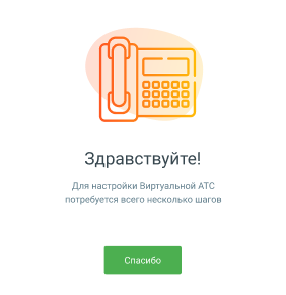

#### 1.8.2.1. Блок 1. Начало обучения. Шкала прогресса Онбординга.

> Трассировка: PDF §1.8.2.1 · сквозные стр. 23 · источники: ч.1 `kb/sources/mango-lk-manual/LK_manual_v-125-1-280.pdf` с.23.

> **Описание иллюстрации LK-§1.8.2.1-1** (к §1.8.2.1 «Блок 1. Начало обучения. Шкала прогресса Онбординга.», стр. 23; 286×295 px). Снимок экрана / схема Личного кабинета.
> Относится к тексту руководства: «…начало раздела».
> Текст на изображении (OCR, требует сверки): ooo00; 66665; Здравствуйте!; Для настройки Виртуальной АТС; потребуется всего несколько шагов

Обучающая система поможет настроить Главную страницу Личного кабинета пользователя ВАТС. Переход к обучению происходит по нажатию на кнопку «Спасибо».

Прогресс обучения отражается на Шкале прогресса Онбординга (Блок 1)

В процессе обучения пользователь будет видеть пиктограммы с подсказками. По итогам обучения на шкале Онбординга отобразятся возможности пользователя ЛК ВАТС.
