##### Чат на сайте

> Трассировка: PDF §4.5.11.2.2 · сквозные стр. 298-310 · источники: ч.2 `kb/sources/mango-lk-manual/LK_manual_v-125-281-566.pdf` с.18-30.

Вкладка «Настройка канала»

Переходите к индивидуальным настройкам канала. Настройте работу канала в рабочее время, указав подходящие параметры.

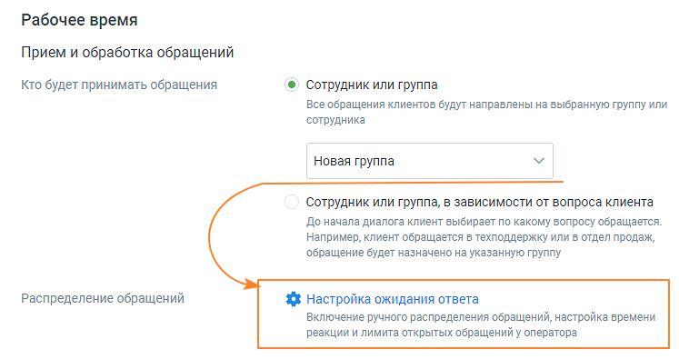

> **Описание иллюстрации LK-§4.5.11.2.2-1** (к §4.5.11.2.2 «Чат на сайте», стр. 299; 747×395 px). Снимок экрана / схема Личного кабинета.
> Относится к тексту руководства: «…Переходите к индивидуальным настройкам канала. Настройте работу канала в рабочее время, указав подходящие параметры.».
> Текст на изображении (OCR, требует сверки): Рабочее время; Прием и обработка обращений; Кто будет принимать обращения; ®) Сотрудник или группа; Все обращения клиентов будут направлены на выбранную группу или; сотрудника; Новая группа; Сотрудник или группа, в зависимости от вопроса клиента; До начала диалога клиент выбирает по какому вопросу обращается.; Например, клиент обращается в техподдержку или в отдел продаж,; обращение будет назначено на указанную группу; Распределение обращений; 5% Настройка ожидания ответа; Включение ручного распределения обращений, настройка времени; реакции и лимита открытых обращений у оператора

Прием и обработка обращений

 Кто будет обрабатывать обращения:

o сотрудник или группа – сотрудник либо группа, которые будут

обрабатывать поступившие звонки.

- При выборе варианта «группа» доступна настройка «Распределение обращений». Настройка устанавливается в соответствующих разделах Личного кабинета пользователя ВАТС.

- При выборе варианта «сотрудник» ниже становится доступна настройка Проактивного чата.

В качестве сотрудника можно выбрать чат-бот (если в ЛК ВАТС подключена услуга «Чат-бот»). В этом случае необходимо будет также выбрать резервного сотрудника или группу, на которых будут распределяться обращения в случае недоступности чат-бота.

o сотрудник или группа в зависимости от вопроса клиента – при выборе

этого варианта доступна настройка до 10-ти правил распределения звонка.

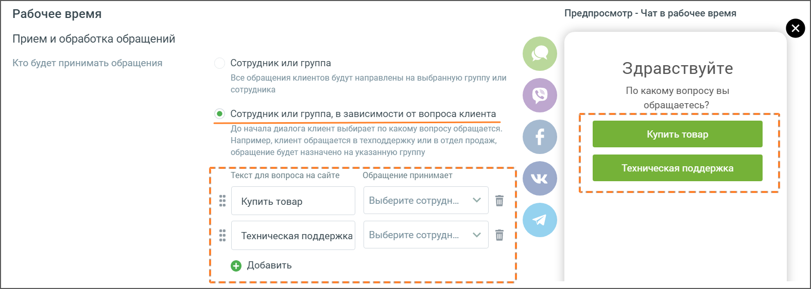

> **Описание иллюстрации LK-§4.5.11.2.2-2** (к §4.5.11.2.2 «Чат на сайте», стр. 300; 1575×563 px). Снимок экрана / схема Личного кабинета.
> Относится к тексту руководства: «…этого варианта доступна настройка до 10-ти правил распределения звонка.».
> Текст на изображении (OCR, требует сверки): Предпросмотр - Чат в рабочее время; Рабочее время; Прием и обработка обращений; Кто будет принимать обращения; Сотрудник или группа; Здравствуйте; Все обращения клиентов будут направлены на выбранную группу или; сотрудника; По какому вопросу вы; обращаетесь?; © Сотрудник или группа, в зависимости от вопроса клиента; `До начала диалога клиент выбирает по какому вопросу обращается.; Например, клиент обращается в техподдержку или в отдел продаж,; обращение будет назначено на указанную группу; Текст для вопроса на сайте; Обращение принимает; Купить товар; Выберите сотрудн...; Техническая поддержка…

При подключенном чат-боте в чате на сайте можно настраивать кнопки быстрых ответов. Кнопки отображаются в чате пользователя, а также в Контакт-центре сотрудника, ведущего диалог.

Максимально возможная длина сообщения в чате на сайте 1000 символов.

Приветствия

Для повышения лояльности клиентов и удобства работы операторов следует указать один или несколько Автоматических ответов.

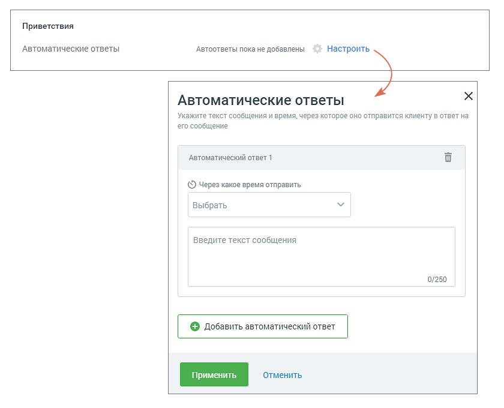

> **Описание иллюстрации LK-§4.5.11.2.2-3** (к §4.5.11.2.2 «Чат на сайте», стр. 300; 840×680 px). Снимок экрана / схема Личного кабинета.
> Относится к тексту руководства: «…Для повышения лояльности клиентов и удобства работы операторов следует указать один или несколько Автоматических ответов.».
> Текст на изображении (OCR, требует сверки): Приветствия; Автоматические ответы; Автоответы пока не добавлены; Настроить; Укажите текст сообщения и время, через которое оно отправится клиенту в ответ на; его сообщение; Автоматический ответ 1; (© Через какое время отправить; Выбрать; Введите текст сообщения; 0/250; | © Добавить автоматический ответ

Рекомендуется использовать автоответы, чтобы убедить клиента дождаться ответа оператора в пиковые часы нагрузки (когда все сотрудники заняты) или когда оператор отсутствует на рабочем месте.

o Автоматические ответы - нажатие на кнопку Настроить открывает окно настроек

автоматического ответа;

o Через какое время отправить - время с момента обращения пользователя и до

отображения ему автоответа;

o Текст сообщения – максимальное количество символов 250.

Пользователь может добавить несколько автоматических ответов и настроить периодичность отображения каждого.

Сообщения автоответов сохраняются в истории обращения, только если пользователь написал в чате свое сообщение.

> **Описание иллюстрации LK-§4.5.11.2.2-4** (к §4.5.11.2.2 «Чат на сайте», стр. 301; 623×148 px). Снимок экрана / схема Личного кабинета.
> Относится к тексту руководства: «…Сообщения автоответов сохраняются в истории обращения, только если пользователь написал в чате свое сообщение.».
> Текст на изображении (OCR, требует сверки): @ ) Показывать сообщение при закрытии обращения; Спасибо за ваше обращение; 25/250

 Показывать сообщение при закрытии обращения

При активации опции «Показывать сообщение при закрытии обращения» клиенту будет отображаться установленное сообщение при завершении обращения.

Текст сообщения: Введите текст в поле под переключателем. Сообщение o будет отправлено клиенту после закрытия обращения. Максимальная длина текста — 250 символов. Сообщение будет показано в случаях закрытия обращения оператором, o автоматического завершения чат-ботом или по истечении тайм-аута.

Активно приглашайте клиента вступить в диалог:

 Использовать проактивный чат

Переключатель «Использовать проактивный чат» в положении «включен» - когда клиент заходит на сайт, где размещен Мультиканальный виджет с каналом «чат на сайте», проактивный чат инициирует общение с клиентом.

Проактивный чат действует в связке с Автоматическими ответами. Чат работает для сессии в целом и отображается в той вкладке, которая в текущий момент активна на мониторе пользователя.

Пример работы Автоматических ответов в связке с Проактивным чатом:

1. Пользователь зашёл на сайт, сработали правила проактивного чата;

2. Пользователь что-то пишет в появившийся проактивный чат;

3. Оператор в данный момент занят и не может отреагировать на обращение;

4. Автоматический ответ создаёт сообщения в чате, тем самым удерживая пользователя в чате;

5. Оператор освободился и взял в работу обращение;

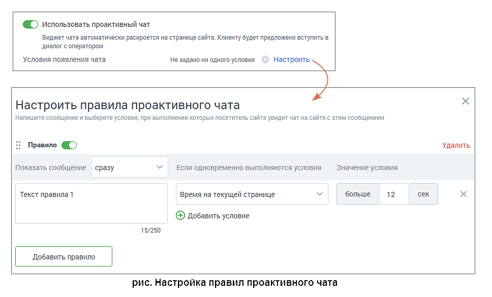

> **Описание иллюстрации LK-§4.5.11.2.2-5** (к §4.5.11.2.2 «Чат на сайте», стр. 302; 968×585 px). Снимок экрана / схема Личного кабинета.
> Относится к тексту руководства: «…5. Оператор освободился и взял в работу обращение;».
> Текст на изображении (OCR, требует сверки): © использовать проактивный чат; виджет чата автоматически раскроется на странице сайта. Клиенту будет предложено вступить в; диалог с оператором.; `Условия появления чата; He задано ни одного условия; Настроить; Настроить правила проактивного чата; Напишите сообщение и выберите условия, при выполнении которых посетитель сайта увидит чат на сайте с этим сообщением; Правило @); Удалить; Показать сообщение сразу; Если одновременно выполняются условия; Значение условия; больше; 12; сек; Текст правила1; время на текущей странице; (® добавить условие; 15/250; рис. Настройка правил проактивного чата

Для этого настройте правила, при которых чат начнет диалог:

> **Описание иллюстрации LK-§4.5.11.2.2-6** (к §4.5.11.2.2 «Чат на сайте», стр. 302; 32×38 px). Пиктограмма (значок элемента интерфейса).
> Относится к тексту руководства: «…Для этого настройте правила, при которых чат начнет диалог:».
> Текста на изображении нет; назначение значка — см. текст, к которому он относится.

o Переключатель активности правила – правило активно, если переключатель установлен в положение «включено»;

o Показать сообщение - период, по истечении которого отображается свернутый

чат на сайте, и через одну секунду отображается Текст правила. При этом должны выполняться условия, задаваемые ниже;

o Текст правила – текст сообщения, которым чат инициирует диалог. Максимальное количество символов – 250;

o Условия и значение условия – список условий и их значений, при выполнении

> **Описание иллюстрации LK-§4.5.11.2.2-7** (к §4.5.11.2.2 «Чат на сайте», стр. 302; 24×22 px). Пиктограмма (значок элемента интерфейса).
> Относится к тексту руководства: «…o Условия и значение условия – список условий и их значений, при выполнении».
> Текста на изображении нет; назначение значка — см. текст, к которому он относится.

> **Описание иллюстрации LK-§4.5.11.2.2-8** (к §4.5.11.2.2 «Чат на сайте», стр. 302; 16×16 px). Пиктограмма (значок элемента интерфейса).
> Относится к тексту руководства: «…Условия и значение условия – список условий и их значений, при выполнении». > Текста на изображении нет; назначение значка — см. текст, к которому он относится.».
> Текста на изображении нет; назначение значка — см. текст, к которому он относится.

которых чат инициирует диалог. Условия можно удалять и добавлять . Если условий несколько, они объединены по принципу «И». Таким образом, правило сработает, если одновременно выполнены все условия.

Также пользователю доступны следующие действия с правилами:

 Для перемещения правил в порядке приоритета перетяните правило вверх или

> **Описание иллюстрации LK-§4.5.11.2.2-9** (к §4.5.11.2.2 «Чат на сайте», стр. 303; 10×18 px). Пиктограмма (значок элемента интерфейса).
> Относится к тексту руководства: «… Для перемещения правил в порядке приоритета перетяните правило вверх или».
> Текста на изображении нет; назначение значка — см. текст, к которому он относится.

вниз, удерживая левой кнопкой мыши курсор на пиктограмме ;

 Для добавления нового правила нажмите кнопку Добавить правило;

 Для удаления правила кликните по ссылке Удалить.

Сохраните внесенные изменения кнопкой Сохранить.

Сообщения проактивного чата сохраняются и отражаются в истории переписки по данному обращению, только если пользователь ответил на сообщение чата.

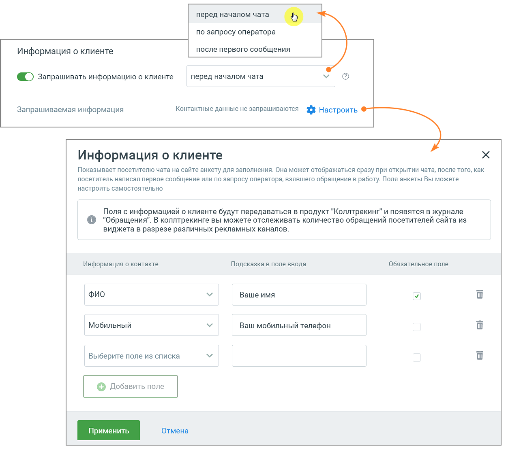

> **Описание иллюстрации LK-§4.5.11.2.2-10** (к §4.5.11.2.2 «Чат на сайте», стр. 303; 1253×1112 px). Снимок экрана / схема Личного кабинета.
> Относится к тексту руководства: «…Сообщения проактивного чата сохраняются и отражаются в истории переписки по данному обращению, только если пользователь ответил на сообщение чата.».
> Текст на изображении (OCR, требует сверки): перед началом чата o; по запросу оператора; после первого сообщения; Информация о клиенте; > запрашивать информацию о клиенте; перед началом чата; Запрашиваемая информация; Контактные данные не запрашиваются Fe 3 Настроить; Показывает посетителю чата на сайте анкету для заполнения. Она может отображаться сразу при открытии чата, после того, как; посетитель написал первое сообщение или по запросу оператора, взявшего обращение в работу. Поля анкеты Вы можете; настроить самостоятельно; Поля с информацией о клиенте будут передаваться в продукт "Коллтрекинг" и появятся в журнале; 'Обращения". В кол…

Для повышения качества и результативности работы с клиентом имеются настройки сбора информации о клиенте.

 Информация о клиенте

o выберите время запроса контактных данных клиента;

o выберите из выпадающего списка те данные, которые вы хотели бы запрашивать

у клиента. Старайтесь запрашивать только необходимый минимум данных.

Подсказка в поле ввода – подсказка, которую увидит клиент.

> **Описание иллюстрации LK-§4.5.11.2.2-11** (к §4.5.11.2.2 «Чат на сайте», стр. 304; 21×21 px). Пиктограмма (значок элемента интерфейса).
> Относится к тексту руководства: «…Подсказка в поле ввода – подсказка, которую увидит клиент.».
> Текста на изображении нет; назначение значка — см. текст, к которому он относится.

Галочка в чекбоксе отмечает выбранное поле, как обязательное. Клик по пиктограмме «корзина» удаляет поле. Кнопка «Добавить» добавляет новое поле данных.

Если фунция «Информация о клиенте» включена, перед началом диалога клиенту отображается виджет следующего вида:

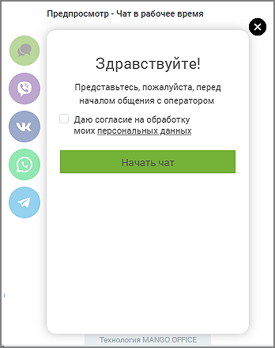

> **Описание иллюстрации LK-§4.5.11.2.2-12** (к §4.5.11.2.2 «Чат на сайте», стр. 304; 348×440 px). Снимок экрана / схема Личного кабинета.
> Относится к тексту руководства: «…Если фунция «Информация о клиенте» включена, перед началом диалога клиенту отображается виджет следующего вида:».
> Текст на изображении (OCR, требует сверки): Предпросмотр - Чат в рабочее время; Здравствуйте!; Представьтесь, пожалуйста, перед; началом общения с оператором; Даю согласие на обработку; моих персональных данных; Технология MANGO OFFICE

 Редактирование сообщений – если чекбокс «разрешать редактировать сообщения в чате» отмечен, оператор Контакт-центра и посетитель виджета на сайте имеют возможность редактировать свое сообщение в течение заданного периода времени.

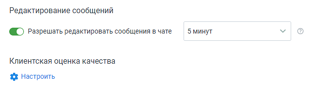

> **Описание иллюстрации LK-§4.5.11.2.2-13** (к §4.5.11.2.2 «Чат на сайте», стр. 305; 649×179 px). Снимок экрана / схема Личного кабинета.
> Относится к тексту руководства: «…щения в чате» отмечен, оператор Контакт-центра и посетитель виджета на сайте имеют возможность редактировать свое сообщение в течение заданного периода времени.».
> Текст на изображении (OCR, требует сверки): Редактирование сообщений; @ > Разрешать редактировать сообщения в чате; 5 минут; Клиентская оценка качества; % Настроить

 Клиентская оценка качества – нажатие на кнопку «Настроить» открывает окно «Настройки группы каналов» для продолжения настроек оценки качества работы оператора по заданным правилам. Клиентская оценка качества будет доступна, если в Личном кабинете подключен модуль «Контроль качества».

Нерабочее время – настройте работу канала в нерабочее время, указав подходящие параметры.

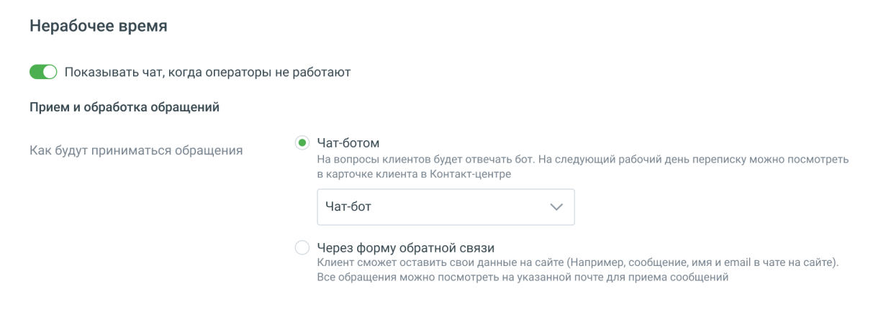

> **Описание иллюстрации LK-§4.5.11.2.2-14** (к §4.5.11.2.2 «Чат на сайте», стр. 305; 1231×434 px). Снимок экрана / схема Личного кабинета.
> Относится к тексту руководства: «…Нерабочее время – настройте работу канала в нерабочее время, указав подходящие параметры.».
> Текст на изображении (OCR, требует сверки): Нерабочее время; > Показывать чат, когда операторы не работают; Прием и обработка обращений; @ Чат-ботом; Как будут приниматься обращения; На вопросы клиентов будет отвечать бот. На следующий рабочий день переписку можно посмотреть; в карточке клиента в Контакт-центре; Чат-бот; Через форму обратной связи; Клиент сможет оставить свои данные на сайте (Например, сообщение, имя и email в чате на сайте).; Все обращения можно посмотреть на указанной почте для приема сообщений

На вкладке указываются:

 Переключатель отображения чата

o Показывать чат, когда операторы не работают – если переключатель

включен иконка чата показывается на сайте и в нерабочее время. При клике по иконке виджет отображается с пометкой «Нерабочее время» и предложением оставить заявку. Если переключатель выключен, то в развёрнутом списке каналов иконка "Чат на сайте" отсутствует. Внешний вид настроенного виджета отображается в окне справа;

 Прием и обработка обращений

o Чат-бот – если в ЛК ВАТС подключена услуга «Чат-бот», то в нерабочее

время также можно выбрать диалог клиента с чат-ботом.

o Через форму обратной связи – при выборе откроется форма ввода адреса

электронной почты для получения сообщений. Каждое сообщение придет в отдельном письме. Сообщение, поступающее на группу, отображается у

всех ее участников. Сотрудники, не включенные в группу, не получают сообщения. Если переключатель «показывать чат» в положении «включен», поле является обязательным для заполнения.

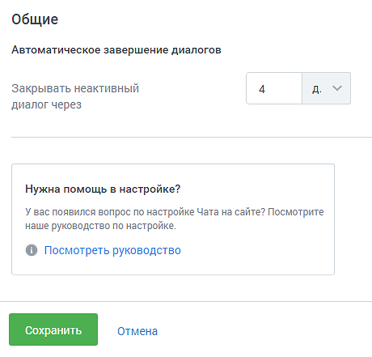

> **Описание иллюстрации LK-§4.5.11.2.2-15** (к §4.5.11.2.2 «Чат на сайте», стр. 306; 460×441 px). Снимок экрана / схема Личного кабинета.
> Относится к тексту руководства: «…Сотрудники, не включенные в группу, не получают сообщения. Если переключатель «показывать чат» в положении «включен», поле является обязательным для заполнения.».
> Текст на изображении (OCR, требует сверки): Общие; Автоматическое завершение диалогов; Закрывать неактивны a; диалог через; Нужна помощь в настройке?; У вас появился вопрос по настройке Чата на сайте? Посмотрите; наше руководство по настройке.; @ Посмотреть руководство

На вкладке указываются:

 Автоматическое завершение диалогов

o Закрывать неактивный диалог через – время в часах или днях, по истечении

которого обращение автоматически закрывается. Значение поля должно быть больше нуля.

Вкладка «Внешний вид»

Общие

Во вкладке указываются:

 Тема, в которой отображается основное окно виджета чата: светлая или темная;  Цвет кнопки чата. По умолчанию установлен зеленый цвет. Можно выбрать

> **Описание иллюстрации LK-§4.5.11.2.2-16** (к §4.5.11.2.2 «Чат на сайте», стр. 306; 30×30 px). Пиктограмма (значок элемента интерфейса).
> Относится к тексту руководства: «… Тема, в которой отображается основное окно виджета чата: светлая или темная;  Цвет кнопки чата. По умолчанию установлен зеленый цвет. Можно выбрать».
> Текста на изображении нет; назначение значка — см. текст, к которому он относится.

произвольный цвет, кликнув по иконке ;

 Текст кнопки – текст, отображаемый на кнопке чата на сайте. Можно выбрать

> **Описание иллюстрации LK-§4.5.11.2.2-17** (к §4.5.11.2.2 «Чат на сайте», стр. 307; 30×30 px). Пиктограмма (значок элемента интерфейса).
> Относится к тексту руководства: «… Текст кнопки – текст, отображаемый на кнопке чата на сайте. Можно выбрать».
> Текста на изображении нет; назначение значка — см. текст, к которому он относится.

произвольный цвет, кликнув по иконке .

Внешний вид настроенного виджета отображается в окне справа.

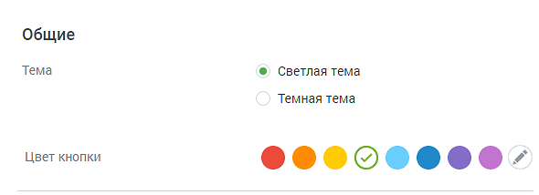

> **Описание иллюстрации LK-§4.5.11.2.2-18** (к §4.5.11.2.2 «Чат на сайте», стр. 307; 590×214 px). Снимок экрана / схема Личного кабинета.
> Относится к тексту руководства: «…Внешний вид настроенного виджета отображается в окне справа.».
> Текст на изображении (OCR, требует сверки): Общие; Тема; @ Светлая тема; Темная тема; Цвет кнопки; @00808008-

Чат на сайте в рабочее время.

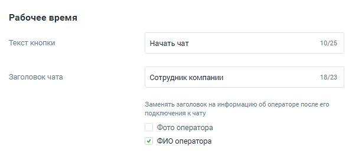

> **Описание иллюстрации LK-§4.5.11.2.2-19** (к §4.5.11.2.2 «Чат на сайте», стр. 307; 613×265 px). Снимок экрана / схема Личного кабинета.
> Относится к тексту руководства: «…Чат на сайте в рабочее время.».
> Текст на изображении (OCR, требует сверки): Рабочее время; Текст кнопки; Начать чат; 10/25; Заголовок чата; Сотрудник компании; 18/23; Заменять заголовок на информацию об операторе после его; подключения к чату; Фото оператора; у ФИО оператора

 Текст кнопки – максимум 25 символов;

 Заголовок чата – наименование в соответствии со стандартом сайтов пользователя.

Для того, чтобы пользователям отображалась информация об операторах чата, следует отметить:

 Фото оператора – фотография из аватара сотрудника в M.Talker или Контакт- центра;

 ФИО оператора – данные загружаются из справочника сотрудников ВАТС.

Внешний вид настроенного виджета отображается в окне справа.

Чат на сайте в нерабочее время

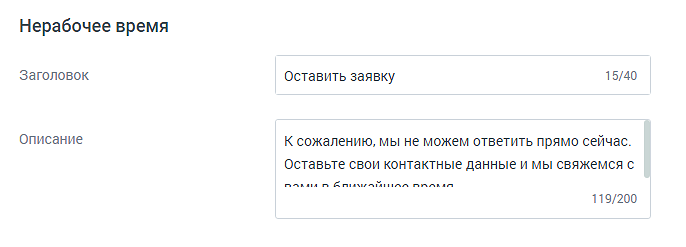

> **Описание иллюстрации LK-§4.5.11.2.2-20** (к §4.5.11.2.2 «Чат на сайте», стр. 308; 686×247 px). Снимок экрана / схема Личного кабинета.
> Относится к тексту руководства: «…Чат на сайте в нерабочее время».
> Текст на изображении (OCR, требует сверки): Нерабочее время; Заголовок; 15/40; Оставить заявку; описание; К сожалению, мы не можем ответить прямо сейчас.; Оставьте свои контактные данные и мы свяжемся с; nanan Колы анлл onan; 119/200

Во вкладке Внешний вид для канала коммуникации «Чат на сайте (в нерабочее время)» указываются:

 Заголовок - отображается в форме чата в нерабочее время;

 Описание - поясняющий текст, отображающийся в форме чата в нерабочее время.

Внешний вид настроенного виджета отображается в окне справа.

Сохраните настройки виджета кнопкой Сохранить.

Отключить канал – после дополнительного согласия на отключение канал связи отключается.

Изменение расположения виджета

Чтобы расположить открытый виджет в другой части экрана, достаточно зафиксировать

> **Описание иллюстрации LK-§4.5.11.2.2-21** (к §4.5.11.2.2 «Чат на сайте», стр. 308; 32×46 px). Пиктограмма (значок элемента интерфейса).
> Относится к тексту руководства: «…Чтобы расположить открытый виджет в другой части экрана, достаточно зафиксировать».
> Текста на изображении нет; назначение значка — см. текст, к которому он относится.

курсор на иконке и переместить виджет.

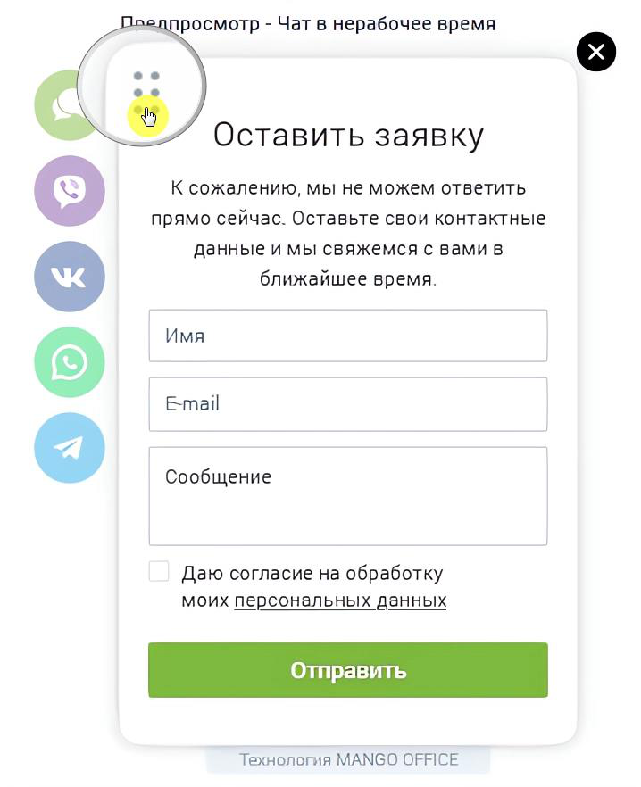

> **Описание иллюстрации LK-§4.5.11.2.2-22** (к §4.5.11.2.2 «Чат на сайте», стр. 309; 718×882 px). Снимок экрана / схема Личного кабинета.
> Относится к тексту руководства: «…курсор на иконке и переместить виджет.».
> Текст на изображении (OCR, требует сверки): LIne 7; росмотр - Чат в нерабочее время; ee; Оставить заявку; К сожалению, мы не можем ответить; прямо сейчас. Оставьте свои контактные; данные и мы свяжемся с вами в; ближайшее время.; Имя; ЗЕЕ; Email; Сообщение; Даю согласие на обработку; моих персональных данных; Технология MANGO OFFICE

Вы можете отслеживать количество обращений по виджету «Текстовые коммуникации» в канале "Чат на сайте". Для использования данной опции виджеты динамического коллтрекинга и мультиканального чата должны быть связаны между собой. Таким образом пользователь может получить полную аналитику по обращениям посетителей сайта из виджета в разрезе рекламных кампаний и источников.

Для настройки интеграции последовательно перейдите в раздел Коллтрекинг → Обзорная панель → Блок Интеграции → «Текстовые коммуникации» и добавьте один или несколько виджетов Диалогов.

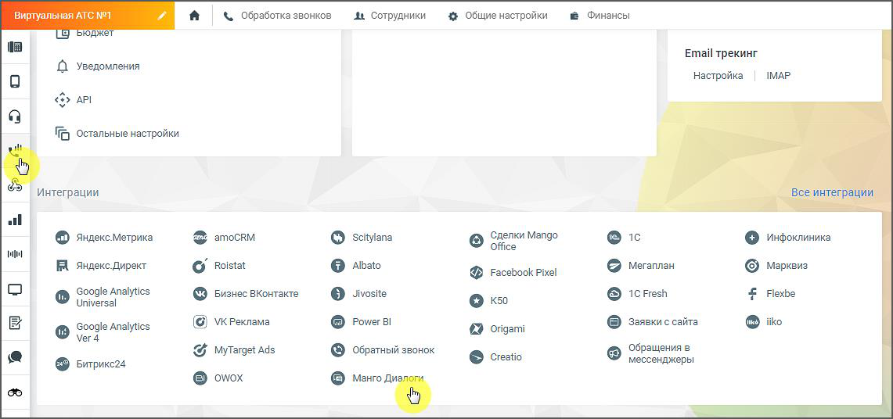

> **Описание иллюстрации LK-§4.5.11.2.2-23** (к §4.5.11.2.2 «Чат на сайте», стр. 310; 1141×536 px). Снимок экрана / схема Личного кабинета.
> Относится к тексту руководства: «…и последовательно перейдите в раздел Коллтрекинг → Обзорная панель → Блок Интеграции → «Текстовые коммуникации» и добавьте один или несколько виджетов Диалогов.».
> Текст на изображении (OCR, требует сверки): & Обработка звонков; Ae Сотрудники; $ Общие настройки; @ Финансы; Email трекинг; Д уведомления; настройка; IMAP; eb ari; fff остальные настройки; Интеграции; ин; amoCRM; ‘Сделки Mango; 1c; © яздксметрика; Scitylana; Office; © инфоклиника; Albato; Мегаплан; Яндекс.Директ; © Roistat; © мерквиз; ФФ Facebook Pixel; Google Analytics; Jivosite; 1с Fresh; Flexbe; Universal; © визнесвконтась; Power Bl; Заявки с сайта; (©) VicPexnama; origami; Ver 4; Обращения в; $ MyTarget ads; Обратный звонок; Битрикс24.; мессенджеры; © owox; `Манго Ди:

ВНИМАНИЕ

На канале существует ряд ограничений (список ограничений смотрите ниже). Учитывайте это, когда знакомитесь с работой канала.

Ограничения канала Чат на сайте

 не более 10 сообщений в минуту с одного IP-адреса в рамках одного виджета;

 не более трех стартов общения (отправка первого сообщения) в чатах с одного ip-адреса в течении двух минут.
