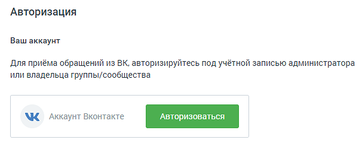
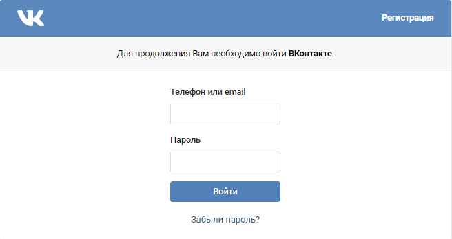
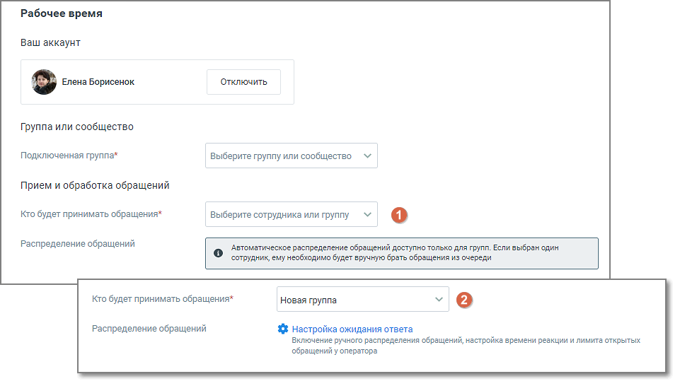
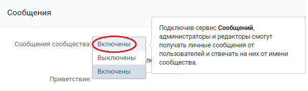

##### ВКонтакте

> Трассировка: PDF §4.5.11.2.2 · сквозные стр. 310-316 · источники: ч.2 `kb/sources/mango-lk-manual/LK_manual_v-125-281-566.pdf` с.30-36.

Вы можете настроить прием сообщений, которые клиенты отправляют вашей группе ВКонтакте. Для этого нажмите «Авторизоваться».

> **Описание иллюстрации LK-§4.5.11.2.2-1** (к §4.5.11.2.2 «ВКонтакте», стр. 311; 606×246 px). Снимок экрана / схема Личного кабинета.
> Относится к тексту руководства: «…Вы можете настроить прием сообщений, которые клиенты отправляют вашей группе ВКонтакте. Для этого нажмите «Авторизоваться».».
> Текст на изображении (OCR, требует сверки): Авторизация; Ваш аккаунт; Для приёма обращений из ВК, авторизируйтесь под учётной записью администратора; или владельца группы/сообщества

В открывшейся форме нужно авторизоваться под администратором той группы, сообщения из которой необходимо обрабатывать. В случае, когда учетная запись не является записью администратора, дальнейшая настройка будет невозможна.

> **Описание иллюстрации LK-§4.5.11.2.2-2** (к §4.5.11.2.2 «ВКонтакте», стр. 311; 656×348 px). Снимок экрана / схема Личного кабинета.
> Относится к тексту руководства: «… группы, сообщения из которой необходимо обрабатывать. В случае, когда учетная запись не является записью администратора, дальнейшая настройка будет невозможна.».
> Текст на изображении (OCR, требует сверки): Регистрация; Для продолжения Вам необходимо войти ВКонтакте.; Телефон или етай; Забыли пароль?

После успешной авторизации ВКонтакте, в настройках виджета в выпадающем списке отобразится перечень всех групп данного администратора.

Далее переходите к индивидуальным настройкам канала.

> **Описание иллюстрации LK-§4.5.11.2.2-3** (к §4.5.11.2.2 «ВКонтакте», стр. 312; 961×546 px). Снимок экрана / схема Личного кабинета.
> Относится к тексту руководства: «…Далее переходите к индивидуальным настройкам канала.».
> Текст на изображении (OCR, требует сверки): Рабочее время; Ваш аккаунт; Отключить; ры; Группа или сообщество; Подключенная группа^; Выберите группу или сообщество; Прием и обработка обращений; Кто будет принимать обращения*; выберите сотрудника или группу; Распределение обращений; Автоматическое распределение обращений доступно только для групп. Если выбран один; сотрудник, ему необходимо будет вручную брать обращения из очереди; Новая группа; 3% Настройка ожидания ответа.; Включение ручного распределения обращений, настройка времени реакции и лимита открытых; обращений у оператора.

На вкладке указываются:

 Группа или сообщество

o Подключенная группа - Выберите группу или сообщество, которые необходимо

подключить. В настройках подключаемой группы/сообщества должна быть включена опция приема сообщений;

> **Описание иллюстрации LK-§4.5.11.2.2-4** (к §4.5.11.2.2 «ВКонтакте», стр. 312; 604×179 px). Снимок экрана / схема Личного кабинета.
> Относится к тексту руководства: «…подключить. В настройках подключаемой группы/сообщества должна быть включена опция приема сообщений;».
> Текст на изображении (OCR, требует сверки): Сообщения; Подключив сервис Сообщений,; администраторы и редакторы смогут; получать личные сообщения от; Сообщения сообщества Велочены)); пользователей и отвечать на них от имени; Выключены; ле; сообщества.; | Включены; Приветствие:

 Прием и обработка обращений

o Кто будет принимать обращение – сотрудник, чат-бот или группа, которые

будут обрабатывать поступившие звонки. При выборе варианта «группа» доступна настройка «Распределение обращений»;

В качестве сотрудника можно выбрать чат-бот (если в ЛК ВАТС подключена услуга «Чат-бот»). В этом случае необходимо будет также выбрать резервного сотрудника или группу, на которых будут распределяться обращения в случае недоступности чат-бота.

o Распределение обращений - распределение обращений и настройки

ожидания ответа устанавливаются в соответствующих разделах Личного кабинета пользователя ВАТС.

При подключенном чат-боте в ВКонтакте можно настраивать кнопки быстрых ответов. Кнопки отображаются в ленте диалога пользователя, а также в Контакт- центре сотрудника, ведущего диалог. Как настраиваются кнопки чат-бота узнайте в Справке Роботов MANGO OFFICE, пункт «Задать несколько вариантов ответа» → Кнопки в тексте и Кнопки клавиатуры.

 Автоматические ответы

> **Описание иллюстрации LK-§4.5.11.2.2-5** (к §4.5.11.2.2 «ВКонтакте», стр. 313; 614×122 px). Снимок экрана / схема Личного кабинета.
> Относится к тексту руководства: «… Автоматические ответы».
> Текст на изображении (OCR, требует сверки): Автоматические ответы; Количество автоответов; He добавлены; ить

o Количество автоответов – количество настроенных для канала автоматических ответов.

o Нажатие на кнопку «Настроить» открывает окно настройки автоответов.

> **Описание иллюстрации LK-§4.5.11.2.2-6** (к §4.5.11.2.2 «ВКонтакте», стр. 313; 937×610 px). Снимок экрана / схема Личного кабинета.
> Относится к тексту руководства: «…o Нажатие на кнопку «Настроить» открывает окно настройки автоответов.».
> Текст на изображении (OCR, требует сверки): Автоматические ответы; Укажите текст сообщения и время, через которое оно отправится клиенту в ответ Ha его сообщение; © Через какое время отправить:; @ Осек; 10 сек; 30 сек; 1 мин; Введите текст сообщения; 0/250; © добавить автоматический ответ

В окне настроек необходимо ввести текст автоответа и отметить время, через которое клиент увидит автоответ в окне чата с оператором.

Нажатие на кнопку «Добавить автоматический ответ» открывает окно добавления следующего автоматического ответа.

Сохраните внесенные изменения кнопкой Применить.

> **Описание иллюстрации LK-§4.5.11.2.2-7** (к §4.5.11.2.2 «ВКонтакте», стр. 314; 623×148 px). Снимок экрана / схема Личного кабинета.
> Относится к тексту руководства: «…Сохраните внесенные изменения кнопкой Применить.».
> Текст на изображении (OCR, требует сверки): @ ) Показывать сообщение при закрытии обращения; Спасибо за ваше обращение; 25/250

 Показывать сообщение при закрытии обращения

При активации опции «Показывать сообщение при закрытии обращения» клиенту будет отображаться установленное сообщение при завершении обращения.

Текст сообщения: Введите текст в поле под переключателем. Сообщение o будет отправлено клиенту после закрытия обращения. Максимальная длина текста — 250 символов. Сообщение будет показано в случаях закрытия обращения оператором, o автоматического завершения чат-ботом или по истечении тайм-аута.

 Клиентская оценка качества

Нажатие на кнопку «Настроить» открывает окно «Настройки группы каналов» для продолжения настроек оценки качества работы оператора по заданным правилам. Клиентская оценка качества будет доступна, если в Личном кабинете подключен модуль «Контроль качества».

 Нерабочее время

Если на ВАТС подключена услуга «Чат-боты», в блоке "Нерабочее время" отображается выпадающий список доступных чат-ботов.

Также в блоке настраивается возможность отправлять автоответы в нерабочее время, чтобы оставаться на связи с посетителями на сайте.

> **Описание иллюстрации LK-§4.5.11.2.2-8** (к §4.5.11.2.2 «ВКонтакте», стр. 315; 1254×666 px). Снимок экрана / схема Личного кабинета.
> Относится к тексту руководства: «…Также в блоке настраивается возможность отправлять автоответы в нерабочее время, чтобы оставаться на связи с посетителями на сайте.».
> Текст на изображении (OCR, требует сверки): Нерабочее время; [ ©) Прием обращений чат-ботом в нерабочее время; Нерабомчее время; Выберите чат-бота; Прием обращений чат-ботом в нерабочее время; Включить автоответ в нерабочее время; В нерабочее время операторов все обращения будут попадать в очередь обращений.; На следующий рабочий день операторы могут вручную брать обращения из очереди; ® > включить автоответ в нерабочее время; К сожалению, мы не можем ответить прямо сейчас. Оставьте свои контактные; данные и мы свяжемся с вами в ближайшее время.; 119/250

Ознакомьтесь с информационным уведомлением о правилах работы с сообщениями в нерабочее время.

Невозможно одновременно использовать оба переключателя – чат-бот и автоответы.

На вкладке «Общие настройки» проставьте период для автоматического завершения диалогов:

> **Описание иллюстрации LK-§4.5.11.2.2-9** (к §4.5.11.2.2 «ВКонтакте», стр. 315; 964×266 px). Снимок экрана / схема Личного кабинета.
> Относится к тексту руководства: «…На вкладке «Общие настройки» проставьте период для автоматического завершения диалогов:».
> Текст на изображении (OCR, требует сверки): Общие настройки; Автоматическое завершение диалогов; Закрывать неактивный; д м; диалог через ($)

 Автоматическое завершение диалогов

o Закрывать неактивный диалог через – время в часах или днях, по истечении

которого обращение автоматически закрывается. Значение поля должно быть больше нуля.

Сохранить – кликом по кнопке сохраните внесенные изменения.

Отключить канал – после дополнительного согласия на отключение канал связи отключается.
