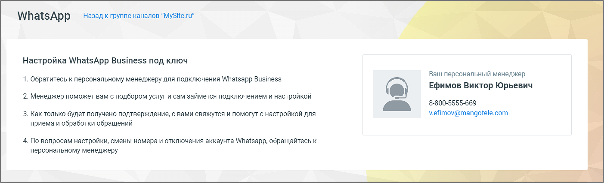
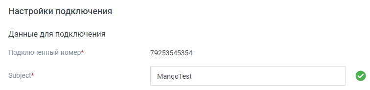
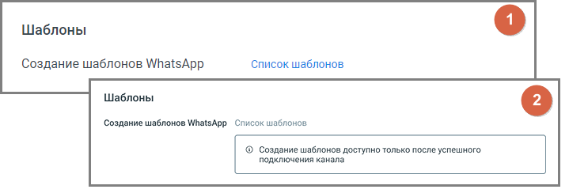
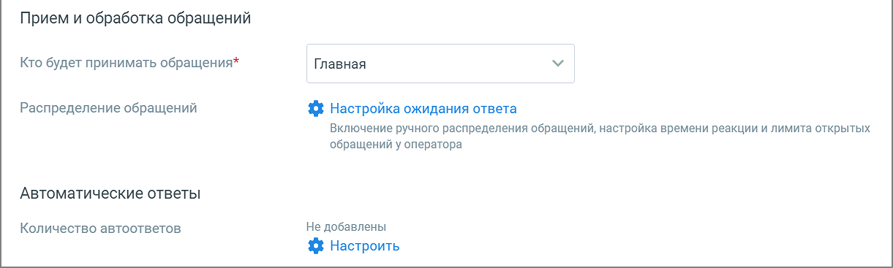

##### WhatsApp

> Трассировка: PDF §4.5.11.2.2 · сквозные стр. 316-320 · источники: ч.2 `kb/sources/mango-lk-manual/LK_manual_v-125-281-566.pdf` с.36-40.

Вы можете настроить прием и отправку сообщений в мессенджере WhatsApp, обратившись к своему персональному менеджеру.

> **Описание иллюстрации LK-§4.5.11.2.2-1** (к §4.5.11.2.2 «WhatsApp», стр. 316; 1403×427 px). Снимок экрана / схема Личного кабинета.
> Относится к тексту руководства: «…Вы можете настроить прием и отправку сообщений в мессенджере WhatsApp, обратившись к своему персональному менеджеру.».
> Текст на изображении (OCR, требует сверки): Назад к группе каналов "MySite.ru"; WhatsApp; Настройка WhatsApp Business под ключ; Ваш персональный менеджер; 1. Обратитесь к персональному менеджеру для подключения Whatsapp Business; Ефимов Виктор Юрьевич; 2. Менеджер поможет вам с подбором услуг и сам займется подключением и настройкой; 8-800-5555-669; v.efimov@mangotele.com; 3. Как только будет получено подтверждение, с вами свяжутся и помогут с настройкой для; приема и обработки обращений; 4. По вопросам настройки, смены номера и отключения аккаунта Whatsapp, обращайтесь к; персональному менеджеру

Виджет доступен только при наличии подключенной в Контакт Центре MANGO OFFICE услуги.

Далее переходите к индивидуальным настройкам канала.

> **Описание иллюстрации LK-§4.5.11.2.2-2** (к §4.5.11.2.2 «WhatsApp», стр. 316; 756×184 px). Снимок экрана / схема Личного кабинета.
> Относится к тексту руководства: «…Далее переходите к индивидуальным настройкам канала.».
> Текст на изображении (OCR, требует сверки): Настройки подключения; Данные для подключения; Подключенный номер*; 79253545354; Subject*; MangoTest

 Данные для подключения – данные для заполнения поля «Subject» предоставляет ваш персональный менеджер. Номер телефона добавляется автоматически.

> **Описание иллюстрации LK-§4.5.11.2.2-3** (к §4.5.11.2.2 «WhatsApp», стр. 316; 719×244 px). Снимок экрана / схема Личного кабинета.
> Относится к тексту руководства: «… Данные для подключения – данные для заполнения поля «Subject» предоставляет ваш персональный менеджер. Номер телефона добавляется автоматически.».
> Текст на изображении (OCR, требует сверки): Шаблоны; Создание шаблонов WhatsApp; Список шаблонов; Создание шаблонов WhatsApp Список шаблонов; © Создание шаблонов доступно только после успешного; подключения канала

1 – вид блока «Шаблоны» в ранее сохраненном канале

2 – вид блока «Шаблоны» в новом канале

Шаблоны – нажатие на кнопку «Список шаблонов» открывает окно «Шаблоны WhatsApp» Личного кабинета. Здесь вы можете просмотреть список существующих шаблонов, добавить новый, архивировать существующий шаблон, отредактировать или удалить черновик шаблона. Подробнее о создании шаблонов в разделе «Шаблоны WatsApp» настоящего документа.

> **Описание иллюстрации LK-§4.5.11.2.2-4** (к §4.5.11.2.2 «WhatsApp», стр. 317; 1221×367 px). Снимок экрана / схема Личного кабинета.
> Относится к тексту руководства: «… архивировать существующий шаблон, отредактировать или удалить черновик шаблона. Подробнее о создании шаблонов в разделе «Шаблоны WatsApp» настоящего документа.».
> Текст на изображении (OCR, требует сверки): Прием и обработка обращений; Кто будет принимать обращения*; Главная; Распределение обращений; {$ Настройка ожидания ответа; Включение ручного распределения обращений, настройка времени реакции и лимита открытых; обращений у оператора; Автоматические ответы; Количество автоответов; Не добавлены; % Настроить

 Прием и обработка обращений

o Кто будет принимать обращение – сотрудник, чат-бот или группа, которые

будут обрабатывать поступившие звонки. При выборе варианта «группа» доступна настройка «Распределения обращений»; При выборе варианты «чат-бот» будет доступен выбор Резервного сотрудника или группы, на которых будут переводиться обращения в случае недоступности чат-бота.

В списке доступны все группы и сотрудники ЛК ВАТС (включая сотрудников-роботов), а также все чат-боты модуля «Роботы MANGO OFFICE» robot.mango-office.ru.

o Распределение обращений - распределение обращений устанавливается

в соответствующем разделе Личного кабинета пользователя ВАТС.

При подключенном чат-боте в WhatsApp можно переводить звонковые и текстовые обращения из модуля «Роботы» MANGO OFFICE, используя настроенные шаблоны WhatsApp HSM. При этом в Контакт-центре будет создано закрытое обращение с параметром: "Сотрудник": "имя чат-бота".

Также при подключенном чат-боте можно настраивать кнопки быстрых ответов. Кнопки отображаются в ленте диалога пользователя, а также в Контакт-центре сотрудника, ведущего диалог. Как настраиваются кнопки чат-бота узнайте в Справке Роботов MANGO OFFICE, пункт «Задать несколько вариантов ответа» → Кнопки в тексте и Кнопки клавиатуры.

 Автоматические ответы

o Приветствия – количество настроенных для канала автоматических ответов.

o Нажатие на кнопку «Настроить» открывает окно настройки автоответов.

> **Описание иллюстрации LK-§4.5.11.2.2-5** (к §4.5.11.2.2 «WhatsApp», стр. 318; 937×610 px). Снимок экрана / схема Личного кабинета.
> Относится к тексту руководства: «…o Нажатие на кнопку «Настроить» открывает окно настройки автоответов.».
> Текст на изображении (OCR, требует сверки): Автоматические ответы; Укажите текст сообщения и время, через которое оно отправится клиенту в ответ Ha его сообщение; © Через какое время отправить:; @ Осек; 10 сек; 30 сек; 1 мин; Введите текст сообщения; 0/250; © добавить автоматический ответ

В окне настроек необходимо ввести текст автоответа и отметить время, через которое клиент увидит автоответ в окне чата с оператором.

Нажатие на кнопку «Добавить автоматический ответ» открывает окно добавления следующего автоматического ответа.

Сохраните внесенные изменения кнопкой Применить.

> **Описание иллюстрации LK-§4.5.11.2.2-6** (к §4.5.11.2.2 «WhatsApp», стр. 318; 623×148 px). Снимок экрана / схема Личного кабинета.
> Относится к тексту руководства: «…Сохраните внесенные изменения кнопкой Применить.».
> Текст на изображении (OCR, требует сверки): @ ) Показывать сообщение при закрытии обращения; Спасибо за ваше обращение; 25/250

 Показывать сообщение при закрытии обращения

При активации опции «Показывать сообщение при закрытии обращения» клиенту будет отображаться установленное сообщение при завершении обращения.

Текст сообщения: Введите текст в поле под переключателем. Сообщение o будет отправлено клиенту после закрытия обращения. Максимальная длина текста — 250 символов.

Сообщение будет показано в случаях закрытия обращения оператором, o автоматического завершения чат-ботом или по истечении тайм-аута.

 Клиентская оценка качества

Нажатие на кнопку «Настроить» открывает окно «Настройки группы каналов» для продолжения настроек оценки качества работы оператора по заданным правилам. Клиентская оценка качества будет доступна, если в Личном кабинете подключен модуль «Контроль качества».

 Чекбокс «Отображать номер заявки для коллтрекинга» - позволяет включить или выключить передачу данных для сквозной аналитики динамического коллтрекинга, а также указать номер заявки и текст вопроса.

o Сценарий использования: Пользователь, находясь в виджете, выбирает

опцию перехода в WhatsApp, после чего переходит в приложение WhatsApp. В поле для ввода сообщения автоматически подставляется текст вопроса.

ВНИМАНИЕ

Для использования данной опции виджеты динамического коллтрекинга и мультиканального чата должны быть связаны между собой. Таким образом они смогут обмениваться данными. Для настройки интеграции последовательно перейдите в раздел Коллтрекинг → Обзорная панель → Блок Интеграции → «Текстовые коммуникации» и добавьте один или несколько виджетов Диалогов.

> **Описание иллюстрации LK-§4.5.11.2.2-7** (к §4.5.11.2.2 «WhatsApp», стр. 319; 1141×536 px). Снимок экрана / схема Личного кабинета.
> Относится к тексту руководства: «…и последовательно перейдите в раздел Коллтрекинг → Обзорная панель → Блок Интеграции → «Текстовые коммуникации» и добавьте один или несколько виджетов Диалогов.».
> Текст на изображении (OCR, требует сверки): & Обработка звонков; Ae Сотрудники; $ Общие настройки; @ Финансы; Email трекинг; Д уведомления; настройка; IMAP; eb ari; fff остальные настройки; Интеграции; ин; amoCRM; ‘Сделки Mango; 1c; © яздксметрика; Scitylana; Office; © инфоклиника; Albato; Мегаплан; Яндекс.Директ; © Roistat; © мерквиз; ФФ Facebook Pixel; Google Analytics; Jivosite; 1с Fresh; Flexbe; Universal; © визнесвконтась; Power Bl; Заявки с сайта; (©) VicPexnama; origami; Ver 4; Обращения в; $ MyTarget ads; Обратный звонок; Битрикс24.; мессенджеры; © owox; `Манго Ди:

Нерабочее время

Если на ВАТС подключена услуга «Чат-боты», в блоке "Нерабочее время" отображается выпадающий список доступных чат-ботов.

Также в блоке настраивается возможность отправлять автоответы в нерабочее время, чтобы оставаться на связи с посетителями на сайте.

> **Описание иллюстрации LK-§4.5.11.2.2-8** (к §4.5.11.2.2 «WhatsApp», стр. 320; 1254×666 px). Снимок экрана / схема Личного кабинета.
> Относится к тексту руководства: «…Также в блоке настраивается возможность отправлять автоответы в нерабочее время, чтобы оставаться на связи с посетителями на сайте.».
> Текст на изображении (OCR, требует сверки): Нерабочее время; [ ©) Прием обращений чат-ботом в нерабочее время; Нерабомчее время; Выберите чат-бота; Прием обращений чат-ботом в нерабочее время; Включить автоответ в нерабочее время; В нерабочее время операторов все обращения будут попадать в очередь обращений.; На следующий рабочий день операторы могут вручную брать обращения из очереди; ® > включить автоответ в нерабочее время; К сожалению, мы не можем ответить прямо сейчас. Оставьте свои контактные; данные и мы свяжемся с вами в ближайшее время.; 119/250

Ознакомьтесь с информационным уведомлением о правилах работы с сообщениями в нерабочее время.

Невозможно одновременно использовать оба переключателя – чат-бот и автоответы.

На вкладке «Общие настройки» проставьте период для автоматического завершения диалогов:

> **Описание иллюстрации LK-§4.5.11.2.2-9** (к §4.5.11.2.2 «WhatsApp», стр. 320; 964×266 px). Снимок экрана / схема Личного кабинета.
> Относится к тексту руководства: «…На вкладке «Общие настройки» проставьте период для автоматического завершения диалогов:».
> Текст на изображении (OCR, требует сверки): Общие настройки; Автоматическое завершение диалогов; Закрывать неактивный; д м; диалог через ($)

Сохранить – кликом по кнопке сохраните внесенные изменения.

Отключить канал – после дополнительного согласия на отключение канал связи отключается.
