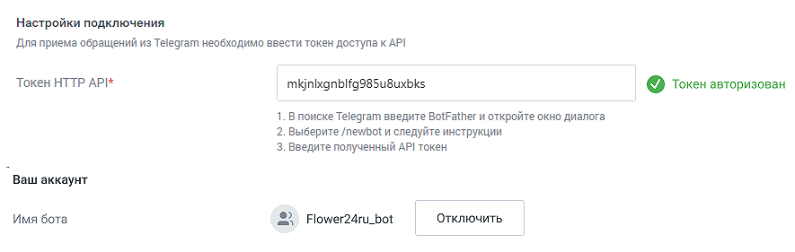
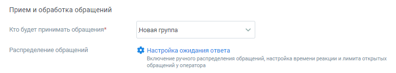
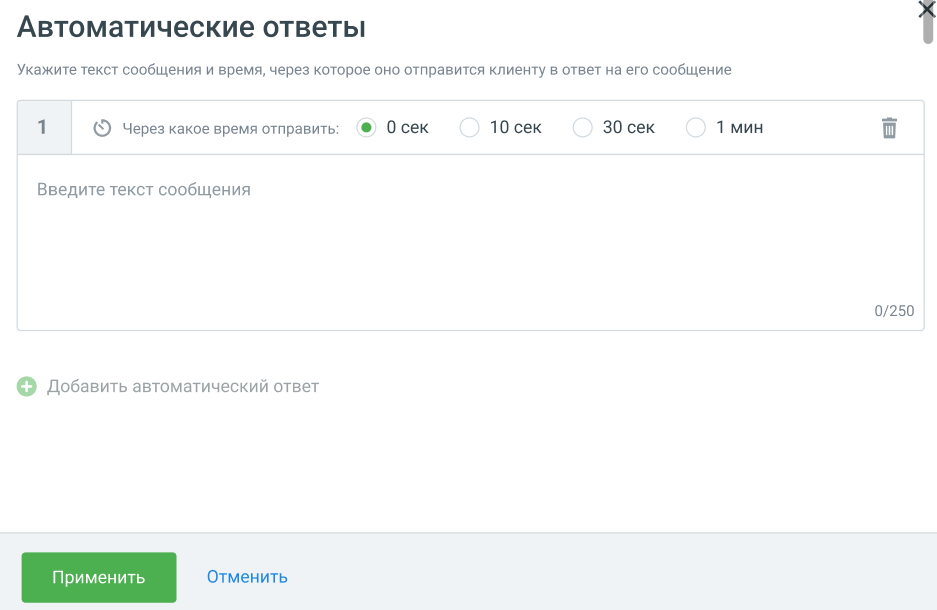
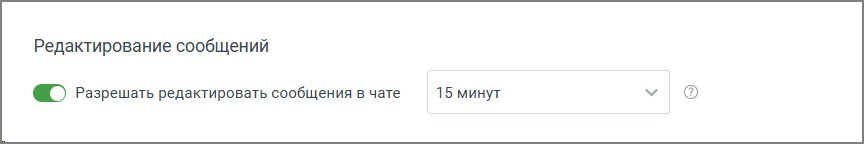

##### Telegram

> Трассировка: PDF §4.5.11.2.2 · сквозные стр. 320-325 · источники: ч.2 `kb/sources/mango-lk-manual/LK_manual_v-125-281-566.pdf` с.40-45.

В данном блоке осуществляется настройка приема сообщений, которые клиенты отправляют через мессенджер Telegram.

Переходите к индивидуальным настройкам канала.

> **Описание иллюстрации LK-§4.5.11.2.2-1** (к §4.5.11.2.2 «Telegram», стр. 321; 885×281 px). Снимок экрана / схема Личного кабинета.
> Относится к тексту руководства: «…Переходите к индивидуальным настройкам канала.».
> Текст на изображении (OCR, требует сверки): Настройки подключения; Для приема обращений из Telegram необходимо ввести токен доступа к АР!; Токен HTTP API*; mkjnixgnblfg98S5u8uxbks; @ Токен авторизован; 1. В поиске Telegram введите BotFather и откройте окно диалога; 2. Выберите /newbot и следуйте инструкции; 3. Введите полученный АР! токен; Ваш аккаунт; Имя бота; © Flower24ru_bot; Отключить

Чтобы принимать сообщения из Telegram, укажите:

 Настройки подключения o Токен HTTP API – в данное поле следует вставить токен, полученный в

Telegram;

Для получения токена выполните следующие действия:

 Откройте Telegram, найдите бота @botfather и откройте с ним диалог;

 В диалоговом окне нажмите кнопку СТАРТ;

 В появившемся списке выберите команду /newbot;

 Далее последовательно укажите имя и юзернейм Вашего бота. Юзернейм должен быть уникальным и оканчиваться на "bot" (например, MangoBot или mango_bot);

 После создания бота вы получите токен для HTTP API.

Скопируйте полученный токен для HTTP API в соответствующее поле формы настроек подключения канала Telegram виджета.

 Ваш аккаунт

o Имя бота – появится автоматически после указания токена и нажатия

клавиши Enter. Если вы указали неверный токен, то появится надпись "Бот не найден".

> **Описание иллюстрации LK-§4.5.11.2.2-2** (к §4.5.11.2.2 «Telegram», стр. 321; 813×150 px). Снимок экрана / схема Личного кабинета.
> Относится к тексту руководства: «…клавиши Enter. Если вы указали неверный токен, то появится надпись "Бот не найден".».
> Текст на изображении (OCR, требует сверки): Прием и обработка обращений; Кто будет принимать обращения*; Новая группа; Распределение обращений; {$ Настройка ожидания ответа; Включение ручного распределения обращений, настройка времени реакции и лимита открытых; ‘обращений у оператора

 Прием и обработка обращений

o Кто будет принимать обращение – сотрудник, чат-бот или группа, которые

будут обрабатывать поступившие звонки. При выборе варианта «группа» доступна настройка «Распределение обращений». При выборе варианта «чат-бот» система предложит выбрать сотрудника или группу для приема обращений при недоступности чат-бота.

o Распределение обращений» – настройка устанавливается в соответствующем разделе Личного кабинета пользователя ВАТС.

При подключенном чат-боте в Telegram можно настраивать кнопки быстрых ответов. Кнопки отображаются в ленте диалога пользователя, а также в Контакт-центре сотрудника, ведущего диалог. Как настраиваются кнопки чат-бота узнайте в Справке Роботов MANGO OFFICE, пункт «Задать несколько вариантов ответа» → Кнопки в тексте и Кнопки клавиатуры.

Если ответ оператора не отправляется по причине блокирования чат-бота пользователем, оператор Контакт-центра уведомляется об этом системным сообщением.

 Автоматические ответы

o Количество автоответов – количество настроенных для канала автоматических

ответов.

o Нажатие на кнопку «Настроить» открывает окно настройки автоответов.

> **Описание иллюстрации LK-§4.5.11.2.2-3** (к §4.5.11.2.2 «Telegram», стр. 322; 937×610 px). Снимок экрана / схема Личного кабинета.
> Относится к тексту руководства: «…o Нажатие на кнопку «Настроить» открывает окно настройки автоответов.».
> Текст на изображении (OCR, требует сверки): Автоматические ответы; Укажите текст сообщения и время, через которое оно отправится клиенту в ответ Ha его сообщение; © Через какое время отправить:; @ Осек; 10 сек; 30 сек; 1 мин; Введите текст сообщения; 0/250; © добавить автоматический ответ

В окне настроек необходимо ввести текст автоответа и отметить время, через которое клиент увидит автоответ в окне чата с оператором.

Нажатие на кнопку «Добавить автоматический ответ» открывает окно добавления следующего автоматического ответа.

Сохраните внесенные изменения кнопкой Применить.

> **Описание иллюстрации LK-§4.5.11.2.2-4** (к §4.5.11.2.2 «Telegram», стр. 323; 623×148 px). Снимок экрана / схема Личного кабинета.
> Относится к тексту руководства: «…Сохраните внесенные изменения кнопкой Применить.».
> Текст на изображении (OCR, требует сверки): @ ) Показывать сообщение при закрытии обращения; Спасибо за ваше обращение; 25/250

 Показывать сообщение при закрытии обращения

При активации опции «Показывать сообщение при закрытии обращения» клиенту будет отображаться установленное сообщение при завершении обращения.

Текст сообщения: Введите текст в поле под переключателем. Сообщение o будет отправлено клиенту после закрытия обращения. Максимальная длина текста — 250 символов. Сообщение будет показано в случаях закрытия обращения оператором, o автоматического завершения чат-ботом или по истечении тайм-аута.

 Редактирование сообщений – в канале Telegram. реализована возможность редактирования сообщений оператора. Переключатель активации позволяет включить или отключить возможность редактирования. При активации редактирование становится доступным в заданном временном интервале.5, 10, 15, 30 и 60 минут.

> **Описание иллюстрации LK-§4.5.11.2.2-5** (к §4.5.11.2.2 «Telegram», стр. 323; 864×144 px). Снимок экрана / схема Личного кабинета.
> Относится к тексту руководства: «…ет включить или отключить возможность редактирования. При активации редактирование становится доступным в заданном временном интервале.5, 10, 15, 30 и 60 минут.».
> Текст на изображении (OCR, требует сверки): Редактирование сообщений; @ ) Разрешать редактировать сообщения в чате; 15 минут

 Клиентская оценка качества

Нажатие на кнопку «Настроить» открывает окно «Настройки группы каналов» для продолжения настроек оценки качества работы оператора по заданным правилам. Клиентская оценка качества будет доступна, если в Личном кабинете подключен модуль «Контроль качества».

Вы можете отслеживать количество обращений по виджету «Текстовые коммуникации» в канале Telegram. Для использования данной опции виджеты динамического коллтрекинга и мультиканального чата должны быть связаны между собой. Таким образом они смогут обмениваться данными. Для настройки интеграции

последовательно перейдите в раздел Коллтрекинг → Обзорная панель → Блок Интеграции → «Текстовые коммуникации» и добавьте один или несколько виджетов Диалогов.

 Нерабочее время

Если на ВАТС подключена услуга «Чат-боты», в блоке "Нерабочее время" отображается выпадающий список доступных чат-ботов.

Также в блоке настраивается возможность отправлять автоответы в нерабочее время, чтобы оставаться на связи с посетителями на сайте.

> **Описание иллюстрации LK-§4.5.11.2.2-6** (к §4.5.11.2.2 «Telegram», стр. 324; 1254×666 px). Снимок экрана / схема Личного кабинета.
> Относится к тексту руководства: «…Также в блоке настраивается возможность отправлять автоответы в нерабочее время, чтобы оставаться на связи с посетителями на сайте.».
> Текст на изображении (OCR, требует сверки): Нерабочее время; [ ©) Прием обращений чат-ботом в нерабочее время; Нерабомчее время; Выберите чат-бота; Прием обращений чат-ботом в нерабочее время; Включить автоответ в нерабочее время; В нерабочее время операторов все обращения будут попадать в очередь обращений.; На следующий рабочий день операторы могут вручную брать обращения из очереди; ® > включить автоответ в нерабочее время; К сожалению, мы не можем ответить прямо сейчас. Оставьте свои контактные; данные и мы свяжемся с вами в ближайшее время.; 119/250

Ознакомьтесь с информационным уведомлением о правилах работы с сообщениями в нерабочее время.

Невозможно одновременно использовать оба переключателя – чат-бот и автоответы.

На вкладке «Общие настройки» проставьте период для автоматического завершения диалогов:

> **Описание иллюстрации LK-§4.5.11.2.2-7** (к §4.5.11.2.2 «Telegram», стр. 324; 964×266 px). Снимок экрана / схема Личного кабинета.
> Относится к тексту руководства: «…На вкладке «Общие настройки» проставьте период для автоматического завершения диалогов:».
> Текст на изображении (OCR, требует сверки): Общие настройки; Автоматическое завершение диалогов; Закрывать неактивный; д м; диалог через ($)

 Автоматическое завершение диалогов

o Закрывать неактивный диалог через – время в часах или днях, по истечении

которого обращение автоматически закрывается. Значение поля должно быть больше нуля.

Сохранить – кликом по кнопке сохраните внесенные изменения.

Отключить канал – после дополнительного согласия на отключение канал связи отключается.
