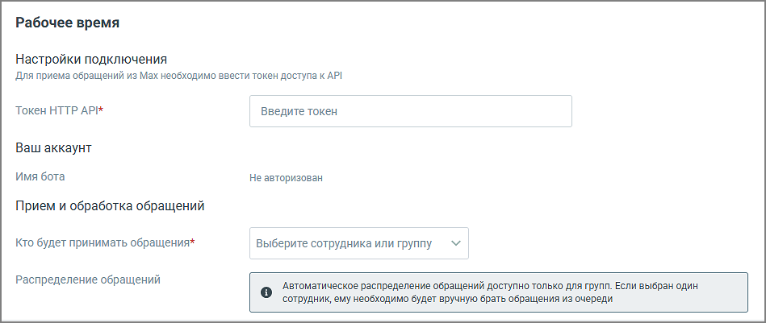

##### 3. Переход к настройкам

> Трассировка: PDF §4.5.11.2.2 · сквозные стр. 326 · источники: ч.2 `kb/sources/mango-lk-manual/LK_manual_v-125-281-566.pdf` с.46.

Нажмите «Настроить и подключить». Откроется страница настроек подключения.

> **Описание иллюстрации LK-§4.5.11.2.2-1** (к §4.5.11.2.2 «3. Переход к настройкам», стр. 326; 949×401 px). Снимок экрана / схема Личного кабинета.
> Относится к тексту руководства: «…Нажмите «Настроить и подключить». Откроется страница настроек подключения.».
> Текст на изображении (OCR, требует сверки): Рабочее время; Настройки подключения; Для приема обращений из Мах необходимо ввести токен доступа к АР!; Token HTTP API*; Введите токен; Ваш аккаунт; Имя бота; Не авторизован; Прием и обработка обращений; кто будет принимать обращения*; Выберите сотрудника или группу; Распределение обращений; ‘Автоматическое распределение обращений доступно только для групп. Если выбран один; ‘сотрудник, ему необходимо будет вручную брать обращения из очереди
