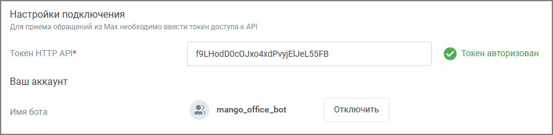

##### 4. Подключение токена Max

> Трассировка: PDF §4.5.11.2.2 · сквозные стр. 326-327 · источники: ч.2 `kb/sources/mango-lk-manual/LK_manual_v-125-281-566.pdf` с.46-47.

1. В поле «Токен HTTP API» вставьте токен, полученный в MAX.

2. Нажмите «Сохранить».

После проверки токена плашка канала перейдёт в состояние «Токен авторизован».

> **Описание иллюстрации LK-§4.5.11.2.2-1** (к §4.5.11.2.2 «4. Подключение токена Max», стр. 327; 904×221 px). Снимок экрана / схема Личного кабинета.
> Относится к тексту руководства: «…После проверки токена плашка канала перейдёт в состояние «Токен авторизован».».
> Текст на изображении (OCR, требует сверки): Настройки подключения; Для приема обращений из Мах необходимо ввести токен доступа к АР!; Token HTTP API*; 9LHodDOcOJxodxdPvyjEleLS5FB; © Toxex авторизован; Ваш аккаунт; Имя бота; mango_office_bot; ‘Отключить
