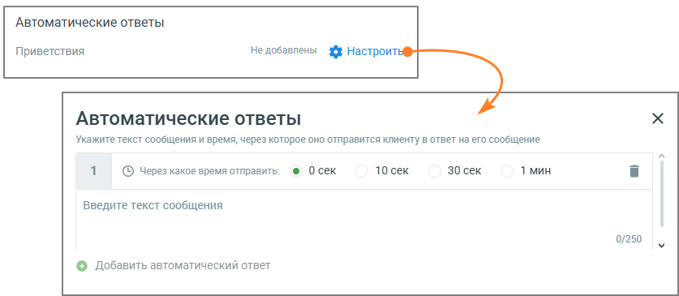

##### 6. Автоматические ответы

> Трассировка: PDF §4.5.11.2.2 · сквозные стр. 327-328 · источники: ч.2 `kb/sources/mango-lk-manual/LK_manual_v-125-281-566.pdf` с.47-48.

Для повышения лояльности клиентов и удобства работы операторов следует указать один или несколько Автоматических ответов.

> **Описание иллюстрации LK-§4.5.11.2.2-1** (к §4.5.11.2.2 «6. Автоматические ответы», стр. 327; 837×365 px). Снимок экрана / схема Личного кабинета.
> Относится к тексту руководства: «…Для повышения лояльности клиентов и удобства работы операторов следует указать один или несколько Автоматических ответов.».
> Текст на изображении (OCR, требует сверки): Автоматические ответы; Приветствия; Не добавлены 3% Настроить; Укажите текст сообщения и время, через которое оно отправится клиенту в ответ на его сообщение; ® Осек; 10 сек; 30 сек; 1 мин; (© Через какое время отправить:; Введите текст сообщения; 0/250; © Добавить автоматический ответ

Рекомендуется использовать автоответы, чтобы убедить клиента дождаться ответа оператора в пиковые часы нагрузки (когда все сотрудники заняты) или когда оператор отсутствует на рабочем месте.

 Автоматические ответы - нажатие на кнопку Настроить открывает окно настроек автоматического ответа;

 Через какое время отправить - время с момента обращения пользователя и до отображения ему автоответа;

 Текст сообщения – максимальное количество символов 250.

Пользователь может добавить несколько автоматических ответов и настроить периодичность отображения каждого.

Сообщения автоответов сохраняются в истории обращения, только если пользователь написал в чате свое сообщение.
