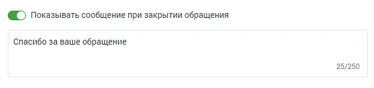

##### 7. Показывать сообщение при закрытии обращения

> Трассировка: PDF §4.5.11.2.2 · сквозные стр. 328 · источники: ч.2 `kb/sources/mango-lk-manual/LK_manual_v-125-281-566.pdf` с.48.

> **Описание иллюстрации LK-§4.5.11.2.2-1** (к §4.5.11.2.2 «7. Показывать сообщение при закрытии обращения», стр. 328; 623×148 px). Снимок экрана / схема Личного кабинета.
> Относится к тексту руководства: «…начало раздела».
> Текст на изображении (OCR, требует сверки): @ ) Показывать сообщение при закрытии обращения; Спасибо за ваше обращение; 25/250

При активации опции «Показывать сообщение при закрытии обращения» клиенту будет отображаться установленное сообщение при завершении обращения.

 Текст сообщения: Введите текст в поле под переключателем. Сообщение будет отправлено клиенту после закрытия обращения. Максимальная длина текста — 250 символов.  Сообщение будет показано в случаях закрытия обращения оператором, автоматического завершения чат-ботом или по истечении тайм-аута.
