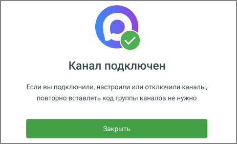

##### 10. Завершение подключения

> Трассировка: PDF §4.5.11.2.2 · сквозные стр. 329-330 · источники: ч.2 `kb/sources/mango-lk-manual/LK_manual_v-125-281-566.pdf` с.49-50.

Проверьте настройки и нажмите «Сохранить». Отображается сообщение об успешной настройке канала.

> **Описание иллюстрации LK-§4.5.11.2.2-1** (к §4.5.11.2.2 «10. Завершение подключения», стр. 330; 463×281 px). Снимок экрана / схема Личного кабинета.
> Относится к тексту руководства: «…Проверьте настройки и нажмите «Сохранить». Отображается сообщение об успешной настройке канала.».
> Текст на изображении (OCR, требует сверки): Канал подключен; Если вы подключили, настроили или отключили каналы,; повторно вставлять код группы каналов не нужно; Закрыть
