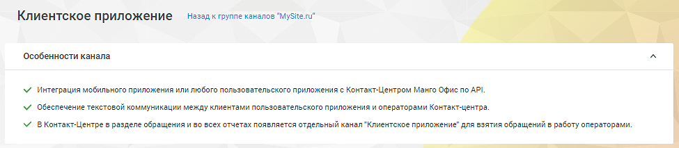
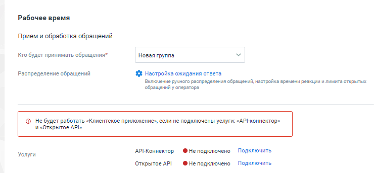
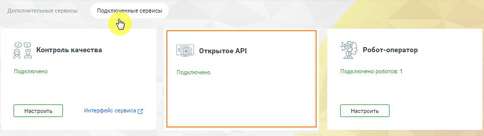

##### Клиентское приложение

> Трассировка: PDF §4.5.11.2.2 · сквозные стр. 330-333 · источники: ч.2 `kb/sources/mango-lk-manual/LK_manual_v-125-281-566.pdf` с.50-53.

Перед началом настройки ознакомьтесь с особенностями канала.

> **Описание иллюстрации LK-§4.5.11.2.2-1** (к §4.5.11.2.2 «Клиентское приложение», стр. 330; 975×213 px). Снимок экрана / схема Личного кабинета.
> Относится к тексту руководства: «…Перед началом настройки ознакомьтесь с особенностями канала.».
> Текст на изображении (OCR, требует сверки): Клиентское приложение; Назад к группе каналов "MySite."; ‘Особенности канала; У интеграция мобильного приложения или любого пользовательского приложения с Контакт-Центром Манго Офис по API.; М обеспечение текстовой коммуникации между клиентами пользовательского приложения и операторами Контакт-центра.; У ВКонтакт-Центре в разделе обращения и во всех отчетах появляется отдельный канал Клиентское приложение" для взятия обращений в работу операторами.

В канале «Клиентское приложение» также есть возможность передавать файлы: изображение, аудио, видео, документы. Пользователь и оператор могут видеть статусы своих сообщений: набор текста, отправляется, отправлено, не отправлено с ошибкой, доставлено, прочитано.

> **Описание иллюстрации LK-§4.5.11.2.2-2** (к §4.5.11.2.2 «Клиентское приложение», стр. 331; 740×344 px). Снимок экрана / схема Личного кабинета.
> Относится к тексту руководства: «…документы. Пользователь и оператор могут видеть статусы своих сообщений: набор текста, отправляется, отправлено, не отправлено с ошибкой, доставлено, прочитано.».
> Текст на изображении (OCR, требует сверки): Рабочее время; Прием и обработка обращений; Кто будет принимать обращения*; Новая группа; Распределение обращений; {$ Настройка ожидания ответа; Включение ручного распределения обращений, настройка еремени реакции и лимита открытых; обращений у оператора; < Не будет работать «Клиентское приложение», если не подключены услуги: «АР|-коннектор»; И «Открытое API»; Услуги; АР!-Коннектор ФНе подключено Подключить; Открытое АР!; ® Не подключено Подключить

Далее переходите к индивидуальным настройкам канала.

Для рабочего времени на вкладке указываются:

 Прием и обработка обращений

o Кто будет принимать обращение – сотрудник, чат-бот или группа, которые

будут обрабатывать поступившие звонки. При выборе варианта «группа» доступна настройка «Распределение обращений». Если чекбокс «Резервный сотрудник или группа» отмечен, на них будут отправляться сообщения при недоступности чат-бота; o Распределение обращений - распределение обращений и настройки

ожидания ответа устанавливаются в соответствующих разделах Личного кабинета пользователя ВАТС.  Услуги – для корректной работы канала необходимо подключить обе услуги. После подключения иконка статуса услуги изменит цвет на зеленый.

o API-Коннектор – нажатие на кнопку Подключить открывает окно

Интеграции/ API коннектор в Личном кабинете пользователя ВАТС. Подробнее о подключении API коннектора узнайте в разделе «API Коннектор». o Открытое API – нажатие на кнопку Подключить открывает окно

подключения сервисов Контакт-центра. После подключения услуга будет отображаться на вкладке «Подключенные сервисы».

> **Описание иллюстрации LK-§4.5.11.2.2-3** (к §4.5.11.2.2 «Клиентское приложение», стр. 332; 963×271 px). Снимок экрана / схема Личного кабинета.
> Относится к тексту руководства: «…подключения сервисов Контакт-центра. После подключения услуга будет отображаться на вкладке «Подключенные сервисы».».
> Текст на изображении (OCR, требует сверки): eo; Контроль качества; Открытое API; Робот-оператор; Подключено; Подключено posoros: 1; интерфейс сервиса [7

Для получения дополнительных сведений смотрите Руководство по API MANGO OFFICE.

Клиентская оценка качества – нажатие на кнопку «Настроить» открывает окно «Настройки группы каналов» для продолжения настроек оценки качества работы оператора по заданным правилам. Клиентская оценка качества будет доступна, если в Личном кабинете подключен модуль «Контроль качества».

Нерабочее время

Если на ВАТС подключена услуга «Чат-боты», в блоке "Нерабочее время" отображается выпадающий список доступных чат-ботов.

Также в блоке настраивается возможность отправлять автоответы в нерабочее время, чтобы оставаться на связи с посетителями на сайте.

> **Описание иллюстрации LK-§4.5.11.2.2-4** (к §4.5.11.2.2 «Клиентское приложение», стр. 332; 1254×666 px). Снимок экрана / схема Личного кабинета.
> Относится к тексту руководства: «…Также в блоке настраивается возможность отправлять автоответы в нерабочее время, чтобы оставаться на связи с посетителями на сайте.».
> Текст на изображении (OCR, требует сверки): Нерабочее время; [ ©) Прием обращений чат-ботом в нерабочее время; Нерабомчее время; Выберите чат-бота; Прием обращений чат-ботом в нерабочее время; Включить автоответ в нерабочее время; В нерабочее время операторов все обращения будут попадать в очередь обращений.; На следующий рабочий день операторы могут вручную брать обращения из очереди; ® > включить автоответ в нерабочее время; К сожалению, мы не можем ответить прямо сейчас. Оставьте свои контактные; данные и мы свяжемся с вами в ближайшее время.; 119/250

Если переключатели оставить в положении «выключено», то все обращения попадут в очередь обращений, с последующей ручной обработкой оператором.

> **Описание иллюстрации LK-§4.5.11.2.2-5** (к §4.5.11.2.2 «Клиентское приложение», стр. 333; 964×266 px). Снимок экрана / схема Личного кабинета.
> Относится к тексту руководства: «…Если переключатели оставить в положении «выключено», то все обращения попадут в очередь обращений, с последующей ручной обработкой оператором.».
> Текст на изображении (OCR, требует сверки): Общие настройки; Автоматическое завершение диалогов; Закрывать неактивный; д м; диалог через ($)

На вкладке «Общие настройки» проставьте период для автоматического завершения диалогов:

 Автоматическое завершение диалогов

o Закрывать неактивный диалог через – время в часах или днях, по истечении

которого обращение автоматически закрывается. Значение поля должно быть больше нуля.

Сохранить – кликом по кнопке сохраните внесенные изменения.

Отключить канал – после дополнительного согласия на отключение канал связи отключается.
