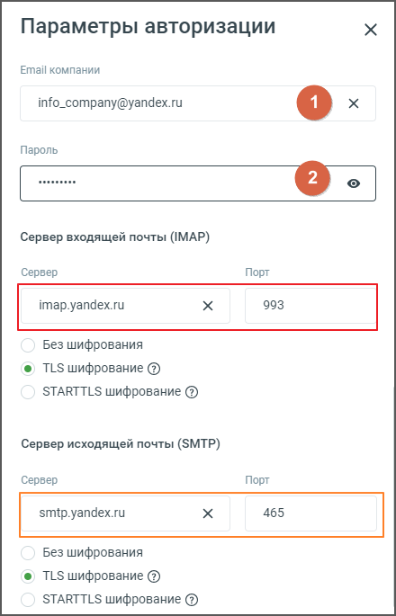
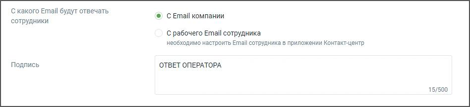

##### Е-mail

> Трассировка: PDF §4.5.11.2.2 · сквозные стр. 333-336 · источники: ч.2 `kb/sources/mango-lk-manual/LK_manual_v-125-281-566.pdf` с.53-56.

В данном блоке осуществляется настройка приема сообщений, которые клиенты отправляют на электронную почту компании.

Переходите к индивидуальным настройкам канала.

> **Описание иллюстрации LK-§4.5.11.2.2-1** (к §4.5.11.2.2 «Е-mail», стр. 333; 902×198 px). Снимок экрана / схема Личного кабинета.
> Относится к тексту руководства: «…Переходите к индивидуальным настройкам канала.».
> Текст на изображении (OCR, требует сверки): Авторизация; Настройки подключения; Email компаниии; mail@company.ru; Укажите Email, на который будут приходить письма OT ваших клиентов.

Для подключения канала e-mail следует указать:

 Настройки подключения

o E-mail компании – в данном поле необходимо указать электронную почту

компании и авторизовать её. Для этого, после ввода адреса почты, нажать «+АВТОРИЗОВАТЬСЯ» и в открывшейся форме ввести данные почтового аккаунта.

ПРИМЕР: Для почтового аккаунта info_company@yandex.ru поля серверов входящей и исходящей почты должны быть заполнены следующими данными:

> **Описание иллюстрации LK-§4.5.11.2.2-2** (к §4.5.11.2.2 «Е-mail», стр. 334; 440×685 px). Снимок экрана / схема Личного кабинета.
> Относится к тексту руководства: «…ПРИМЕР: Для почтового аккаунта info_company@yandex.ru поля серверов входящей и исходящей почты должны быть заполнены следующими данными:».
> Текст на изображении (OCR, требует сверки): Параметры авторизации; Email компании; info_company@yandex.ru; Пароль; | зан; Сервер входящей почты (IMAP); Сервер; Порт; imap.yandex.ru; 993; Без шифрования; ® TLS шифрование (3); STARTTLS шифрование (3); Сервер исходящей почты (SMTP); smtp.yandex.ru; 465

Где:

1 — поле для размещения адреса электронной почты.

2 — поле для размещения пароля от электронной почты.

внимание

Если не удалось авторизовать указанный почтовый аккаунт, проверьте, не установлен ли для него пароль для приложений. Если такой пароль установлен, то в поле (2) необходимо вводить именно его:

 Пароли для внешних приложений | Яндекс ID (yandex.ru)  Пароли для внешних приложений | Mail.ru

Сервис электронной почты от Google — Gmail — имеет свои особенности: письма с вложениями могут доставляться через API с задержкой от 5 до 20 минут.

> **Описание иллюстрации LK-§4.5.11.2.2-3** (к §4.5.11.2.2 «Е-mail», стр. 335; 957×193 px). Снимок экрана / схема Личного кабинета.
> Относится к тексту руководства: «…Сервис электронной почты от Google — Gmail — имеет свои особенности: письма с вложениями могут доставляться через API с задержкой от 5 до 20 минут.».
> Текст на изображении (OCR, требует сверки): Прием и обработка обращений; кто будет принимать обращения*; Распределение обращений; {% Настройка автоматического распределения обращений; Включение автоматического распределения обращен; ‘распределения обращений на ответственного; оператора, настройка времени реакции и лимита открытых обращений у оператора.

 Прием и обработка обращений

Кто будет принимать обращение — сотрудник или группа, которые будут o обрабатывать поступившие звонки. При выборе варианта «группа» доступна настройка «Распределение обращений»; Распределение обращений — настройки распределения обращений o устанавливаются в соответствующих разделах Личного кабинета пользователя ВАТС.

> **Описание иллюстрации LK-§4.5.11.2.2-4** (к §4.5.11.2.2 «Е-mail», стр. 335; 948×217 px). Снимок экрана / схема Личного кабинета.
> Относится к тексту руководства: «…деление обращений»; Распределение обращений — настройки распределения обращений o устанавливаются в соответствующих разделах Личного кабинета пользователя ВАТС.».
> Текст на изображении (OCR, требует сверки): С какого Email будут отвечать; © СЕтаЙ компании; сотрудники; С рабочего Email сотрудника; необходимо настроить Email сотрудника в приложении Контакт-центр; Подпись; ОТВЕТ ОПЕРАТОРА; 15/500

На данном этапе можно выбрать, с какого Email сотрудники будут отправлять ответы клиентам:

С Email компании — сотрудники будут отвечать с общего адреса компании. o С рабочего Email сотрудника — сотрудники будут отправлять ответы o с индивидуального рабочего адреса, указанного в настройках Контакт-центра. Чтобы выбрать этот вариант, необходимо предварительно настроить Email сотрудника в Контакт-центре. В поле «Подпись» можно задать текст, который будет автоматически добавляться в конце каждого отправленного письма. Максимальное количество символов в подписи — 500.

В разделе «Общие настройки» проставьте период для автоматического завершения диалогов:

 Автоматическое завершение диалогов

o Закрывать неактивный диалог через — время в часах или днях,

по истечении которого обращение автоматически закрывается. Значение поля должно быть больше нуля.

При создании виджета доступна опция «Каждое входящее письмо — новое обращение». При активации данной настройки для каждого входящего сообщения будет создаваться отдельное новое обращение, а предыдущая переписка будет автоматически включаться в тело письма при ответе.

совет

Для подключения данной опции обратитесь к Персональному менеджеру.

Сохранить – кликом по кнопке сохраните внесенные изменения.

Отключить канал – после дополнительного согласия на отключение канал связи отключается.
