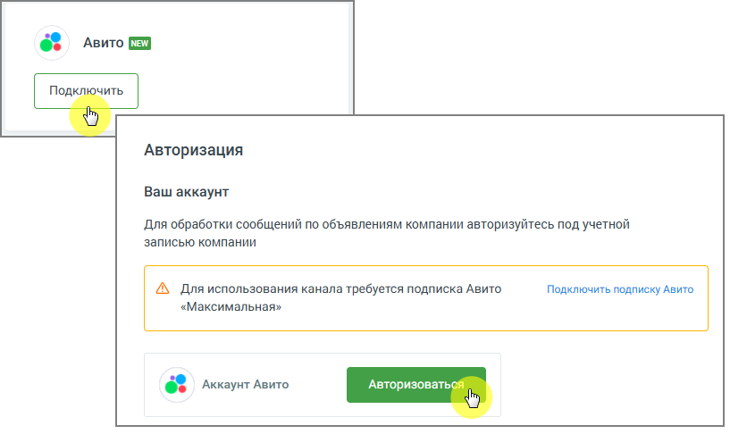
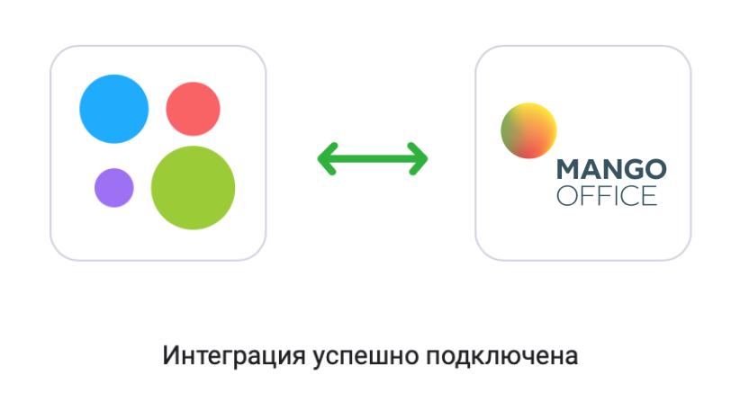
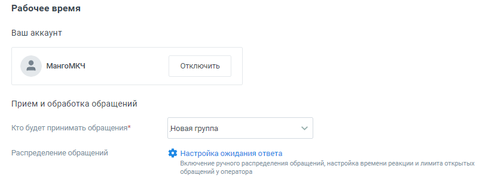
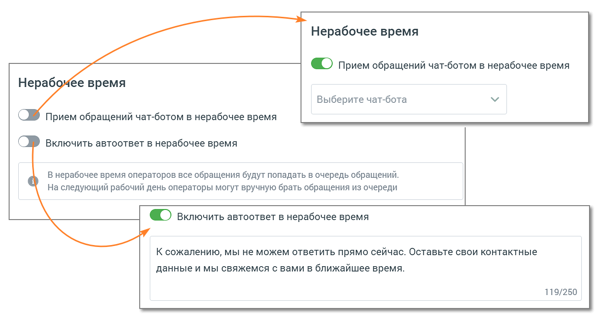

##### Aвито

> Трассировка: PDF §4.5.11.2.2 · сквозные стр. 336-341 · источники: ч.2 `kb/sources/mango-lk-manual/LK_manual_v-125-281-566.pdf` с.56-61.

Вы можете настроить прием сообщений, которые клиенты отправляют на ваш аккаунт Авито. На канале нет возможности инициировать обращение к клиенту. Доступны только ответы на обращение клиента.

Рабочее время

• Ваш аккаунт

Подключите свой аккаунт Aвито. Для этого последовательно нажмите «Подключить» → «Авторизоваться».

> **Описание иллюстрации LK-§4.5.11.2.2-1** (к §4.5.11.2.2 «Aвито», стр. 337; 817×486 px). Снимок экрана / схема Личного кабинета.
> Относится к тексту руководства: «…Подключите свой аккаунт Aвито. Для этого последовательно нажмите «Подключить» → «Авторизоваться».».
> Текст на изображении (OCR, требует сверки): 6% —Авито Ш; [ mmr; Авторизация; Ваш аккаунт; Для обработки сообщений по объявлениям компании авторизуйтесь под учетной; записью компании; А Для использования канала требуется подписка Авито; Подключить подписку Авито; «Максимальная»; Авторизоватьс; 6 Аккаунт Авито

В открывшемся окне подтвердите разрешение на доступ MANGO OFFICE к содержанию, отправке и удалению сообщений на Авито. После успешного подключения интеграции вы увидите окно.

> **Описание иллюстрации LK-§4.5.11.2.2-2** (к §4.5.11.2.2 «Aвито», стр. 337; 832×457 px). Снимок экрана / схема Личного кабинета.
> Относится к тексту руководства: «…окне подтвердите разрешение на доступ MANGO OFFICE к содержанию, отправке и удалению сообщений на Авито. После успешного подключения интеграции вы увидите окно.».
> Текст на изображении (OCR, требует сверки): МАМСО; OFFICE; Интеграция успешно подключена

На вкладке настроек обновится информация о подключенном аккаунте.

Переходите к индивидуальным настройкам канала.

> **Описание иллюстрации LK-§4.5.11.2.2-3** (к §4.5.11.2.2 «Aвито», стр. 338; 813×304 px). Снимок экрана / схема Личного кабинета.
> Относится к тексту руководства: «…Переходите к индивидуальным настройкам канала.».
> Текст на изображении (OCR, требует сверки): Рабочее время; Ваш аккаунт; Мангомкч; Отключить; Прием и обработка обращений; Кто будет принимать обращения*; Новая группа; Распределение обращений; {$ Настройка ожидания ответа; Включение ручного распределения обращений, настройка времени реакции и лимита открытых; обращений у оператора

Для рабочего времени

 Прием и обработка обращений

o Кто будет принимать обращение – сотрудник, чат-бот или группа, которые

будут обрабатывать поступившие звонки. При выборе варианта «группа» доступна настройка «Распределение обращений»;

В качестве сотрудника можно выбрать чат-бот (если в ЛК ВАТС подключена услуга «Чат-бот»). В этом случае необходимо будет также выбрать резервного сотрудника или группу, на которых будут распределяться обращения в случае недоступности чат-бота.

o Распределение обращений - распределение обращений и настройки

ожидания ответа устанавливаются в соответствующих разделах Личного кабинета пользователя ВАТС.

 Автоматические ответы

o Количество автоответов – количество настроенных для канала автоматических ответов.

o Нажатие на кнопку «Настроить» открывает окно настройки автоответов.

> **Описание иллюстрации LK-§4.5.11.2.2-4** (к §4.5.11.2.2 «Aвито», стр. 339; 937×610 px). Снимок экрана / схема Личного кабинета.
> Относится к тексту руководства: «…o Нажатие на кнопку «Настроить» открывает окно настройки автоответов.».
> Текст на изображении (OCR, требует сверки): Автоматические ответы; Укажите текст сообщения и время, через которое оно отправится клиенту в ответ Ha его сообщение; © Через какое время отправить:; @ Осек; 10 сек; 30 сек; 1 мин; Введите текст сообщения; 0/250; © добавить автоматический ответ

В окне настроек необходимо ввести текст автоответа и отметить время, через которое клиент увидит автоответ в окне чата с оператором.

Нажатие на кнопку «Добавить автоматический ответ» открывает окно добавления следующего автоматического ответа.

Сохраните внесенные изменения кнопкой Применить.

> **Описание иллюстрации LK-§4.5.11.2.2-5** (к §4.5.11.2.2 «Aвито», стр. 339; 623×148 px). Снимок экрана / схема Личного кабинета.
> Относится к тексту руководства: «…Сохраните внесенные изменения кнопкой Применить.».
> Текст на изображении (OCR, требует сверки): @ ) Показывать сообщение при закрытии обращения; Спасибо за ваше обращение; 25/250

 Показывать сообщение при закрытии обращения

При активации опции «Показывать сообщение при закрытии обращения» клиенту будет отображаться установленное сообщение при завершении обращения.

Текст сообщения: Введите текст в поле под переключателем. Сообщение o будет отправлено клиенту после закрытия обращения. Максимальная длина текста — 250 символов. Сообщение будет показано в случаях закрытия обращения оператором, o автоматического завершения чат-ботом или по истечении тайм-аута.

 Клиентская оценка качества

Нажатие на кнопку «Настроить» открывает окно «Настройки группы каналов» для продолжения настроек оценки качества работы оператора по заданным правилам. Клиентская оценка качества будет доступна, если в Личном кабинете подключен модуль «Контроль качества».

 Нерабочее время

Если на ВАТС подключена услуга «Чат-боты», в блоке "Нерабочее время" отображается выпадающий список доступных чат-ботов.

Также в блоке настраивается возможность отправлять автоответы в нерабочее время, чтобы оставаться на связи с посетителями на сайте.

> **Описание иллюстрации LK-§4.5.11.2.2-6** (к §4.5.11.2.2 «Aвито», стр. 340; 1254×666 px). Снимок экрана / схема Личного кабинета.
> Относится к тексту руководства: «…Также в блоке настраивается возможность отправлять автоответы в нерабочее время, чтобы оставаться на связи с посетителями на сайте.».
> Текст на изображении (OCR, требует сверки): Нерабочее время; [ ©) Прием обращений чат-ботом в нерабочее время; Нерабомчее время; Выберите чат-бота; Прием обращений чат-ботом в нерабочее время; Включить автоответ в нерабочее время; В нерабочее время операторов все обращения будут попадать в очередь обращений.; На следующий рабочий день операторы могут вручную брать обращения из очереди; ® > включить автоответ в нерабочее время; К сожалению, мы не можем ответить прямо сейчас. Оставьте свои контактные; данные и мы свяжемся с вами в ближайшее время.; 119/250

Ознакомьтесь с информационным уведомлением о правилах работы с сообщениями в нерабочее время.

внимание

Невозможно одновременно использовать оба переключателя – чат-бот и автоответы.

На вкладке «Общие настройки» проставьте период для автоматического завершения диалогов:

> **Описание иллюстрации LK-§4.5.11.2.2-7** (к §4.5.11.2.2 «Aвито», стр. 341; 964×266 px). Снимок экрана / схема Личного кабинета.
> Относится к тексту руководства: «…На вкладке «Общие настройки» проставьте период для автоматического завершения диалогов:».
> Текст на изображении (OCR, требует сверки): Общие настройки; Автоматическое завершение диалогов; Закрывать неактивный; д м; диалог через ($)

 Автоматическое завершение диалогов

o Закрывать неактивный диалог через – время в часах или днях, по

истечении которого обращение автоматически закрывается. Значение поля должно быть больше нуля.

Сохранить – кликом по кнопке сохраните внесенные изменения.

Отключить канал – после дополнительного согласия на отключение канал связи отключается.

ВНИМАНИЕ

Не следует регистрировать один и тот же аккаунт Авито в разных виджетах Личного кабинета. Действующим будет только канал, созданный последним.
