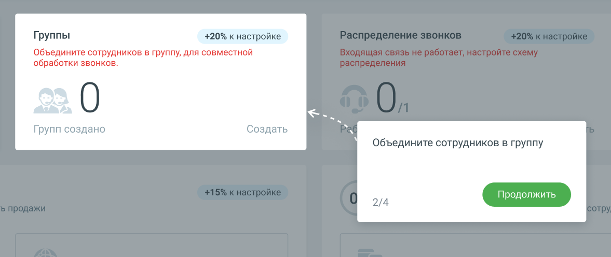

#### 1.8.2.3. Блок 3. Добавление групп

> Трассировка: PDF §1.8.2.3 · сквозные стр. 24-25 · источники: ч.1 `kb/sources/mango-lk-manual/LK_manual_v-125-1-280.pdf` с.24-25.

> **Описание иллюстрации LK-§1.8.2.3-1** (к §1.8.2.3 «Блок 3. Добавление групп», стр. 24; 1177×496 px). Снимок экрана / схема Личного кабинета.
> Относится к тексту руководства: «…начало раздела».
> Текст на изображении (OCR, требует сверки): Группы; +20% к настройке; Объедините сотрудников в группу, для совместной; обработки звонков.; Групп создано; Создать; 'Объедините сотрудников в группу; 2/4

Кликните по кнопке Создать и добавьте в Личный кабинет группы сотрудников. Информационные подсказки модуля Онбординг рассказывают о последовательности переходов.

Если хотя бы одна группа уже создана, нажатие на кнопку открывает страницу ЛК со списком групп.

После завершения этапа количество созданных групп отобразится на Главной панели в Блоке 3 «Группы». Шкала прогресса Онбординга увеличится на 20%.

Чтобы перейти к настройке схемы распределения звонков, нажмите кнопку Продолжить.
