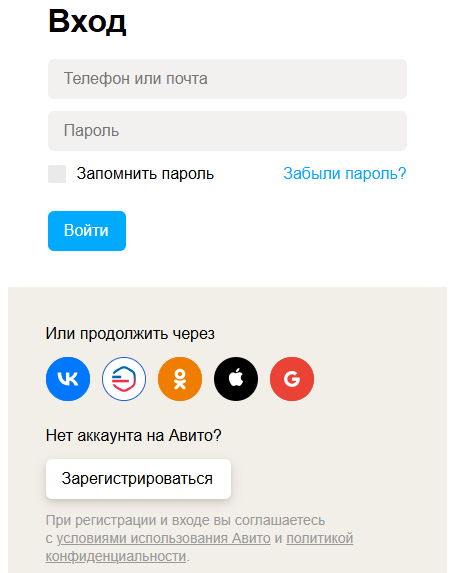
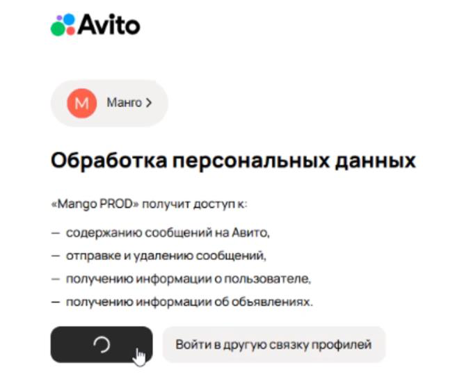
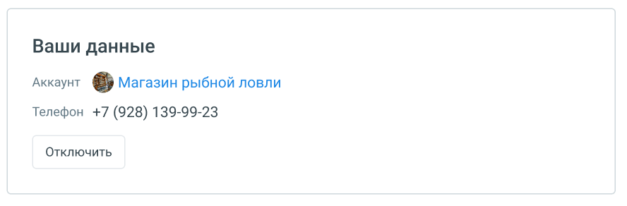
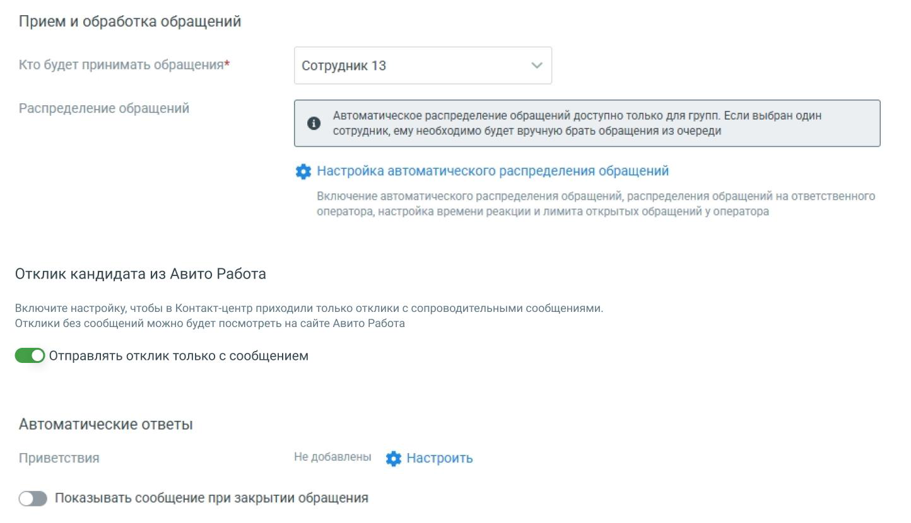

##### Авито Работа

> Трассировка: PDF §4.5.11.2.2 · сквозные стр. 341-347 · источники: ч.2 `kb/sources/mango-lk-manual/LK_manual_v-125-281-566.pdf` с.61-67.

Интеграция с Авито Работа упрощает работу HR-специалистов и операторов: теперь все отклики с Авито попадают прямо в ваш Контакт-центр MANGO OFFICE. Это значит:

 Не нужно каждый раз вручную проверять Авито.  Всё в одном месте: вакансия → отклик → чат с кандидатом.  Меньше рутины — больше времени на важные задачи.

Чтобы настроить интеграцию, выполните следующие шаги:

Шаг 1: Подключение канала

1. Перейдите в раздел Диалоги → Группы каналов → [ваша группа]. 2. Найдите виджет Авито Работа и нажмите Подключить.

> **Описание иллюстрации LK-§4.5.11.2.2-1** (к §4.5.11.2.2 «Авито Работа», стр. 342; 394×154 px). Снимок экрана / схема Личного кабинета.
> Относится к тексту руководства: «…1. Перейдите в раздел Диалоги → Группы каналов → [ваша группа]. 2. Найдите виджет Авито Работа и нажмите Подключить.».
> Текст на изображении (OCR, требует сверки): © Авито Работа

Шаг 2: Авторизация в Авито

1. Нажмите Авторизоваться. 2. Введите логин (телефон или e-mail) и пароль от аккаунта Авито.

> **Описание иллюстрации LK-§4.5.11.2.2-2** (к §4.5.11.2.2 «Авито Работа», стр. 342; 459×573 px). Снимок экрана / схема Личного кабинета.
> Относится к тексту руководства: «…1. Нажмите Авторизоваться. 2. Введите логин (телефон или e-mail) и пароль от аккаунта Авито.».
> Текст на изображении (OCR, требует сверки): Вход; Телефон или почта; Пароль; Запомнить пароль; Забыли пароль?; Или продолжить через; оо@®е; Нет аккаунта на Авито?; Зарегистрироваться; При регистрации и входе вы соглашаетесь; с условиями использования Авито и политикой; конфиденциальности

3. Разрешите доступ к:

 Просмотру и отправке сообщений  Данных о пользователях и вакансиях

> **Описание иллюстрации LK-§4.5.11.2.2-3** (к §4.5.11.2.2 «Авито Работа», стр. 343; 677×558 px). Снимок экрана / схема Личного кабинета.
> Относится к тексту руководства: «… Просмотру и отправке сообщений  Данных о пользователях и вакансиях».
> Текст на изображении (OCR, требует сверки): &Avito; Обработка персональных данных; «Mango PROD» получит доступ к; — содержанию сообщений на Авито,; — отправке и удалению сообщений,; — получению информации о пользователе,; — получению информации об объявлениях.; Войти другую связку профилей

4. При отключении и повторном подключении потребуется заново авторизоваться.

Шаг 3: Настройка обработчиков

После авторизации появится информация о вашем аккаунте.

> **Описание иллюстрации LK-§4.5.11.2.2-4** (к §4.5.11.2.2 «Авито Работа», стр. 343; 888×292 px). Снимок экрана / схема Личного кабинета.
> Относится к тексту руководства: «…После авторизации появится информация о вашем аккаунте.».
> Текст на изображении (OCR, требует сверки): Ваши данные; Аккаунт 5, Магазин рыбной ловли; Телефон +7 (928) 139-99-23; Отключить

Далее задайте параметры так, как удобно вам.

РАБОЧЕЕ ВРЕМЯ

> **Описание иллюстрации LK-§4.5.11.2.2-5** (к §4.5.11.2.2 «Авито Работа», стр. 344; 1444×830 px). Снимок экрана / схема Личного кабинета.
> Относится к тексту руководства: «…РАБОЧЕЕ ВРЕМЯ».
> Текст на изображении (OCR, требует сверки): Прием и обработка обращений; Кто будет принимать обращения*; Сотрудник 13; Распределение обращений; Автоматическое распределение обращений доступно только для групп. Если выбран один; ‘сотрудник, ему необходимо будет вручную брать обращения из очереди; {$ Настройка автоматического распределения обращений; Включение автоматического распределения обращений, распределения обращений на ответственного; оператора, настройка времени реакции и лимита открытых обращений у оператора; Отклик кандидата из Авито Работа; Включите настройку, чтобы в Контакт-центр приходили только отклики с сопроводительными …

Прием и обработка обращений:

 Кто будет принимать обращение – укажите конкретного сотрудника, группу или чат-бота (если он подключён в ЛК ВАТС).

В качестве сотрудника можно выбрать чат-бот (если в ЛК ВАТС подключена услуга «Чат-бот»). В этом случае необходимо будет также выбрать резервного сотрудника или группу, на которых будут распределяться обращения в случае недоступности чат-бота.

 Распределение обращений - распределение обращений и настройки ожидания ответа устанавливаются в соответствующих разделах Личного кабинета пользователя ВАТС.

Настройка автоматического распределения обращений — произведите необходимые настройки на странице «Настройки дозвона и сообщений по умолчанию».

Отклик кандидата из Авито Работа — включите переключатель, чтобы в работу к сотруднику Контакт-центра попадали только отклики с сообщениями.

Автоматические ответы — нажатие на кнопку «Настроить» открывает окно настройки автоответов.

> **Описание иллюстрации LK-§4.5.11.2.2-6** (к §4.5.11.2.2 «Авито Работа», стр. 345; 937×610 px). Снимок экрана / схема Личного кабинета.
> Относится к тексту руководства: «…Автоматические ответы — нажатие на кнопку «Настроить» открывает окно настройки автоответов.».
> Текст на изображении (OCR, требует сверки): Автоматические ответы; Укажите текст сообщения и время, через которое оно отправится клиенту в ответ Ha его сообщение; © Через какое время отправить:; @ Осек; 10 сек; 30 сек; 1 мин; Введите текст сообщения; 0/250; © добавить автоматический ответ

В окне настроек необходимо ввести текст автоответа и отметить время, через которое клиент увидит автоответ в окне чата с оператором.

Нажатие на кнопку Добавить автоматический ответ открывает окно добавления следующего автоматического ответа.

Сохраните внесенные изменения кнопкой Применить.

НЕРАБОЧЕЕ ВРЕМЯ

Прием обращений чат-ботом в нерабочее время - если на ВАТС подключена услуга «Чат-боты», в блоке «Нерабочее время» отображается выпадающий список доступных чат-ботов.

Включить автоответ в нерабочее время - в блоке настраивается возможность отправлять автоответы в нерабочее время, чтобы оставаться на связи с посетителями на сайте.

> **Описание иллюстрации LK-§4.5.11.2.2-7** (к §4.5.11.2.2 «Авито Работа», стр. 346; 1254×666 px). Снимок экрана / схема Личного кабинета.
> Относится к тексту руководства: «…чить автоответ в нерабочее время - в блоке настраивается возможность отправлять автоответы в нерабочее время, чтобы оставаться на связи с посетителями на сайте.».
> Текст на изображении (OCR, требует сверки): Нерабочее время; [ ©) Прием обращений чат-ботом в нерабочее время; Нерабомчее время; Выберите чат-бота; Прием обращений чат-ботом в нерабочее время; Включить автоответ в нерабочее время; В нерабочее время операторов все обращения будут попадать в очередь обращений.; На следующий рабочий день операторы могут вручную брать обращения из очереди; ® > включить автоответ в нерабочее время; К сожалению, мы не можем ответить прямо сейчас. Оставьте свои контактные; данные и мы свяжемся с вами в ближайшее время.; 119/250

Ознакомьтесь с информационным уведомлением о правилах работы с сообщениями в нерабочее время.

ОБЩИЕ НАСТРОЙКИ

Проставьте период для автоматического завершения диалогов:

> **Описание иллюстрации LK-§4.5.11.2.2-8** (к §4.5.11.2.2 «Авито Работа», стр. 346; 964×266 px). Снимок экрана / схема Личного кабинета.
> Относится к тексту руководства: «…Проставьте период для автоматического завершения диалогов:».
> Текст на изображении (OCR, требует сверки): Общие настройки; Автоматическое завершение диалогов; Закрывать неактивный; д м; диалог через ($)

Автоматическое завершение диалогов

 Закрывать неактивный диалог через – время в часах или днях, по истечении которого обращение автоматически закрывается. Значение поля должно быть больше нуля.

Сохранить – кликом по кнопке сохраните внесенные изменения.

С этого момента отклики начнут поступать операторам.
