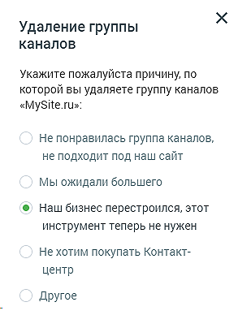

##### 4.5.11.2.3. Удаление группы каналов

> Трассировка: PDF §4.5.11.2.3 · сквозные стр. 347 · источники: ч.2 `kb/sources/mango-lk-manual/LK_manual_v-125-281-566.pdf` с.67.

Для удаления группы каналов следует открыть настройки группы и щелкнуть по кнопке Удалить группу каналов.

В результате на экране отобразится форма для ввода причины удаления. Заполнение формы не является обязательным.

> **Описание иллюстрации LK-§4.5.11.2.3-1** (к §4.5.11.2.3 «Удаление группы каналов», стр. 347; 293×388 px). Снимок экрана / схема Личного кабинета.
> Относится к тексту руководства: «…В результате на экране отобразится форма для ввода причины удаления. Заполнение формы не является обязательным.».
> Текст на изображении (OCR, требует сверки): Удаление группы; каналов; Укажите пожалуйста причину, по; которой вы удаляете группу каналов; «MySite.rus:; Не понравилась группа каналов,; не подходит под наш сайт; Мы ожидали большего; ©) Наш бизнес перестроился, этот; инструмент теперь не нужен; Не хотим покупать Контакт-; центр; Другое
