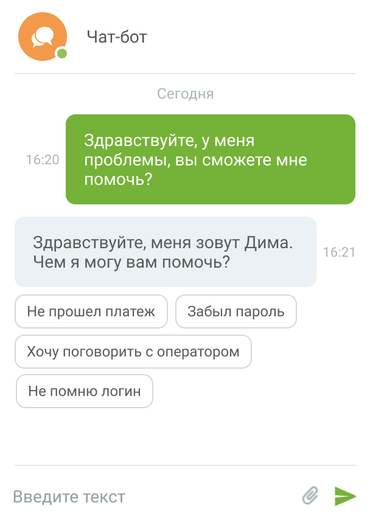

##### 4.5.11.2.4. Чат-бот для групп каналов «Текстовые коммуникации»

> Трассировка: PDF §4.5.11.2.4 · сквозные стр. 347-348 · источники: ч.2 `kb/sources/mango-lk-manual/LK_manual_v-125-281-566.pdf` с.67-68.

Чат-бот «Текстовые коммуникации» – это текстовый бот для общения с клиентом в группах каналов коммуникации. Чат-бот может обрабатывать обращения по одному, нескольким или всем каналам одновременно.

Чат-бот может быть добавлен на прием обращений по следующим каналам: Заказ обратного звонка, Лидогенерация, Чат на сайте, Вконтакте, WhatsApp, Telegram, Авито и Авито Работа, Клиентское приложение.

Добавление чат-бота осуществляется отдельно для каждого канала. Подключение чат-ботов и создание скриптов чат-ботов осуществляется в модуле «Роботы MANGO OFFICE» robot.mango-office.ru. После подключения чат-бот появится

> **Описание иллюстрации LK-§4.5.11.2.4-1** (к §4.5.11.2.4 «Чат-бот для групп каналов «Текстовые коммуникации»», стр. 347; 40×34 px). Пиктограмма (значок элемента интерфейса).
> Относится к тексту руководства: «…ала. Подключение чат-ботов и создание скриптов чат-ботов осуществляется в модуле «Роботы MANGO OFFICE» robot.mango-office.ru. После подключения чат-бот появится».
> Текста на изображении нет; назначение значка — см. текст, к которому он относится.

в общем списке сотрудников ЛК ВАТС с иконкой . При необходимости можно запросить помощь в подключении чат-бота у персонального менеджера.

При авторизации в модуле «Роботы MANGO OFFICE» robot.mango-office.ru используйте пару «логин-пароль» от Личного кабинета ВАТС.

Как настраиваются кнопки чат-бота узнайте в Справке Роботов MANGO OFFICE, пункт «Задать несколько вариантов ответа» → Кнопки в тексте и Кнопки клавиатуры

Пример работы чат-бота в виджете «Чата на сайте». Клиент может выбирать ответы из вариантов, заданных в скрипте чат-бота.

> **Описание иллюстрации LK-§4.5.11.2.4-2** (к §4.5.11.2.4 «Чат-бот для групп каналов «Текстовые коммуникации»», стр. 348; 608×868 px). Снимок экрана / схема Личного кабинета.
> Относится к тексту руководства: «…Пример работы чат-бота в виджете «Чата на сайте». Клиент может выбирать ответы из вариантов, заданных в скрипте чат-бота.».
> Текст на изображении (OCR, требует сверки): Чат-бот; Сегодня; Здравствуйте, у меня; 16:20; проблемы, вы сможете мне; помочь?; Здравствуйте, меня зовут Дима.; 16:21; Чем я могу вам помочь?; Не прошел платеж; Забыл пароль; Хочу поговорить с оператором; Не помню логин; Введите текст
