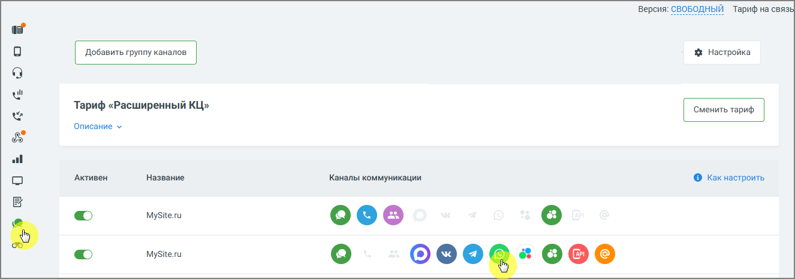
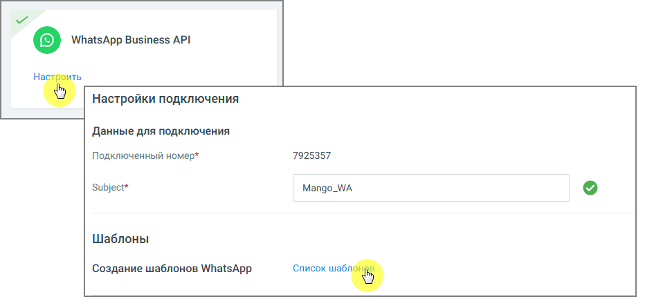
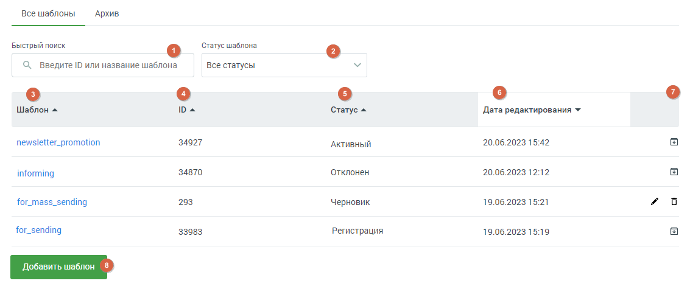
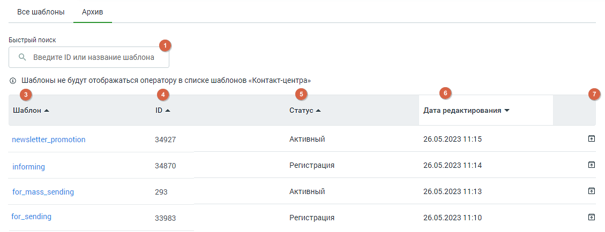

##### 4.5.11.2.5. Шаблоны WhatsApp

> Трассировка: PDF §4.5.11.2.5 · сквозные стр. 348-351 · источники: ч.2 `kb/sources/mango-lk-manual/LK_manual_v-125-281-566.pdf` с.68-71.

Мессенджер WhatsApp ограничивает возможность инициировать обращение к клиенту. Написать клиенту первым можно только с помощью HSM-сообщения, которое имеет строго установленную форму – HSM-шаблон. Сообщения на основе шаблонов можно отправлять как одному конкретному человеку, так и в массовой рассылке по базе номеров, а также использовать в автоматических воронках продаж.

Первичное обращение к клиенту оплачивается согласно тарифам компании. Его стоимость зависит от категории шаблона и страны получателя. Последующие сообщения клиенту той же категории будут бесплатны в течение 24 часов после последнего ответа клиента.

Пример: Клиенту отправлено оплачиваемое HSM-сообщение категории «Маркетинговые сообщения». Клиент ответил на это сообщение. С момента ответа клиента в течение 24 часов все HSM-сообщения сотрудника категории «Маркетинговые сообщения» или ответы в свободной форме (без шаблона) сотрудника этому клиенту не оплачиваются. Каждый последний ответ клиента возобновляет бесплатный период на 24 часа.

Однако если этому же клиенту будет отправлено HSM-сообщение категории «Транзакционные сообщения» или «Одноразовые пароли», за такое сообщение необходимо будет заплатить.

Контакт-центр MANGO OFFICE предлагает удобный функционал рассылок как для первичного обращения к клиенту, так и для последующего диалога с ним.

Ваши HSM-шаблоны

Чтобы просмотреть список своих HSM-шаблонов необходимо последовательно пройти в раздел «Текстовые коммуникации» → Группы каналов → Канал коммуникации → WhatsApp (Настроить) → Список шаблонов.

> **Описание иллюстрации LK-§4.5.11.2.5-1** (к §4.5.11.2.5 «Шаблоны WhatsApp», стр. 349; 1326×467 px). Снимок экрана / схема Личного кабинета.
> Относится к тексту руководства: «…HSM-шаблонов необходимо последовательно пройти в раздел «Текстовые коммуникации» → Группы каналов → Канал коммуникации → WhatsApp (Настроить) → Список шаблонов.».
> Текст на изображении (OCR, требует сверки): Версия: СВОБОДНЫЙ Тариф на связь; % Настройка; wl; Тариф «Расширенный КЦ»; Описание У; all; ‘Активен; Название; Каналы коммуникации; © Какнастроить; MySite.ru; oee

> **Описание иллюстрации LK-§4.5.11.2.5-2** (к §4.5.11.2.5 «Шаблоны WhatsApp», стр. 350; 932×446 px). Снимок экрана / схема Личного кабинета.
> Относится к тексту руководства: «…сия: СВОБОДНЫЙ Тариф на связь; % Настройка; wl; Тариф «Расширенный КЦ»; Описание У; all; ‘Активен; Название; Каналы коммуникации; © Какнастроить; MySite.ru; oee».
> Текст на изображении (OCR, требует сверки): [©] WhatsApp Business API; “eo Настройки подключения; Данные для подключения; Подключенный номер*; 7925357; ‘Subject*; Mango_WA; Шаблоны; ‘Создание шаблонов WhatsApp; Список 5)

После клика по ссылке «Список шаблонов» откроется рабочая панель HSM-шаблонов WhatsApp.

Рабочая панель HSM-шаблонов WhatsApp состоит из вкладок Все шаблоны и Архив. На вкладках отображается ключевая информация о шаблоне.

Для пользователей, у которых подключен Контакт-центр MANGO OFFICE, шаблоны вкладки «Все шаблоны» в статусе «Активные» также отображаются в списке шаблонов Контакт-центра.

> **Описание иллюстрации LK-§4.5.11.2.5-3** (к §4.5.11.2.5 «Шаблоны WhatsApp», стр. 350; 1133×475 px). Снимок экрана / схема Личного кабинета.
> Относится к тексту руководства: «…вателей, у которых подключен Контакт-центр MANGO OFFICE, шаблоны вкладки «Все шаблоны» в статусе «Активные» также отображаются в списке шаблонов Контакт-центра.».
> Подпись в руководстве: «Рис. Вкладка «Все шаблоны»».
> Текст на изображении (OCR, требует сверки): все шаблоны; Архив; Быстрый поиск; ‘Статус шаблона; С, введите ID или название шаблона; все статусы; Шаблон =.; IDa; Статус >; Дата редактирования +; 34927; 20.06.2023 15:42; newsletter_promotion; АКТИВНЫЙ; informing; 34870; отклонен!; 20.06.2023 12:12; for_mass_sending; 203; Черновик; 19.06.2023 15:21; for_sending; 33983; Регистрация; 19.06.2023 1519

Рис. Вкладка «Все шаблоны»

> **Описание иллюстрации LK-§4.5.11.2.5-4** (к §4.5.11.2.5 «Шаблоны WhatsApp», стр. 351; 1129×434 px). Снимок экрана / схема Личного кабинета.
> Относится к тексту руководства: «…Рис. Вкладка «Все шаблоны»».
> Подпись в руководстве: «Рис. Вкладка «Архив»».
> Текст на изображении (OCR, требует сверки): все шаблоны; Архив; Быстрый поиск; С, введите ID или название шаблона; © Шаблоны не будут отображаться оператору в списке шаблонов «Контакт-центра»; Шаблон =.; IDA; Статус >; Дата редактирования +; АКТИВНЫЙ; 26.05.2023 11:15; newsletter_promotion; 34927; 34870; Регистрация; 26.05.2023 11:14; informing; for_mass_sending; 203; 26.05.2023 11:13; for_sending; 33983; 26.05.2023 11:10

Рис. Вкладка «Архив»

Вкладки содержат следующие данные:

1. Поле полнотекстового поиска по ID или названию шаблона.

2. Фильтр по статусу шаблона.

3. Наименование шаблона. Клик по пиктограмме в заголовке сортирует список в

алфавитном порядке.

4. ID шаблона. Клик по пиктограмме в заголовке сортирует список по

убыванию/возрастанию числа.

5. Статус шаблона – один из четырех вариантов: Активный, Отклонен, Черновик, Регистрация. Клик по пиктограмме в заголовке сортирует список в алфавитном

порядке.

6. Дата и время редактирования шаблона. Клик по пиктограмме в заголовке

сортирует список по убыванию/возрастанию даты.

7. Кнопки обработки шаблона. Варианты – «удалить» и «редактировать» доступны только для шаблонов в статусе «черновик». Шаблоны в прочих статусах можно архивировать или разархивировать. Клик по соответствующей пиктограмме переводит шаблон на вкладку «Архив», и обратно.

8. Кнопка «Добавить шаблон». Нажатие на кнопку открывает окно создания нового шаблона.

Клик по наименованию шаблона открывает его для просмотра. Никакие действия с просматриваемым шаблоном невозможны.

Шаблоны в статусе «Черновик» доступны для редактирования.
