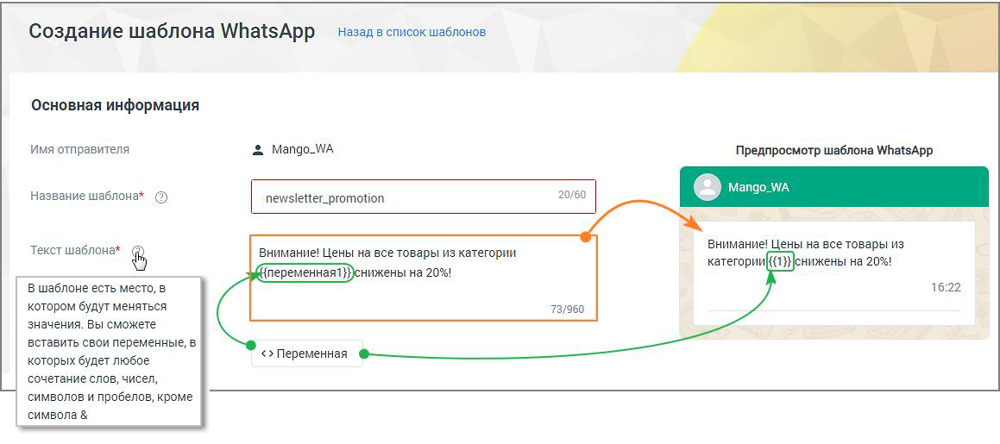
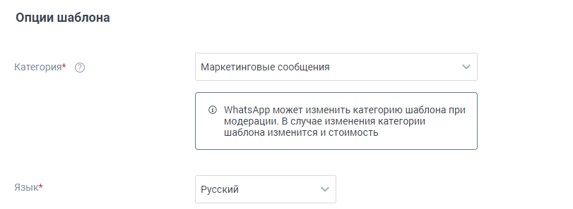
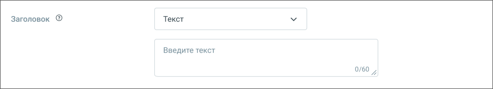
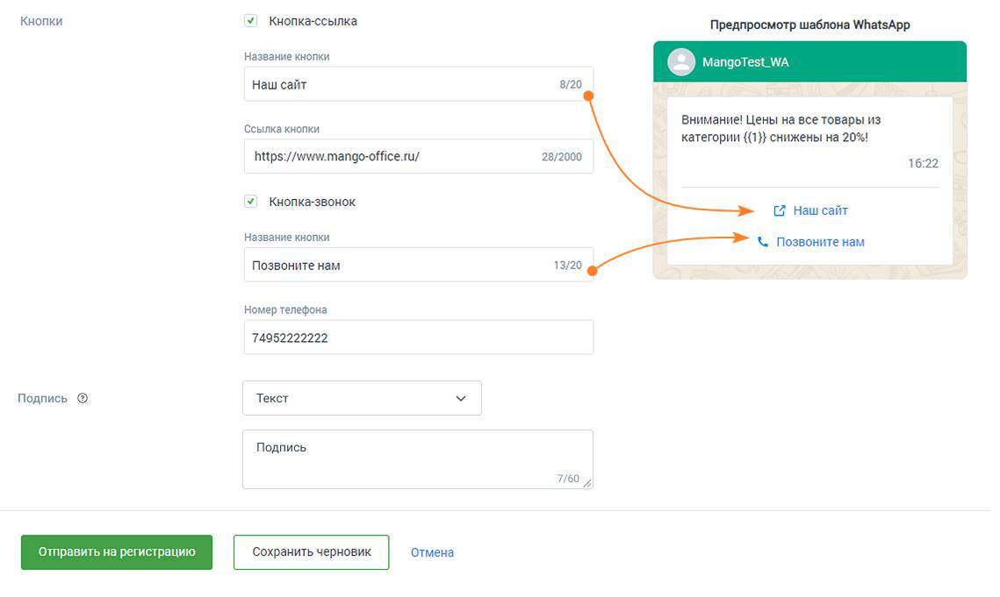
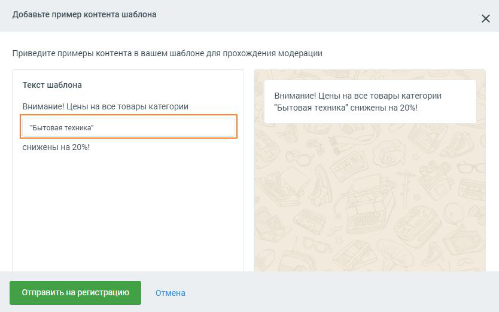

###### 4.5.11.2.5.1. Создание шаблона WhatsApp

> Трассировка: PDF §4.5.11.2.5.1 · сквозные стр. 351-357 · источники: ч.2 `kb/sources/mango-lk-manual/LK_manual_v-125-281-566.pdf` с.71-77.

Чтобы создать новый HSM-шаблон нажмите на кнопку (8) «Добавить шаблон» на рабочей панели шаблонов WhatsApp. Шаги создания шаблона:

ШАГ-1: В открывшемся окне «Создание шаблона WhatsApp» необходимо заполнить поля будущего шаблона. При заполнении просматривайте системные подсказки,

> **Описание иллюстрации LK-§4.5.11.2.5.1-1** (к §4.5.11.2.5.1 «Создание шаблона WhatsApp», стр. 352; 22×22 px). Пиктограмма (значок элемента интерфейса).
> Относится к тексту руководства: «…ШАГ-1: В открывшемся окне «Создание шаблона WhatsApp» необходимо заполнить поля будущего шаблона. При заполнении просматривайте системные подсказки,».
> Текста на изображении нет; назначение значка — см. текст, к которому он относится.

размещенные под пиктограммой ШАГ-2: Отправьте созданный шаблон на модерацию и регистрацию. Статус шаблона отслеживайте на рабочей панели шаблонов. Шаблоны в статусе «активный» готовы к использованию.

ШАГ-3: Используйте созданный шаблон в единичных сообщениях или в текстовых рассылках Контакт-центра.

> **Описание иллюстрации LK-§4.5.11.2.5.1-2** (к §4.5.11.2.5.1 «Создание шаблона WhatsApp», стр. 352; 1159×515 px). Снимок экрана / схема Личного кабинета.
> Относится к тексту руководства: «…ШАГ-3: Используйте созданный шаблон в единичных сообщениях или в текстовых рассылках Контакт-центра.».
> Текст на изображении (OCR, требует сверки): Назад в список шаблонов; Создание шаблона WhatsApp; ‘Основная информация; Имя отправителя; Mango_WA; Предпросмотр шаблона WhatsApp; Название шаблона" ©; newsletter_promotion; 20/60; Внимание! Цены на все товары из; внимание! Цены на все товары из категории; категории; снижены на 20%!; Текст шаблона* ®; `нижены на 20%!; В шаблоне есть место, в; 16:22; котором будут меняться; 73/960; значения. Вы сможете; вставить свои переменные, в; <> Переменная; которых будет любое; сочетание слов, чисел,; символов и пробелов, кроме; символа &

ШАГ-1. ЗАПОЛНЕНИЕ ПОЛЕЙ ШАБЛОНА

Название шаблона – можно использовать латинские буквы, цифры, нижнее подчеркивание. Использование заглавных букв, пробелов, кириллических символов не допускается. Не более 60 символов. Поле обязательно для заполнения. Название должно отражать смысл шаблона и быть понятным модератору, проверяющему его корректность. Это позволит шаблону успешно пройти модерацию.

Пример корректного названия: action_bicycle;

Примеры некорректного названия: Promotion 20, акция_20%, 84746466, Шаблон № 3.

Текст шаблона – текст, который увидит абонент. Не более 960 символов. Поле обязательно для заполнения. Отображается справа, в окне предпросмотра шаблона. Рекомендуется составлять текст таким образом, чтобы модератору, проверяющему его корректность, было очевидно назначение сообщения. Это позволит шаблону успешно пройти модерацию.

Пример корректного текста шаблона: Уважаемый {{переменная1}}, Ваше бронирование №{{переменная2}} находится в статусе {{переменная3}}. Для изменения бронирования пройдите по ссылке www.bronotelej.ru/{{переменная4}}

Пример некорректного текста шаблона: {{переменная1}}! Мы предлагаем {{переменная2}}. Для просмотра {{переменная3}}.

Переменная – значение переменной может меняться. В дальнейшем в этом месте можно будет вставить любой свой текст и переменные, путем сопоставления в Контакт- центре. Переменные добавляются в текст шаблона в строгой числовой последовательности.

Пример корректного текста шаблона: Здравствуйте, {{переменная1}}. Ваш заказ №{{переменная2}} оплачен. Справка по телефону {{переменная3}}.

Пример некорректного текста шаблона: Здравствуйте, {{переменная1}}. Ваш заказ №{{переменная3}} оплачен. Справка по телефону {{переменная2}}.

> **Описание иллюстрации LK-§4.5.11.2.5.1-3** (к §4.5.11.2.5.1 «Создание шаблона WhatsApp», стр. 353; 811×297 px). Снимок экрана / схема Личного кабинета.
> Относится к тексту руководства: «…Пример некорректного текста шаблона: Здравствуйте, {{переменная1}}. Ваш заказ №{{переменная3}} оплачен. Справка по телефону {{переменная2}}.».
> Текст на изображении (OCR, требует сверки): Опции шаблона; Категория* (5); Маркетинговые сообщения; @® WhatsApp может изменить категорию шаблона при; модерации. В случае изменения категории; шаблона изменится и стоимость; Язык*; Русский

Категория – доступные варианты: Маркетинговые сообщения, Транзакционные сообщения, Одноразовые пароли. От категории шаблона зависит стоимость рассылки сообщения. Поле обязательно для заполнения.

 Маркетинговые сообщения – новости о компании и ее мероприятиях, акционные и рекламные предложения, напоминания о товарах в забытой корзине. Это самая дорогая категория сообщений. Пример текста шаблона: Внимание! Цены на все товары в категории {{переменная1}} снижены на {{переменная2}}. Приходите за покупками!

 Транзакционные сообщения – информационные сообщения о смене статуса аккаунта, состоянии заказа, денежных транзакций и т.д. Пример текста шаблона: Здравствуйте, {{переменная1}}. Ваш заказ №{{переменная2}} доставлен в пункт самовывоза по адресу {{переменная3}}.

 Одноразовые пароли – коды доступа к сервисам и учетным записям, уведомления о смене пароля, обновлении данных, настройках аккаунта. Это самая дешевая категория сообщений. Пример текста шаблона: Для смены пароля пройдите по ссылке {{переменная1}} и введите код {{переменная2}}. Код действителен в течение {{переменная3}} минут.

Язык – язык текста шаблона. Варианты: русский или английский.

> **Описание иллюстрации LK-§4.5.11.2.5.1-4** (к §4.5.11.2.5.1 «Создание шаблона WhatsApp», стр. 354; 1240×225 px). Снимок экрана / схема Личного кабинета.
> Относится к тексту руководства: «…Язык – язык текста шаблона. Варианты: русский или английский.».
> Текст на изображении (OCR, требует сверки): Заголовок ®; Текст; Введите текст

Заголовок – заголовок шаблона. При создании шаблона можно добавить заголовок с типами:

 изображение – до 5 МБ , форматы .jpg, .jpeg, .png.

 текст – если выбран этот вариант заголовка, отображается поле для ввода текста, до 60 символов, без учета переменных.

 документ – до 5 МБ, формат .pdf.

 видео – до 5 МБ, формат mp4.

Абонент, получивший сообщение, увидит отображаемые изображение, видео или текст, а также сможет скачать документ.

Для размещения видео или изображения при создании сообщения на основе шаблона в сообщение необходимо вставить прямую ссылку на файл. Это ссылка, на конце которой указано расширение файла - .jpg, .jpeg, .png для изображений и mp4 для видео.

Например https://ltdfoto.ru/images/2024/08/20/cat548ba3aa37a77c1a.jpg

Для получения прямой ссылки на изображение или видео можно использовать бесплатные облачные файловые хранилища:

 imgur.com - для изображений и видео  ltdfoto.ru - для изображений  telegra.ph - для изображений

внимание

Ссылки на файл на Яндекс-диске не подходят, так как не являются прямыми ссылками.

Если выбран заголовок с прикреплением (картинка, видео или документ), для регистрации понадобится пример файла. Вы сможете добавить пример файла после нажатия кнопки "Отправить на регистрацию".

> **Описание иллюстрации LK-§4.5.11.2.5.1-5** (к §4.5.11.2.5.1 «Создание шаблона WhatsApp», стр. 355; 1139×681 px). Снимок экрана / схема Личного кабинета.
> Относится к тексту руководства: «…нием (картинка, видео или документ), для регистрации понадобится пример файла. Вы сможете добавить пример файла после нажатия кнопки "Отправить на регистрацию".».
> Текст на изображении (OCR, требует сверки): Кнопки; Кнопка-ссылка; Предпросмотр шаблона WhatsApp; Название кнопки; Наш сайт; 8/20; внимание! Цены на все товары из; Ссылка кнопки; категории {(1)} снижены на 20%!; https://www.mango-office.ru/; 28/2000; 16:22; Кнопка-звонок; [2 Наш сайт; Позвоните нам; om oe Я { Позвоните нам; Номер телефона; 74952222222; Текст; Подпись ®; Подпись; 7/60

Чекбокс Кнопка-ссылка – если чекбокс отмечен, доступны для заполнения поля «Название кнопки» и «Ссылка». Кнопка со ссылкой будет отображаться в сообщении, полученном абонентом.

Пример корректного заполнения: http://www.mango-office.ru/, https://www.mango- office.ru/

Пример некорректного заполнения: mango-office.ru

Чекбокс Кнопка-звонок – если чекбокс отмечен, доступны для заполнения поля «Название кнопки» и «Номер телефона». Кнопка с номером будет отображаться в сообщении, полученном абонентом.

Пример корректного заполнения: 74955404444

Пример некорректного заполнения: (495) 540-44-44

Подпись – поле для добавления подписи, например слогана компании. Если выбран вариант «Текст», отображается поле для ввода подписи.

Сохранить черновик – нажатие на кнопку сохраняет черновик шаблона, пользователь переходит к списку шаблонов.

Отмена – нажатие на кнопку отменяет создание шаблона, пользователь переходит к списку шаблонов.

ШАГ-2. ОТПРАВЛЕНИЕ ШАБЛОНА НА РЕГИСТРАЦИЮ Кнопка Отправить на регистрацию – нажатие на кнопку отправляет заполненный шаблон на модерацию и регистрацию WhatsApp. Если помеченные символом (*)

обязательные поля не заполнены или заполнены некорректно, об этом проинформирует системное сообщение.

Если в шаблоне имеются переменные, система попросит предоставить пример содержимого переменной. Если переменных нет, этот дополнительный шаг не потребуется.

Если был выбран заголовок с вложением (картинка, видео или документ), на этом этапе вам необходимо добавить ссылку на пример файла.

> **Описание иллюстрации LK-§4.5.11.2.5.1-6** (к §4.5.11.2.5.1 «Создание шаблона WhatsApp», стр. 356; 834×522 px). Снимок экрана / схема Личного кабинета.
> Относится к тексту руководства: «…Если был выбран заголовок с вложением (картинка, видео или документ), на этом этапе вам необходимо добавить ссылку на пример файла.».
> Текст на изображении (OCR, требует сверки): Добавьте пример контента шаблона; Приведите примеры контента в вашем шаблоне для прохождения модерации; Текст шаблона; Внимание! Цены на все товары категории; "Бытовая техника" снижены на 20%!; снижены на 20%!

После отправки шаблона на регистрацию всплывает системное сообщение об успешной отправке. Время регистрации шаблона может занимать от нескольких минут до 1-2 дней. После регистрации статус шаблона сменится на «Активный» или «Отклонен».

Шаблон с высокой долей вероятности будет отклонен модератором, если:

 текст шаблона носит оскорбительный или угрожающий характер;  текст шаблона содержит орфографические или грамматические ошибки;  текст шаблона содержит сокращённые ссылки;  выбранный язык шаблона не совпадает с языком текста шаблона;  выбранная категория не соответствует названию и содержанию текста шаблона. ШАГ-3. ИСПОЛЬЗУЙТЕ СОЗДАННЫЙ ШАБЛОН В ИНТЕРЕСАХ БИЗНЕСА

HSM-шаблон позволяет инициировать обращение к клиенту или продолжить диалог. Используйте созданный шаблон в единичных сообщениях или в текстовых рассылках Контакт-центра.
