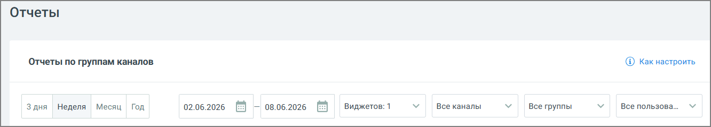

###### 4.5.11.3.1.1. Блок фильтров

> Трассировка: PDF §4.5.11.3.1.1 · сквозные стр. 357-358 · источники: ч.2 `kb/sources/mango-lk-manual/LK_manual_v-125-281-566.pdf` с.77-78.

> **Описание иллюстрации LK-§4.5.11.3.1.1-1** (к §4.5.11.3.1.1 «Блок фильтров», стр. 357; 1332×239 px). Снимок экрана / схема Личного кабинета.
> Относится к тексту руководства: «…начало раздела».
> Текст на изображении (OCR, требует сверки): Отчеты; Отчеты по группам каналов; @ Kak настроить; 3 дня; Неделя; Месяц Год; Виджетов: 1; Все каналы; Все группы; Все пользова...

Блок фильтров включает в себя:

 Отчетный период: 3 дня, неделя, месяц, год, а также произвольный период, задаваемый датой начала и датой окончания;  Виджеты – для составления отчета возможен выбор не более 3-х виджетов;  Каналы - возможен выбор любого из каналов обращений: Max, Чат, ВКонтакте, Telegram, E-mail, WhatsApp, Клиентское приложение, Авито и Авито Работа (или любой их комбинации);  Группы – группа сотрудников ВАТС, работавшая с обращением;  Пользователи – сотрудник ВАТС, работавший с обращением.
