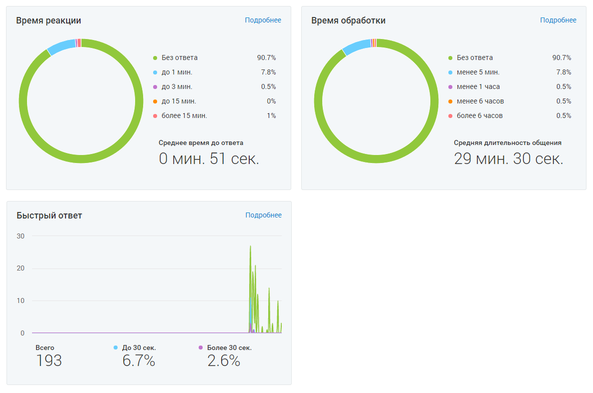

###### 4.5.11.3.1.2. Блок графиков

> Трассировка: PDF §4.5.11.3.1.2 · сквозные стр. 358 · источники: ч.2 `kb/sources/mango-lk-manual/LK_manual_v-125-281-566.pdf` с.78.

> **Описание иллюстрации LK-§4.5.11.3.1.2-1** (к §4.5.11.3.1.2 «Блок графиков», стр. 358; 1185×786 px). Снимок экрана / схема Личного кабинета.
> Относится к тексту руководства: «…начало раздела».
> Текст на изображении (OCR, требует сверки): Время реакции; Подробнее; Время обработки; ИИ; tl; Без ответа.; 90.7%; Bo 1 мин,; менее 5 мин.; Bo 3 мин,; менее 1 часа; до 15 мин.; менее 6 часов; ‘более 15 мин.; ‘более 6 часов; ‘Среднее время до ответа; Средняя длительность общения; О мин. 51 сек.; 29 мин. 30 сек.; Быстрый ответ; 30; 20; 10; Всего,; © Более 30 сек.; 193

Доступны три графика:

 Время реакции  Время обработки  Быстрый ответ

Для перехода из графика в детальный отчет кликните на кнопку Подробнее.

Пользователю доступно три вида отчетов:

 Время реакции – данные о времени реакции на обращение;  Время обработки – данные о времени обработки обращения;  Быстрый ответ - данные по проценту и количеству быстрых ответов на обращения.

Отчеты состоят из блока визуализаций и табличной части.
