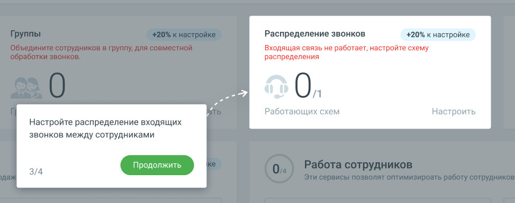

#### 1.8.2.4. Блок 4. Настройка схем распределения звонков

> Трассировка: PDF §1.8.2.4 · сквозные стр. 25-26 · источники: ч.1 `kb/sources/mango-lk-manual/LK_manual_v-125-1-280.pdf` с.25-26.

> **Описание иллюстрации LK-§1.8.2.4-1** (к §1.8.2.4 «Блок 4. Настройка схем распределения звонков», стр. 25; 868×343 px). Снимок экрана / схема Личного кабинета.
> Относится к тексту руководства: «…начало раздела».
> Текст на изображении (OCR, требует сверки): Распределение звонков; +20% к настройке; Входящая связь не работает, настройте схему; распределения; Работающих схем; Настроить; Настройте распределение входящих; звонков между сотрудниками; 3/4

Кликните по кнопке Настроить и добавьте в раздел «Голосовое меню и распределение звонков» Личного кабинета одну или несколько схем распределения входящих вызовов. Информационные подсказки рассказывают о последовательности переходов к разделу, наличии и работе схем распределения в рабочие и выходные дни, и др.

Если хотя бы одна схема уже настроена, нажатие на кнопку открывает страницу ЛК «Распределение звонков, приветствие, голосовое меню».

После завершения этапа количество созданных схем распределения отобразится на Главной панели в Блоке 4 «Распределение звонков» как [Количество активных

созданных на продукте схем распределения с переадресацией]/[Количество активных созданных на продукте схем].

Шкала прогресса Онбординга увеличится на 20%.

Чтобы перейти к настройке исходящих вызовов, нажмите кнопку Продолжить.
