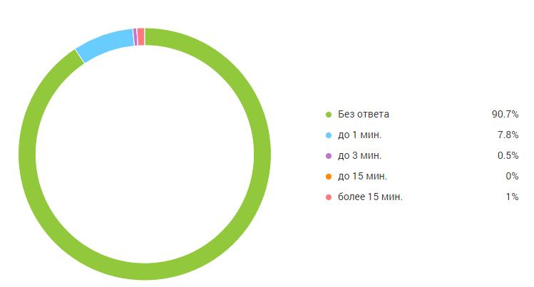
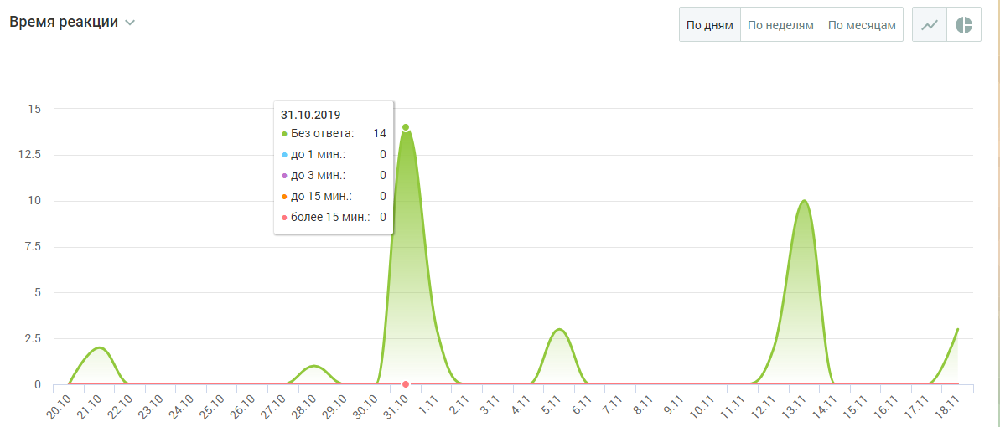

##### Блок визуализации

> Трассировка: PDF §4.5.11.3.2 · сквозные стр. 358-360 · источники: ч.2 `kb/sources/mango-lk-manual/LK_manual_v-125-281-566.pdf` с.78-80.

Данные в блоке отображаются в виде графика (по умолчанию) или круговой диаграммы.

> **Описание иллюстрации LK-§4.5.11.3.2-1** (к §4.5.11.3.2 «Блок визуализации», стр. 359; 749×403 px). Снимок экрана / схема Личного кабинета.
> Относится к тексту руководства: «…Данные в блоке отображаются в виде графика (по умолчанию) или круговой диаграммы.».
> Текст на изображении (OCR, требует сверки): gn"; Без ответа; 90.7%; До 1 мин.; до 3 мин.; до 15 мин.; более 15 мин

Для отчета Время реакции круговая диаграмма содержит следующую информацию:

 Процент обращений, оставшихся без ответа;

 процент обращений, где время реакции до 1 минуты;

 процент обращений, где время реакции до 3 минут (но более 1 минуты);

 процент обращений, где время реакции до 15 минут (но более 3 минут);

 процент обращений, где время реакции более 15 минут.

> **Описание иллюстрации LK-§4.5.11.3.2-2** (к §4.5.11.3.2 «Блок визуализации», стр. 359; 34×32 px). Пиктограмма (значок элемента интерфейса).
> Относится к тексту руководства: «… процент обращений, где время реакции более 15 минут.».
> Текста на изображении нет; назначение значка — см. текст, к которому он относится.

Для переключения на график щелкните по иконке в правом верхнем углу окна.

График содержит следующую информацию:

 на горизонтальной оси - динамика по времени;  на вертикальной оси - количество обращений.

При наведении курсора на график отображается подсказка, включающая:

 число обращений на выбранную дату;  время реакции на обращения

> **Описание иллюстрации LK-§4.5.11.3.2-3** (к §4.5.11.3.2 «Блок визуализации», стр. 360; 1193×510 px). Снимок экрана / схема Личного кабинета.
> Относится к тексту руководства: «… число обращений на выбранную дату;  время реакции на обращения».
> Текст на изображении (OCR, требует сверки): Время реакции ^^; Подням Понеделям fo месяцам | | м; 15; 31.10.2019; © Без ответа; 14; 125; 10; © 4015 мин; © более 15 мин.; 75; 25; уф?

График может отображаться в срезах: по дням, по неделям, по месяцам.

> **Описание иллюстрации LK-§4.5.11.3.2-4** (к §4.5.11.3.2 «Блок визуализации», стр. 360; 34×33 px). Пиктограмма (значок элемента интерфейса).
> Относится к тексту руководства: «…График может отображаться в срезах: по дням, по неделям, по месяцам.».
> Текста на изображении нет; назначение значка — см. текст, к которому он относится.

Для переключения на круговую диаграмму щелкните по иконке в правом верхнем углу окна.
