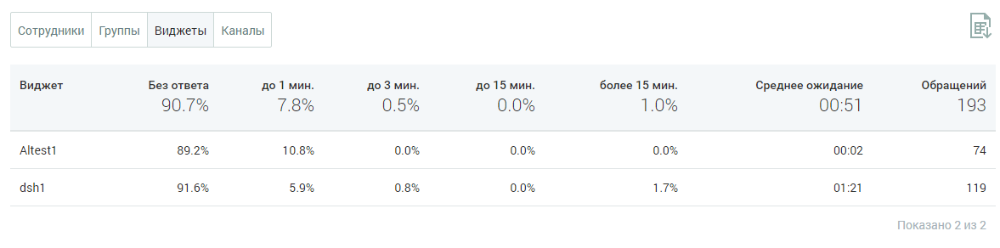

##### Блок таблицы

> Трассировка: PDF §4.5.11.3.2 · сквозные стр. 360-361 · источники: ч.2 `kb/sources/mango-lk-manual/LK_manual_v-125-281-566.pdf` с.80-81.

Таблица формируется по срезам:

 Сотрудники

 Группы

 Виджеты

 Каналы

> **Описание иллюстрации LK-§4.5.11.3.2-1** (к §4.5.11.3.2 «Блок таблицы», стр. 360; 1177×292 px). Снимок экрана / схема Личного кабинета.
> Относится к тексту руководства: «… Каналы».
> Текст на изображении (OCR, требует сверки): Сотрудники; Группы; виджеты; Каналы; Виджет; Без ответа; до 1 мин.; до 3 мин.; до15 мин.; более 15 мин.; Среднее ожидание; Обращений; 90.7%; 00:51; 193; Altestt; 89.2%; 10.8%; 00:02; 74; dsht; 91.6%; 17%; 01:21; 119; Показано 2 us 2

Таблица включает следующие данные:

 Наименование среза - в данном примере срезом выбран виджет;  Процент обработанных обращений в зависимости от времени реакции на обращение.

Для сортировки данных в таблице щелкните по наименованию столбца.
