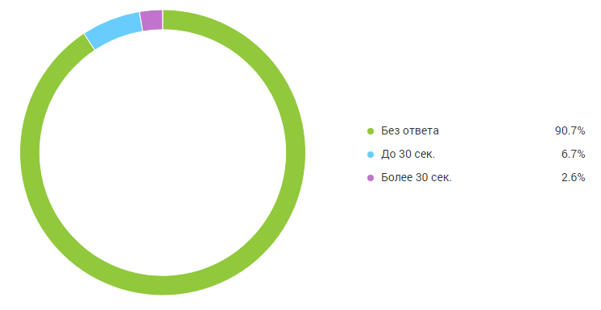
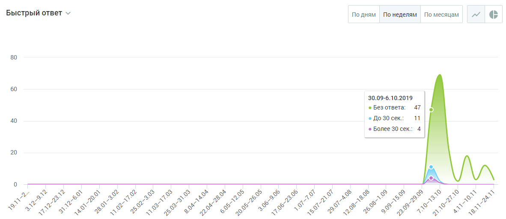

##### Блок визуализации

> Трассировка: PDF §4.5.11.3.3 · сквозные стр. 361-362 · источники: ч.2 `kb/sources/mango-lk-manual/LK_manual_v-125-281-566.pdf` с.81-82.

Данные в блоке отображаются в виде графика (по умолчанию) или круговой диаграммы.

> **Описание иллюстрации LK-§4.5.11.3.3-1** (к §4.5.11.3.3 «Блок визуализации», стр. 361; 746×385 px). Снимок экрана / схема Личного кабинета.
> Относится к тексту руководства: «…Данные в блоке отображаются в виде графика (по умолчанию) или круговой диаграммы.».
> Текст на изображении (OCR, требует сверки): ea; © Без ответа; 90.7%; e До 30 сек.; ® Более 30 сек.

Для отчета Быстрые ответы круговая диаграмма содержит следующую информацию:

 Процент обращений, оставшихся без ответа;

 Процент обращений с быстрым ответом (до 30 секунд);

 Процент обращений с медленным ответом (свыше 30 секунд).

> **Описание иллюстрации LK-§4.5.11.3.3-2** (к §4.5.11.3.3 «Блок визуализации», стр. 361; 34×32 px). Пиктограмма (значок элемента интерфейса).
> Относится к тексту руководства: «… Процент обращений с медленным ответом (свыше 30 секунд).».
> Текста на изображении нет; назначение значка — см. текст, к которому он относится.

Для переключения на график щелкните по иконке в правом верхнем углу окна.

График содержит следующую информацию:

 на горизонтальной оси - динамика по времени;  на вертикальной оси - количество обращений.

При наведении курсора на график отображается подсказка, включающая:

 число обращений на выбранную дату;  время реакции на обращения: без ответа, до 30 сек., более 30 сек.

> **Описание иллюстрации LK-§4.5.11.3.3-3** (к §4.5.11.3.3 «Блок визуализации», стр. 362; 1182×512 px). Снимок экрана / схема Личного кабинета.
> Относится к тексту руководства: «… число обращений на выбранную дату;  время реакции на обращения: без ответа, до 30 сек., более 30 сек.».
> Текст на изображении (OCR, требует сверки): Быстрый ответ >; Подням Понеделям По месяцам | | м; 30.09-6.10.2019; © Без ответа; ® Более 30 сек: 4; Ух; ры; Ss; wv; Sas; Ка

График может отображаться в срезах: по дням, по неделям, по месяцам.

> **Описание иллюстрации LK-§4.5.11.3.3-4** (к §4.5.11.3.3 «Блок визуализации», стр. 362; 34×33 px). Пиктограмма (значок элемента интерфейса).
> Относится к тексту руководства: «…График может отображаться в срезах: по дням, по неделям, по месяцам.».
> Текста на изображении нет; назначение значка — см. текст, к которому он относится.

Для переключения на круговую диаграмму щелкните по иконке в правом верхнем углу окна.
