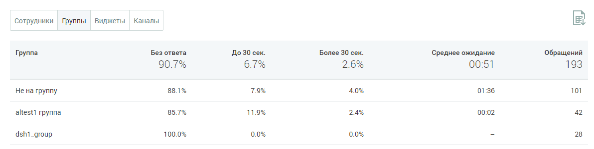

##### Блок таблицы

> Трассировка: PDF §4.5.11.3.3 · сквозные стр. 362-363 · источники: ч.2 `kb/sources/mango-lk-manual/LK_manual_v-125-281-566.pdf` с.82-83.

Таблица формируется по срезам:

 Сотрудники

 Группы

 Виджеты

 Каналы

> **Описание иллюстрации LK-§4.5.11.3.3-1** (к §4.5.11.3.3 «Блок таблицы», стр. 362; 1192×301 px). Снимок экрана / схема Личного кабинета.
> Относится к тексту руководства: «… Каналы».
> Текст на изображении (OCR, требует сверки): ‘Сотрудники | Группы; виджеты; Каналы; Группа; Без ответа; До 30 сек.; Более 30 сек.; Среднее ожидание; Обращений; 90.7%; 00:51; 193; He на группу; 88.1%; 01:36; 101; altesti группа; 85.7%; 11.9%; 00:02; 42; dshi_group; 100.0%; 28

Таблица включает следующие данные:

 Наименование среза - в данном примере срезом выбрана группа;  Процент обработанных обращений в зависимости от скорости ответа на обращение.

Для сортировки данных в таблице щелкните по наименованию столбца.
