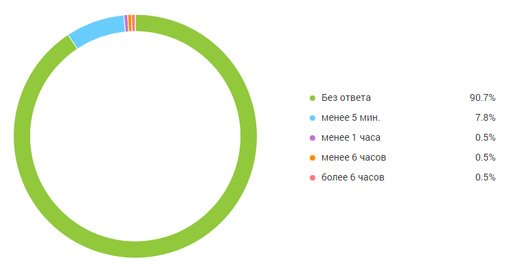
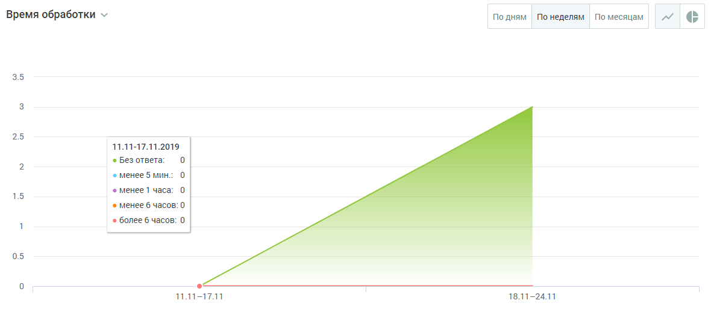

##### Блок визуализации

> Трассировка: PDF §4.5.11.3.4 · сквозные стр. 363-364 · источники: ч.2 `kb/sources/mango-lk-manual/LK_manual_v-125-281-566.pdf` с.83-84.

Данные в блоке отображаются в виде графика (по умолчанию) или круговой диаграммы.

> **Описание иллюстрации LK-§4.5.11.3.4-1** (к §4.5.11.3.4 «Блок визуализации», стр. 363; 741×389 px). Снимок экрана / схема Личного кабинета.
> Относится к тексту руководства: «…Данные в блоке отображаются в виде графика (по умолчанию) или круговой диаграммы.».
> Текст на изображении (OCR, требует сверки): gn"; Без ответа; 90.7%; менее 5 мин.; менее 1 часа; менее 6 часов; более 6 часов

Для отчета Время обработки круговая диаграмма содержит следующую информацию:

 Процент обращений, оставшихся без ответа;

 процент обращений, где время обработки до 5 минут;

 процент обращений, где время обработки менее 1 часа (но более 5 минут);

 процент обращений, где время обработки менее 6 часов (но более 1 часа);

 процент обращений, где время обработки более 6 часов.

> **Описание иллюстрации LK-§4.5.11.3.4-2** (к §4.5.11.3.4 «Блок визуализации», стр. 363; 34×32 px). Пиктограмма (значок элемента интерфейса).
> Относится к тексту руководства: «… процент обращений, где время обработки более 6 часов.».
> Текста на изображении нет; назначение значка — см. текст, к которому он относится.

Для переключения на график щелкните по иконке в правом верхнем углу окна.

График содержит следующую информацию:

 на горизонтальной оси - динамика по времени;  на вертикальной оси - количество обращений.

При наведении курсора на график отображается подсказка, включающая:

 число обращений на выбранную дату;  время реакции на обращения: без ответа, менее 5 минут, менее 1 час, менее 6 часов, более 6 часов.

> **Описание иллюстрации LK-§4.5.11.3.4-3** (к §4.5.11.3.4 «Блок визуализации», стр. 364; 1180×514 px). Снимок экрана / схема Личного кабинета.
> Относится к тексту руководства: «… число обращений на выбранную дату;  время реакции на обращения: без ответа, менее 5 минут, менее 1 час, менее 6 часов, более 6 часов.».
> Текст на изображении (OCR, требует сверки): Время обработки ~; Подням Понеделям По месяцам; 35; 25; 11.11-17.11.2019.; © Без ответа; © менее 5 мин.; 15; © менее 1 час:; © менее 6 часов: 0; © более 6 часов: 0; 05; 11-171; 18.11-24.11

График может отображаться в срезах: по дням, по неделям, по месяцам.

> **Описание иллюстрации LK-§4.5.11.3.4-4** (к §4.5.11.3.4 «Блок визуализации», стр. 364; 34×33 px). Пиктограмма (значок элемента интерфейса).
> Относится к тексту руководства: «…График может отображаться в срезах: по дням, по неделям, по месяцам.».
> Текста на изображении нет; назначение значка — см. текст, к которому он относится.

Для переключения на круговую диаграмму щелкните по иконке в правом верхнем углу окна.
