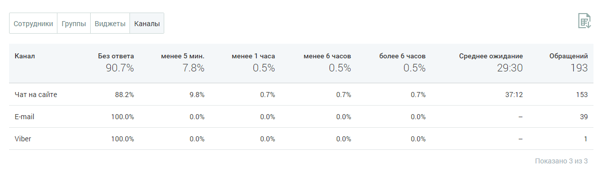

##### Блок таблицы

> Трассировка: PDF §4.5.11.3.4 · сквозные стр. 364-365 · источники: ч.2 `kb/sources/mango-lk-manual/LK_manual_v-125-281-566.pdf` с.84-85.

Таблица формируется по срезам:

 Сотрудники

 Группы

 Виджеты

 Каналы

> **Описание иллюстрации LK-§4.5.11.3.4-1** (к §4.5.11.3.4 «Блок таблицы», стр. 364; 1185×344 px). Снимок экрана / схема Личного кабинета.
> Относится к тексту руководства: «… Каналы».
> Текст на изображении (OCR, требует сверки): Сотрудники Группы; Виджеты; Каналы; Канал; Без ответа; менее 5 мин.; ‘менее 1 часа; менее 6 часов; более 6 часов.; Среднее ожидание; Обращений; 90.7%; 29:30; 193; Чат на сайте; 88.2%; 3712; 153; Email; 100.0%; Мег; Показано 3 us 3

Таблица включает следующие данные:

 Наименование среза - в данном примере срезом выбран канал;  Процент обработанных обращений в зависимости от времени обработки обращения.

Для сортировки данных в таблице щелкните по наименованию столбца.
