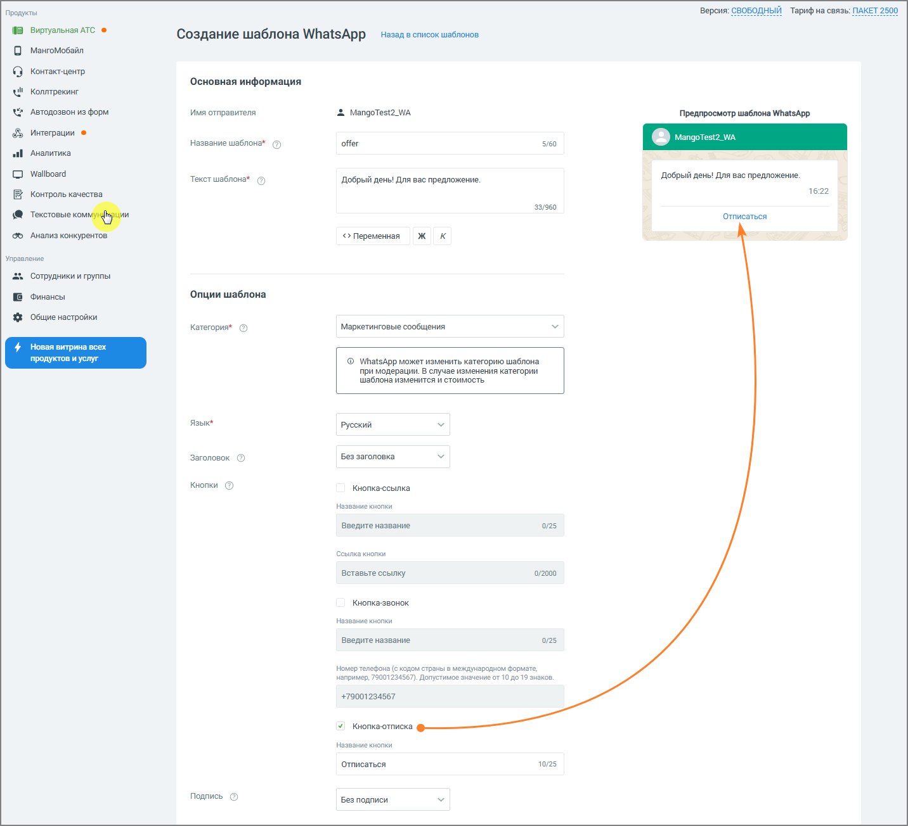
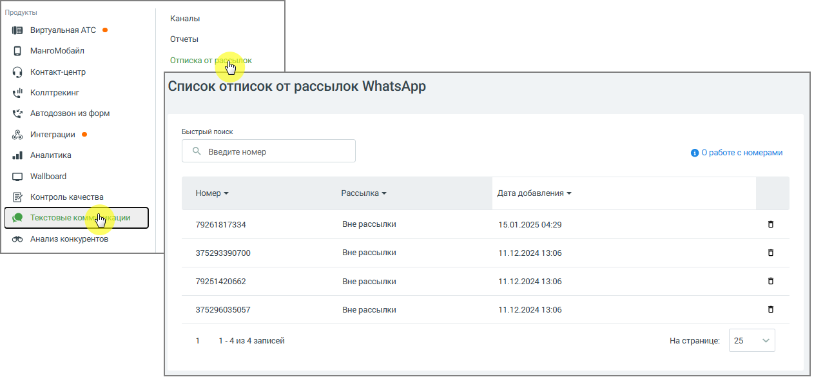
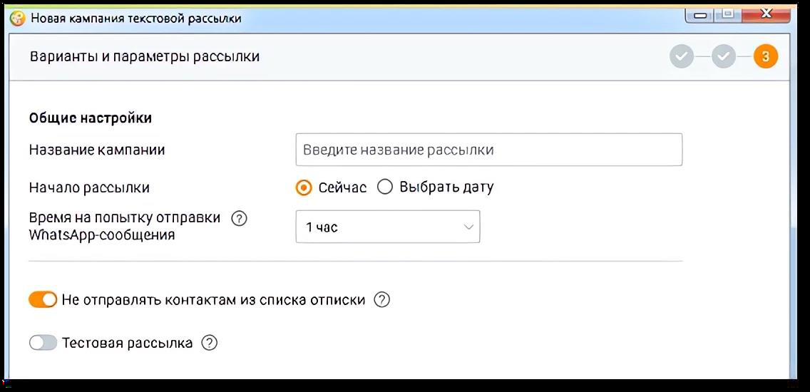

#### 4.5.11.4. Отписка от рассылок WhatsApp

> Трассировка: PDF §4.5.11.4 · сквозные стр. 365-368 · источники: ч.2 `kb/sources/mango-lk-manual/LK_manual_v-125-281-566.pdf` с.85-88.

Опция «Отписаться» в шаблоне сообщения WhatsApp Business API (WABA) предназначена для автоматизации процесса исключения абонентов из маркетинговых рассылок. Эта функция позволяет абонентам самостоятельно отказаться от дальнейшего получения сообщений компании, что помогает снизить риск блокировки аккаунта WhatsApp (WABA) клиентом и улучшить репутационный рейтинг компании.

Как использовать опцию «Отписаться» 1) Добавление кнопки «Отписаться» в шаблон сообщения:

 В Личном кабинете пользователя ВАТС предусмотрена возможность включения кнопки «Отписаться» при создании или редактировании шаблона маркетингового сообщения.  После нажатия на кнопку абонент отправляет автоматическое уведомление об отказе от рассылок.

> **Описание иллюстрации LK-§4.5.11.4-1** (к §4.5.11.4 «Отписка от рассылок WhatsApp», стр. 366; 1432×1304 px). Снимок экрана / схема Личного кабинета.
> Относится к тексту руководства: «…при создании или редактировании шаблона маркетингового сообщения.  После нажатия на кнопку абонент отправляет автоматическое уведомление об отказе от рассылок.».
> Текст на изображении (OCR, требует сверки): Продукты; Версия: СВОБОДНЫЙ Тариф на связь: ПАКЕТ 2500; Виртуальная ATC ©; Создание шаблона WhatsApp; Назад в список шаблонов; `МангоМобайл; Контакт-центр,; Основная информация; Коллтрекинг; ul; Автодозвон из форм.; Имя отправителя; 2 MangoTest2_WA; Предпросмотр шаблона WhatsApp; Интеграции ®; 'Название шаблона" ©); offer; 5160; `Аналитика; Wallboard; Добрый день! Для вас предложение.; Текст шаблона»; "Добрый день! Для вас предложение.; 16:22; Контроль качества; 33/960; Отписаться; тете; oe; ‘Анализ конкурентов; <> Переменная; жк; Управление; ‘Сотрудники и группы; B Финансы; Опции шаблона; {# …

2) Действия системы после нажатия кнопки «Отписаться»:

 Номер абонента автоматически добавляется в «Список отписок от рассылок WhatsApp» компании (раздел ВАТС Текстовые коммуникации → Список отписок).

 Абонент исключается из всех текущих и будущих маркетинговых рассылок WhatsApp. При этом другие способы взаимодействия с абонентом остаются доступными.

> **Описание иллюстрации LK-§4.5.11.4-2** (к §4.5.11.4 «Отписка от рассылок WhatsApp», стр. 367; 1263×585 px). Снимок экрана / схема Личного кабинета.
> Относится к тексту руководства: «… Абонент исключается из всех текущих и будущих маркетинговых рассылок WhatsApp. При этом другие способы взаимодействия с абонентом остаются доступными.».
> Текст на изображении (OCR, требует сверки): Продукты; Каналы; Виртуальная ATC ©; Отчеты; `Мангомобайл; Отписка от; Контакт-центр,; ul; Коллтрекинг; Список отписок от рассылок WhatsApp; Автодозвон из форм.; Быстрый поиск; Интеграции ©; ‘Аналитика; ©, веедитеномер; © Оработе с номерами; Wallboard; Номер >; Рассылка +; Alara добавления +; Контроль качества; Текстовые к; ции; 79261817334; Вне рассылки; 15.01.2025 04:29; ‘Анализ конкурентов; 375293390700; 11.12.2024 13:06; 79251420662; 375296035057; 1-4и34 записей; Ha странице:; 25

3) Управление «Списком отписок от рассылок WhatsApp»:

 Операторы могут вручную управлять «Списком отписок от рассылок WhatsApp» в Личном кабинете пользователя ВАТС:

o Просматривать номера, попавшие в список после отписки.

o Удалять номера абонентов из списка: чтобы удалить номер, нажмите

на иконку «корзина» в строке с удаляемым номером.

4) Исключение номеров из кампаний Контакт-центра:

 При запуске кампании из Контакт-центра в настройках текстовой рассылки доступна опция «Не отправлять контактам из списка отписки».

 При отправке массовой текстовой рассылки для абонентов, чей номер находится в списке отписок, будет указан статус «Не доставлено» и причина «Абонент добавлен в список отписки рассылки».

> **Описание иллюстрации LK-§4.5.11.4-3** (к §4.5.11.4 «Отписка от рассылок WhatsApp», стр. 368; 1136×550 px). Снимок экрана / схема Личного кабинета.
> Относится к тексту руководства: «…стовой рассылки для абонентов, чей номер находится в списке отписок, будет указан статус «Не доставлено» и причина «Абонент добавлен в список отписки рассылки».».
> Текст на изображении (OCR, требует сверки): © Новая кампания текстовой рассылки; Варианты и параметры рассылки; Общие настройки; Название кампании; Введите название рассылки; Начало рассылки; (©) сейчас О Выбрать дату; время на попытку отправки (2); 1 час; Ма15Арр-сообщения; @ Не отправлять контактам из списка отписки ©); Тестовая рассылка @)

5) Рекомендации по использованию

 Включайте опцию «Отписаться» во все маркетинговые сообщения, чтобы снизить количество жалоб от абонентов.

Функционал отписки помогает защитить аккаунт от блокировки, повышает удовлетворённость абонентов и позволяет сосредоточиться на взаимодействии с заинтересованной аудиторией.
