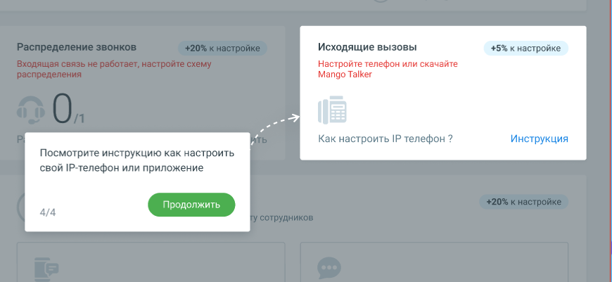

#### 1.8.2.5. Блок 5. Настройка исходящих вызовов

> Трассировка: PDF §1.8.2.5 · сквозные стр. 26 · источники: ч.1 `kb/sources/mango-lk-manual/LK_manual_v-125-1-280.pdf` с.26.

> **Описание иллюстрации LK-§1.8.2.5-1** (к §1.8.2.5 «Блок 5. Настройка исходящих вызовов», стр. 26; 870×401 px). Снимок экрана / схема Личного кабинета.
> Относится к тексту руководства: «…начало раздела».
> Текст на изображении (OCR, требует сверки): Исходящие вызовы; +5% к настройке; Настройте телефон или скачайте; Mango Talker; Как настроить IP телефон ?; Инструкция; Посмотрите инструкцию как настроить; свой |Р-телефон или приложение; 4/4

Кликните по кнопке Инструкция и настройте исходящую связь посредством IP- телефонии или приложения.

Если хотя бы у одного сотрудника в карточке будет задан sip-адрес, после завершения этапа шкала прогресса Онбординга увеличится на 5%.

Чтобы перейти к настройке исходящих вызовов, нажмите кнопку Продолжить.
