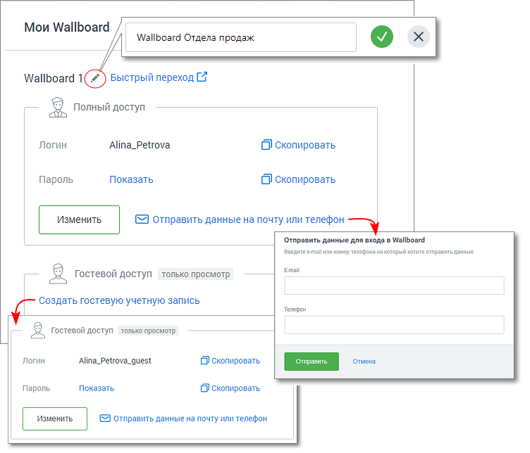
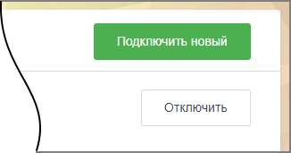

### 4.5.13. Wallboard

> Трассировка: PDF §4.5.13 · сквозные стр. 370-373 · источники: ч.2 `kb/sources/mango-lk-manual/LK_manual_v-125-281-566.pdf` с.90-93.

Доступ к разделу Wallboard есть у пользователей ВАТС с ролью Администратор. В противном случае пункт меню "Wallboard" не отображается.

Модуль Wallboard отражает индивидуальные или командные рейтинги операторов, а также общие показатели подразделений в режиме реального времени. Доступ к модулю осуществляется по адресу tv.mango-office.ru.

> **Описание иллюстрации LK-§4.5.13-1** (к §4.5.13 «Wallboard», стр. 370; 24×20 px). Пиктограмма (значок элемента интерфейса).
> Относится к тексту руководства: «…и командные рейтинги операторов, а также общие показатели подразделений в режиме реального времени. Доступ к модулю осуществляется по адресу tv.mango-office.ru.».
> Текста на изображении нет; назначение значка — см. текст, к которому он относится.

Для подключения услуги кликните по иконке модуля в вертикальном меню Личного кабинета пользователя ВАТС.

Ознакомьтесь с информацией в окне подключения, нажмите кнопку Подключить Wallboard.

> **Описание иллюстрации LK-§4.5.13-2** (к §4.5.13 «Wallboard», стр. 370; 978×541 px). Снимок экрана / схема Личного кабинета.
> Относится к тексту руководства: «…Ознакомьтесь с информацией в окне подключения, нажмите кнопку Подключить Wallboard.».
> Текст на изображении (OCR, требует сверки): Wallboard MANGO OFFICE; Мотивация ваших сотрудников в режиме реального времени.; Не теряйте время на ведение мотивационных досок и донесение информации о результатах работы до каждого из сотрудников.; Подключите наш сервис, позволяющий в наглядной форме показать всем сотрудникам их; спехи относительно коллег на общем экране; телевизора или монитора.; Преимущества использования; Прозрачность результатов 2; Ключевые метрики в реальном времени; Мотивация сотрудников; Информация на экране доступна для всех.; Отображение ключевых показателей; Соревновательный эффект позволяет; Когда сотрудники, рук…

Заполните поля формы создания аккаунта Wallboard. Пароль должен содержать не менее 8 символов, включать строчные, заглавные латинские буквы и цифры.

> **Описание иллюстрации LK-§4.5.13-3** (к §4.5.13 «Wallboard», стр. 371; 526×378 px). Снимок экрана / схема Личного кабинета.
> Относится к тексту руководства: «…Заполните поля формы создания аккаунта Wallboard. Пароль должен содержать не менее 8 символов, включать строчные, заглавные латинские буквы и цифры.».
> Текст на изображении (OCR, требует сверки): Подключить Wallboard; Задайте логин и пароль для доступа к Wallboard; Логин; Alina_Petrova; Пароль; secccccese; Сгенерировать

После подключения услуги иконка модуля перемещается выше, в раздел подключенных продуктов. По клику на иконку открывается окно услуги «Мой Wallboard».

> **Описание иллюстрации LK-§4.5.13-4** (к §4.5.13 «Wallboard», стр. 371; 752×644 px). Снимок экрана / схема Личного кабинета.
> Относится к тексту руководства: «…После подключения услуги иконка модуля перемещается выше, в раздел подключенных продуктов. По клику на иконку открывается окно услуги «Мой Wallboard».».
> Текст на изображении (OCR, требует сверки): Мои Wallboard; Wallboard Отдела продаж; Wallboard 1 (A) Быстрый переход (4; — Я Полный доступ; Логин; Alina_Petrova; Скопировать; Пароль; Показать; Отправить данные на почту или телефон; Отправить данные для входа в Wallboard; Взедите e-mail или номер телефона на который хотите отправить данные; Email; — В Гостевой доступ только просмотр ———; Создать гостевую учетную запись; Телефон; В Гостевой доступ только просмотр; Отмена; Alina_Petrova_guest; © отправить данные на почту или телефон

В окне доступны следующие действия:

 Переименование учетной записи аккаунта – для переименования кликните по пиктограмме «карандаш»;  Быстрый переход к Wallboard – по клику на ссылке открывается монитор показателей. Для новых аккаунтов – открывается окно настроек Wallboard;  Изменение данных аккаунта – для изменения данных аккаунта нажмите кнопку «Изменить»;  Копирование данных аккаунта – логин или пароль аккаунта копируются в буфер обмена;  Отправка данных аккаунта на почту или телефон;  Просмотра пароля к аккаунту;  Создание гостевой учетной записи – для каждого аккаунта может быть создана дополнительная гостевая учетная запись для доступа к Wallboard в режиме просмотра;  Изменение/удаление гостевого аккаунта - для изменения данных или удаления гостевого аккаунта нажмите кнопку «Изменить»;

 Удаление учетной записи Wallboard – для удаления учетной записи кликните по кнопке «Отключить» в правом верхнем углу окно услуги «Мой Wallboard». Подтвердите свое согласие на отключение;  Подключение дополнительной учетной записи – чтобы подключить новый аккаунт Wallboard, нажмите кнопку «Подключить новый».

> **Описание иллюстрации LK-§4.5.13-5** (к §4.5.13 «Wallboard», стр. 372; 326×171 px). Снимок экрана / схема Личного кабинета.
> Относится к тексту руководства: «…твердите свое согласие на отключение;  Подключение дополнительной учетной записи – чтобы подключить новый аккаунт Wallboard, нажмите кнопку «Подключить новый».».
> Текст на изображении (OCR, требует сверки): Отключить

совет

Настройки Wallboard хранятся для каждой учетной записи отдельно. Подключая две учетные записи, компания может использовать два Wallboard с разными настройками. Например, один для отдела продаж, второй для отдела обслуживания клиентов.

Далее переходите к настройкам монитора показателей Wallboard.
