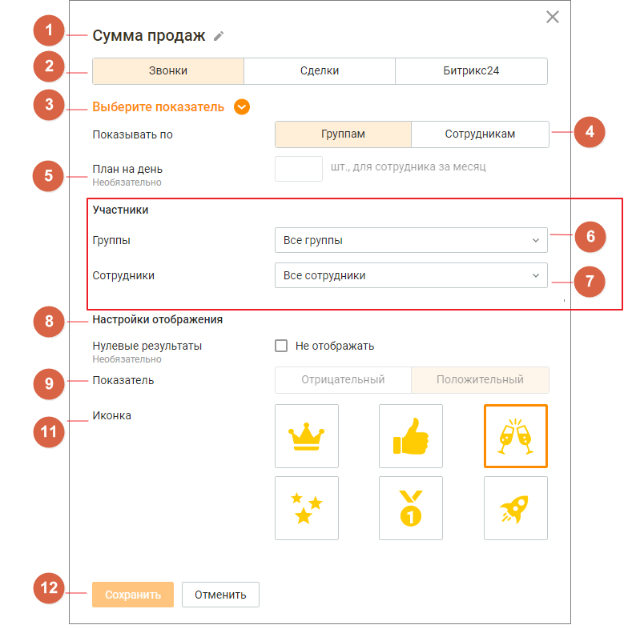

#### 4.5.13.1. Настройка виджетов групповых показателей

> Трассировка: PDF §4.5.13.1 · сквозные стр. 373-374 · источники: ч.2 `kb/sources/mango-lk-manual/LK_manual_v-125-281-566.pdf` с.93-94.

> **Описание иллюстрации LK-§4.5.13.1-1** (к §4.5.13.1 «Настройка виджетов групповых показателей», стр. 373; 19×18 px). Пиктограмма (значок элемента интерфейса).
> Относится к тексту руководства: «…начало раздела».
> Текста на изображении нет; назначение значка — см. текст, к которому он относится.

Для настройки нажмите пиктограмму в правом верхнем углу окна группового виджета.

Заполните следующие поля:

1. Название - наименование виджета, не более 60 символов;

2. Группа показателей - доступен выбор одной из вкладок:

 "Звонки" (по умолчанию)  "Сделки"  "Битрикс24"

3. Показатель - список показателей производительности, соответствующий выбранной в п.2 группе показателей. Подробное описание показателей приведено здесь;

> **Описание иллюстрации LK-§4.5.13.1-2** (к §4.5.13.1 «Настройка виджетов групповых показателей», стр. 373; 799×786 px). Снимок экрана / схема Личного кабинета.
> Относится к тексту руководства: «…3. Показатель - список показателей производительности, соответствующий выбранной в п.2 группе показателей. Подробное описание показателей приведено здесь;».
> Текст на изображении (OCR, требует сверки): 1 Сумма продаж г; Звонки; Сделки; Битрикс24; 3 Выберите показатель @; Показывать по; Группам; Сотрудникам; План на день; шт., для сотрудника за месяц; Необязательно; Участники; Группы; Все группы; Сотрудники; Все сотрудники; о | настройки отображения; Нулевые результаты; (-] Не отображать; Отрицательный; Положительный; о | Показатель; ® | Иконка; av Vi; Ww; Отменить

4. Отображение - переключатели настроек:

 "по группам" - в рейтинге будут отображаться результаты групп по групповым показателям;  "по сотрудникам" - в рейтинге будут отображаться результаты сотрудников по персональным показателям;

5. План - поле для ввода значение плана для выбранного показателя. Не является обязательным для заполнения;

6-7. Участники - список групп и сотрудников ВАТС. Содержит поля:

 группы;  сотрудники - доступно при выбранной в п.4 настройке отображения "По сотрудникам". Включает в себя список сотрудников ВАТС, относящихся к выбранным в поле "Группа" группам;

8. Настройки отображения:

 если чекбокс проставлен - нулевые результаты будут отображаться в рейтинге;  если чекбокс не проставлен - нулевые результаты исключаются из рейтинга;

9. Показатель - характеристика показателя: отрицательный или положительный;

10. Иконка - выбранная картинка будет отображаться рядом с аватаром лидера рейтинга. Доступен выбор одной иконки;

11. Кнопки Сохранить/Отменить:

 по клику на кнопку "Сохранить" внесенные изменения сохраняются;  по клику на кнопку "Отмена" внесенные изменения отменяются.
