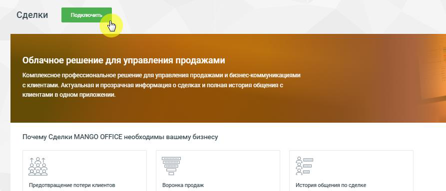
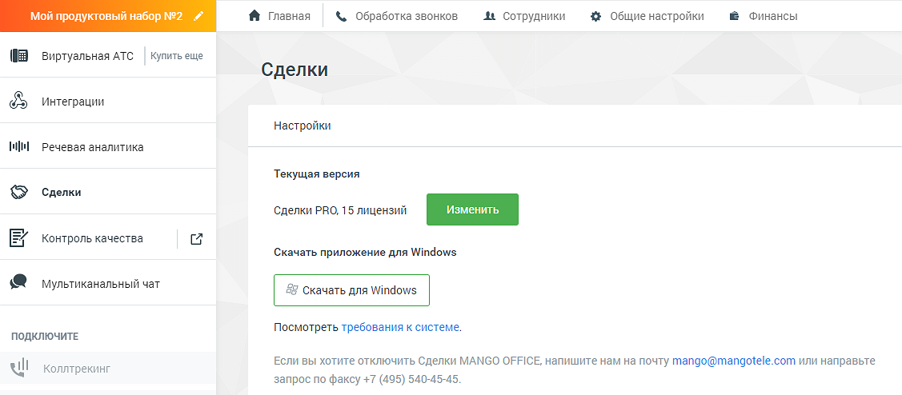

### 4.5.14. Сделки

> Трассировка: PDF §4.5.14 · сквозные стр. 383-385 · источники: ч.2 `kb/sources/mango-lk-manual/LK_manual_v-125-281-566.pdf` с.103-105.

Модуль Сделки предназначен для учета и автоматизации продаж, и доступен в двух версиях "Сделки Лайт" и "Сделки PRO".

> **Описание иллюстрации LK-§4.5.14-1** (к §4.5.14 «Сделки», стр. 384; 893×383 px). Снимок экрана / схема Личного кабинета.
> Относится к тексту руководства: «…Модуль Сделки предназначен для учета и автоматизации продаж, и доступен в двух версиях "Сделки Лайт" и "Сделки PRO".».
> Текст на изображении (OCR, требует сверки): Сделки; Облачное решение для управления продажами; Комплексное профессиональное решение для управления продажами и бизнес-коммуникациями; с клиентами. Актуальная и прозрачная информация о сделках и полная история общения с; клиентами в одном приложении.; Почему Сделки MANGO OFFICE необходимы вашему бизнесу; acs; jou?); 2 om; Предотвращение потери клиентов; Воронка продаж; История общения по сделке

Для подключения услуги воспользуйтесь одним из вариантов:

1) Откройте в браузере страницу Сделки MANGO OFFICE, ознакомьтесь с информацией о возможностях модуля и нажмите кнопку Подключить в одной из версий. При подключении потребуется авторизация в Личном кабинете пользователя ВАТС.

> **Описание иллюстрации LK-§4.5.14-2** (к §4.5.14 «Сделки», стр. 384; 24×19 px). Пиктограмма (значок элемента интерфейса).
> Относится к тексту руководства: «… с информацией о возможностях модуля и нажмите кнопку Подключить в одной из версий. При подключении потребуется авторизация в Личном кабинете пользователя ВАТС.».
> Текста на изображении нет; назначение значка — см. текст, к которому он относится.

2) Щелкните по иконке модуля в вертикальном меню Личного кабинета пользователя ВАТС.

После подключения услуги иконка модуля перемещается выше, в раздел подключенных продуктов. По клику на иконку открывается страница «Сделки Mango Office», с описанием текущей версии услуги, количеством приобретенных лицензий и ссылкой на скачивание приложения Контакт Центр MANGO OFFICE для Windows.

Чтобы изменить текущую версию услуги, нажмите на кнопку Изменить.

> **Описание иллюстрации LK-§4.5.14-3** (к §4.5.14 «Сделки», стр. 384; 1127×494 px). Снимок экрана / схема Личного кабинета.
> Относится к тексту руководства: «…Чтобы изменить текущую версию услуги, нажмите на кнопку Изменить.».
> Текст на изображении (OCR, требует сверки): Главная; 2 Финансы; мой продуктовы; абор; &. Обработка звонков.; At сотрудники; $# Общие настройки; 8) виртуальная АТС; Купить еще; Сделки; Интеграции; Настройки; речевая аналитика; Текущая версия; Сделки PRO, 15 лицензий; Контроль качества; ‘Скачать приложение для Windows; мультиканальный чат; Посмотреть требования к системе.; ПОДКЛЮЧИТЕ; Если вы хотите отключить Сделки MANGO OFFICE, напишите нам на почту Mango@mangotele.com или направьте; ull Коллтрекинг; запрос по факсу +7 (495) 540-45-45.

Дальнейшая работа с модулем - через приложение Контакт-центр MANGO OFFICE.

Отключение услуги возможно только через личного менеджера.

внимание

Пункт главного меню «Сделки». доступен только если на ВАТС не подключен продукт «Контакт-центр».
