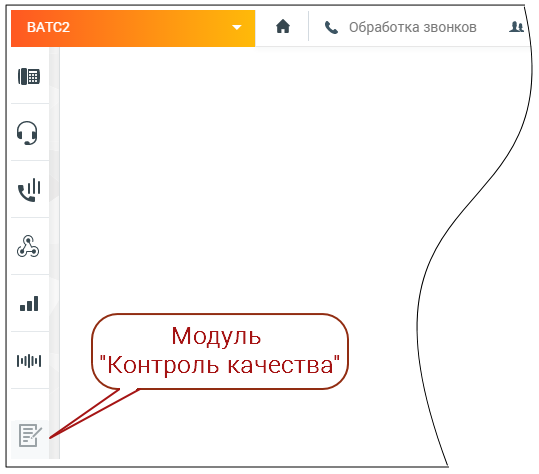

### 4.5.15. Контроль качества

> Трассировка: PDF §4.5.15 · сквозные стр. 385-386 · источники: ч.2 `kb/sources/mango-lk-manual/LK_manual_v-125-281-566.pdf` с.105-106.

Для подключения модуля Контроль качества воспользуйтесь одним из вариантов:

1) Откройте в браузере страницу Контроль качества MANGO OFFICE, ознакомьтесь с информацией о возможностях модуля и нажмите кнопку Подключить. Оставьте заявку в форме подключения. 2) Щелкните по иконке модуля в вертикальном меню Личного кабинета пользователя ВАТС.

> **Описание иллюстрации LK-§4.5.15-1** (к §4.5.15 «Контроль качества», стр. 385; 539×474 px). Снимок экрана / схема Личного кабинета.
> Относится к тексту руководства: «…ях модуля и нажмите кнопку Подключить. Оставьте заявку в форме подключения. 2) Щелкните по иконке модуля в вертикальном меню Личного кабинета пользователя ВАТС.».
> Текст на изображении (OCR, требует сверки): а & Обработка звонков 4; wl; alll; Модуль; ШУ; "Контроль качества"

На экране отобразятся три блока модуля:

 Постзвонковая оценка - оценка работы сотрудника клиентом;

 Оценка разговоров по бланкам - оценка работы сотрудника контролером;

 Речевая аналитика - распознавание разговоров и поиск (вручную или автоматически) необходимой информации в разговоре.

Ознакомьтесь с условиями и самостоятельно подключите блоки, кликнув по кнопкам Подключить.

В дальнейшем любой из блоков может быть отключен, либо пользователем могут быть изменены условия подключения.

Доступ к модулю Контроль качества MANGO OFFICE осуществляется через браузер по адресу qm.mango-office.ru.

Пользователь без прав на подключение услуг, но с правами на настройку модуля, также может использовать модуль Контроля качества.

внимание

Функция подключения/отключения модулей продукта «Контроль качества» доступна только администратору Лицевого счета и пользователям с правом «Управление услугами». Доступ к просмотру страницы подключения есть у всех пользователей ВАТС.
