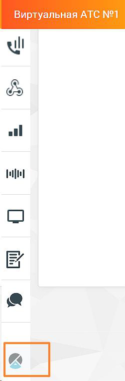

### 4.5.16. Аналитика «Calltouch»

> Трассировка: PDF §4.5.16 · сквозные стр. 386-387 · источники: ч.2 `kb/sources/mango-lk-manual/LK_manual_v-125-281-566.pdf` с.106-107.

Иконка меню "Аналитика Calltouch" отображается у пользователей с соответствующими правами доступа.

> **Описание иллюстрации LK-§4.5.16-1** (к §4.5.16 «Аналитика «Calltouch»», стр. 386; 251×763 px). Снимок экрана / схема Личного кабинета.
> Относится к тексту руководства: «…Иконка меню "Аналитика Calltouch" отображается у пользователей с соответствующими правами доступа.».
> Текст на изображении (OCR, требует сверки): ul; al; Рей

Клик по иконке открывает страницу авторизации в сервисе "Аналитика Calltouch" Вход в личный кабинет | Calltouch

Зарегистрироваться в сервисе можно по ссылке https://www.calltouch.ru/mango/.
